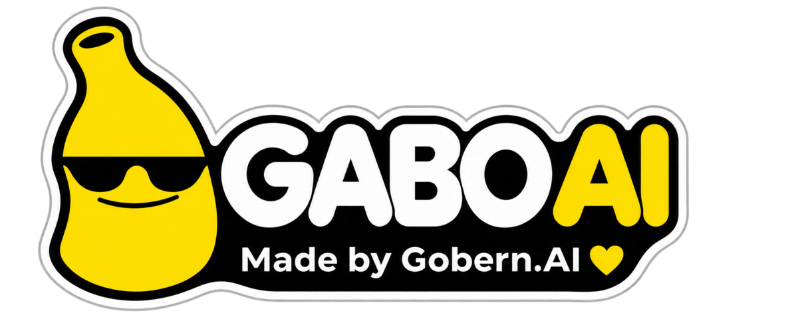
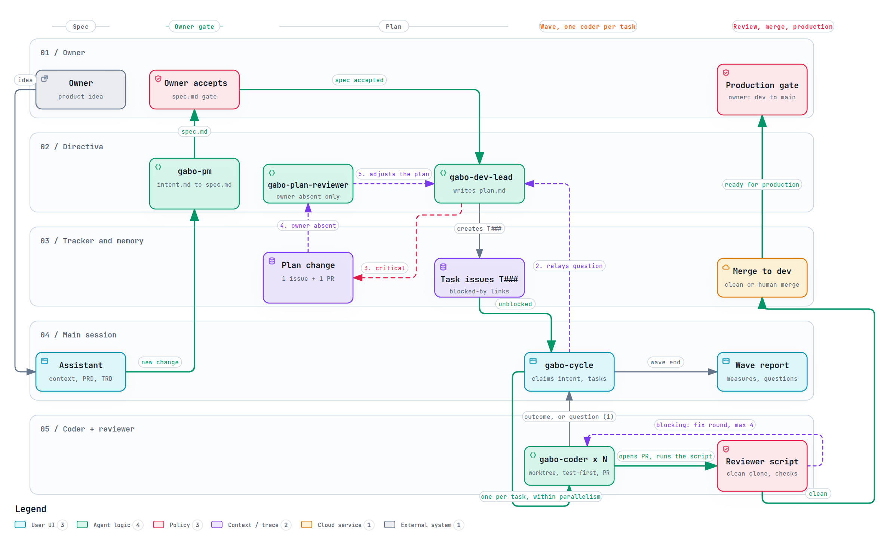
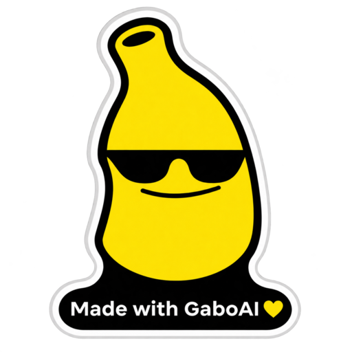

<h1 align="center">
  
</h1>

**A team of coding agents for your project that follows the AI-Native SDLC: every change goes from intent to spec to plan to reviewed PRs, and you only decide.**

- **You** state what you want, accept each spec, and merge releases into `main`.
- **The agents** write the intent, spec and plan, open the tasks, implement them in parallel, review every PR and merge into your integration branch.
- **gabo** is the CLI that installs and checks that team in your repository. It works with your tracker, your methodology and your coding engine: Claude Code, Codex, Pi or OpenCode.

## Install and set up

You need Go (the version in [`apps/cli/go.mod`](apps/cli/go.mod)), git, and one coding engine: Claude Code, Codex, Pi or OpenCode.

1. **Install the CLI:**

   ```sh
   go install github.com/testeos-z/gabo-ai/apps/cli/cmd/gabo@latest
   ```

2. **Run `gabo init`** in your project root. It copies the skill catalog to `.gabo/` and prints a setup prompt.
3. **Paste the prompt into your coding agent** and answer its questions, one at a time. It writes `gabo.yaml` and builds the agents for your engine.
4. **Run `gabo init` again.** Now that `gabo.yaml` exists, it configures your engine's integration (plugin or package) at project level and tells you what is left, such as trusting the project folder.
5. **Run `gabo check`**, then commit the changed files.

From then on, open your agent and talk to the assistant: describe a change, accept its spec, and ask it to run the wave. See [Running a wave](#running-a-wave).

## The flow

Each change is one **intent**. There is no big upfront plan: the tracker is the global view, and each intent moves through the same lifecycle.



*Per-change SDLC flow, exported from the [archify diagram](docs/product/diagrams/sdlc-flow.html) (labels in Spanish). Open it for the legend, the floating-questions path and the plan-change loop.*

| step | who | produces | gate |
|---|---|---|---|
| 1. Intent | PM agent | `intent.md`: the problem and why it matters | — |
| 2. Spec | PM agent (with frontend and DB agents when needed) | `spec.md`: requirements, acceptance criteria, UX flow, data changes | — |
| 3. Accept | **you** | your acceptance, recorded in the spec | `gabo check` blocks a plan without it |
| 4. Plan | dev lead agent | `plan.md` and one task issue per task, with blocked-by links | — |
| 5. Wave | `gabo-cycle` | worktrees and coders for the intent's unblocked tasks | one intent per wave |
| 6. Build | coders | one PR per task, test-first | — |
| 7. Review | independent reviewer | checks on the merged tree and a `VERDICT` on the PR | merges only clean PRs, only into `dev` |
| 8. Release | **you** | the `dev` → `main` merge | agents never merge into `main` |
| 9. Tag | **you** authorize it | `apps/cli/vX.Y.Z` | installs come from tags |

The three documents live together in [`docs/product/intents/<NNNN-slug>/`](docs/product/intents/README.md). When a wave closes, `wave.after` decides what happens: `wait` (the default) stops until you ask, `next` starts the next accepted intent. Changes to scope mid-project go through a **plan change**: a proposal you debate, or that a clean-context plan reviewer debates when you are away.

## Philosophy: let questions float

You don't need to plan everything from zero before you start. Start with an idea, leave loose ends, and let the agents help you close them.

- **Doubts are welcome.** An open question is not a failure of planning; it is work the team can do. Write down what you don't know yet, and keep going.
- **Questions float up to whoever can answer them.** A coder that gets stuck asks the dev lead. A technical question stops there; a product question goes up to the PM, and only the decisions that are truly yours reach you, one at a time.
- **Agents research before they ask.** When a spec or a plan has a gap, the agents look into it (code, docs, the web) and bring a proposed answer with its reasoning, so you choose instead of starting from a blank page.
- **The plan grows with what you learn.** Each intent is small, so a surprise changes one spec or one plan, not a big upfront design. A finding that changes scope becomes a plan change you debate, or that a plan reviewer debates when you are away.
- **Nothing blocks on you by default.** In `auto` mode the agents decide what they can and record every decision with its reason, so you can review it later. In `manual` mode they ask you first.

## Compatibility

| engine | tier | how gabo integrates | note |
|---|---|---|---|
| Claude Code | full | plugin `gabo@gabo-ai`, enabled by `gabo init` in `.claude/settings.json` | trust the project folder |
| Codex | full | plugin `gabo@gabo-ai`, enabled by `gabo init` in `.codex/config.toml` | trust the project and its two hooks |
| Pi | full | package `@gabo-ai/pi`, added by `gabo init` to `.pi/settings.json` | needs a subagent package, such as [gentle-pi](https://www.npmjs.com/package/gentle-pi) |
| OpenCode | full | stage-gate plugin copied into the project by its runtime skill | no install step |
| any other engine | flexible | gabo skills and configuration only: no plugin, no hooks | planned: `gabo.yaml` accepts only the four names above |

**Full** engines get hooks that run `gabo check` around every write, plus the integration `gabo init` sets up. All four can run every role, including the reviewer. `gabo init` writes only project-level config, never your global engine settings.

Details per engine, manual install commands and checked versions: [docs/compatibility.md](docs/compatibility.md).

## Running a wave

After setup, open your agent in the project and talk to the assistant, your single point of contact:

1. Describe a change. The PM agent writes its intent and spec.
2. Read the spec and accept it. The dev lead writes the plan and the task issues.
3. Ask for the wave. `gabo-cycle` claims the intent's unblocked tasks, creates worktrees and launches coders, up to `parallelism`.
4. Each PR goes through the reviewer, which merges clean ones into `dev`.
5. You get a wave report. When the work is ready, merge `dev` into `main`.

Coder questions travel through the cycle to the assistant. In `manual` mode it asks you one question at a time; in `auto` mode it decides and records each decision with its reason. See the [app flow](docs/product/APP_FLOW.md#j3-run-a-wave-without-watching-r4-r5-r15).

## Concepts

| concept | what it means |
|---|---|
| **Assistant** | The agent you talk to. It delegates everything else. |
| **Directiva** | The planning agents: PM (PRD, intents, specs), dev lead (TRD, plans, task issues), DB master (data changes and the [migrations log](docs/product/MIGRATIONS.md)) and frontend (UX and flow in the spec). |
| **gabo-cycle, coders, reviewer** | The wave runner, the agents that implement one task each, and the independent merge gate. The reviewer never reads the shared memory. |
| **Runtimes** | The engine each role runs in: `runtimes.coder`, `runtimes.reviewer`, `runtimes.assistant`. |
| **Slots and adapters** | Each pluggable part (`tasks`, `repository_host`, `memory`, `methodology`, `reviewer_placement`, `agent_host`, and optional `notifications`, `direct_sessions`) has a contract. An adapter is a Markdown skill that explains how to meet it with your tool. No tool-specific behavior is compiled code. |
| **Integration branch** | `repo.integration_branch`, for example `dev`. Agents merge only there; `main` is yours. |

Deeper reading: [architecture](docs/architecture.md), the [PRD](docs/product/PRD.md) and the [TRD](docs/product/TRD.md).

## Commands

The CLI has four commands. Everything else is done by your agent through the skills.

| command | what it does |
|---|---|
| `gabo init` | Copies the skill catalog to `.gabo/skills/`, writes `.gabo/VERSION`, installs the reviewer skill at user level and, with a `gabo.yaml`, configures each declared engine at project level. Never touches an existing config or your global engine config. |
| `gabo check` | Validates, read-only, the config, the agents, slot coverage and the catalog version. Exits non-zero on any failure. |
| `gabo version` | Prints the gabo version. |
| `gabo prompt` | Prints the setup prompt again. |

## Configuration

| file | scope | holds |
|---|---|---|
| `gabo.yaml` (project root) | team, committed | `repo`, `runtimes`, `slots`, `review`, `mode`, `plan_change`, `parallelism`, `developers`, `worktree` |
| `~/.config/gabo/config.yaml` | personal | `alias`, `language`, `tone`, `interaction_level` |

The project file overrides the user file key by key; unknown keys fail. Secrets never go in either file, only the names of the environment variables that hold them. See the annotated [`gabo.example.yaml`](apps/cli/gabo.example.yaml) and the [JSON Schemas](schemas/).

## Upgrading

1. Install the newer CLI (the `go install` command above, or `@vX.Y.Z` to pin a release).
2. Run `gabo init` in the project. It refreshes the catalog and adds any missing engine key, keeping the ones you set.
3. Ask your agent to rebuild the agents.
4. Run `gabo check` until it passes.

## Known limitations

- **Install from a tag.** `gabo init` refuses a pseudo-version, such as the one Go installs from a branch. Release tags are named `apps/cli/vX.Y.Z` because the module lives in `apps/cli`. To build from source, pass the version yourself: `go -C apps/cli install -ldflags "-X main.buildVersion=<x.y.z>" ./cmd/gabo`.
- **No self-update and no curl installer yet.** Without signed releases, `gabo init` prints the upgrade command instead of updating itself.
- **Pi needs a subagent package.** Pi has no subagents of its own; gabo refuses to build agents without one. The recommended setup is the [Gentle AI framework](https://github.com/Gentleman-Programming/gentle-ai) (`gentle-ai install --agent pi`).
- **Flexible tier.** Engines outside the four full ones are planned in [I0005 (#176)](https://github.com/testeos-z/gabo-ai/issues/176).

## Documentation

- [Engine compatibility and integrations](docs/compatibility.md)
- [Setup prompt and install details](docs/setup-prompt.md)
- [Intents](docs/product/intents/README.md)
- [Architecture](docs/architecture.md)
- [Product requirements (PRD)](docs/product/PRD.md) and [technical design (TRD)](docs/product/TRD.md)
- [App flow](docs/product/APP_FLOW.md) and [UX and UI](docs/product/UX_UI.md)
- [Cloud agent flow](docs/cloud-agent-flow.md)
- [Archived planning documents](docs/product/archive/README.md)

## Made with gabo-ai



Built something with gabo-ai? You can show it, if you want: it is optional and never required by the license. Add the "Made with GaboAI" sticker to your project's README:

```html
<a href="https://github.com/testeos-z/gabo-ai">
  
</a>
```

## License

[MIT](LICENSE)
