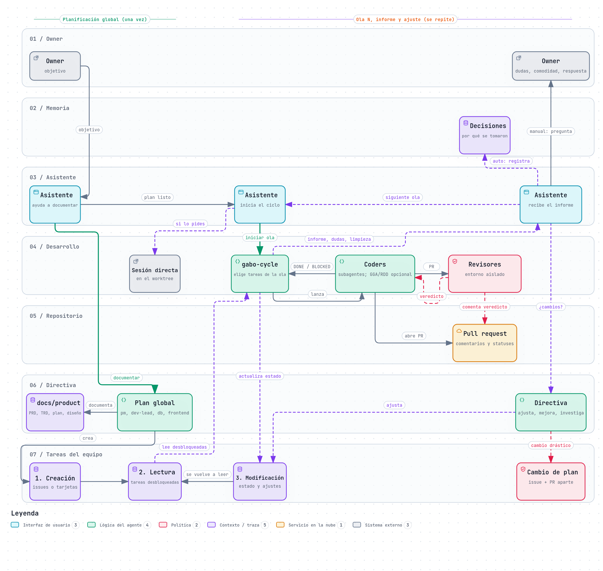

# gabo-ai

A CLI and harness that sets up a team of autonomous coding agents in your project: an assistant you talk to, planning agents, a wave runner, coders and an independent reviewer. The team uses your tracker, your methodology and your infrastructure.

## Why

When you build with AI agents, you often end up as the glue between them. You plan with one agent, launch coders with another, review results and answer every question. When you are tired or away, work stops.

gabo-ai gives that coordination to the agents. You keep what only you can do: validate, plan and decide. Work moves forward wave after wave. Each question goes to whoever can answer it, and in auto mode every decision is recorded with its reason. See the [PRD](docs/product/PRD.md) for the full problem statement and goals.

## Core concepts

| concept | what it means |
|---|---|
| **Agents** | The **assistant** is your single point of contact. **Directiva** plans: the PM (PRD, each intent and its spec), the dev lead (TRD, each intent's plan and its task issues with dependencies), the DB master (data changes and the migrations log) and the frontend agent (UX and flow in the spec). **gabo-cycle** runs waves. **Coders** implement one task each in their own worktree. The **reviewer** is an independent process and the merge gate. |
| **Slots and adapters** | Each configurable part of the system is a slot: `tasks`, `repository_host`, `memory`, `methodology`, `reviewer_placement`, `agent_host`, and optionally `notifications` and `direct_sessions`. gabo-ai ships a **contract** for each slot (what the agents must be able to do). An **adapter** is a Markdown skill or document that explains how to do it with your tool. Tool-specific behavior is never compiled code. |
| **Runtimes** | The engine each agent role runs in (`runtimes.coder`, `runtimes.reviewer`, `runtimes.assistant`). Claude Code and Pi have shipped runtime skills. Other engines can be added with `gabo-runtime-builder` if they support subagents and skills. |
| **Intents** | Each change is an intent in `docs/product/intents/<NNNN-slug>/`: `intent.md` states the problem, `spec.md` the requirements and acceptance criteria, and `plan.md` the tasks. A human accepts each spec before its plan is written. There is no global plan written upfront; the tracker is the global view. |
| **Waves** | A wave is one intent: its unblocked tasks. The assistant starts it, gabo-cycle launches coders, each coder opens a PR, the reviewer posts a verdict, and the cycle reports back to the assistant. When the wave closes, `wave.after` decides: `next` starts the next accepted intent, `wait` (the default) stops until you ask. |
| **Reviewer** | Runs the checks in `review.checks` on a credential-free copy of the merged tree and posts a `VERDICT` line on the PR. It never reads or writes the shared memory. Paths in `review.human_only_paths`, the catalog and the version stamp always need a human merge. |
| **Plan change** | Mid-project changes to scope or the plan go through a plan-change proposal in its own issue and PR, touching only `docs/product` and tasks. You debate it if you are present. If you are absent, a clean-context `gabo-plan-reviewer` debates it, within the limits of `plan_change.*`: the scope is one task of an intent's plan, one whole intent, or several intents and the PRD/TRD conventions. |
| **Integration branch** | Agents merge only into `repo.integration_branch` (for example `dev`), never into `main`. Merging to `main` is always your decision. |

Read more in [docs/architecture.md](docs/architecture.md), the [TRD](docs/product/TRD.md) and the [app flow](docs/product/APP_FLOW.md).

## How it works



*Team flow and configurable points, exported from the [archify diagram](docs/product/diagrams/team-flow.html) (labels in Spanish).*

You set gabo-ai up once with `gabo init`, the setup prompt and `gabo check`; after that you only talk to the assistant. For each change, directiva writes an intent and its spec; once you accept the spec, it writes the plan and the task issues with their dependencies. Each wave runs one intent: `gabo-cycle` takes that intent's unblocked tasks and launches one coder per task in its own worktree; every PR goes through the independent reviewer, the merge gate, which merges only into the integration branch, never into `main`. The reviewer never reads or writes the shared memory.

For details, see the diagrams [team-flow.html](docs/product/diagrams/team-flow.html) and [configuration-flow.html](docs/product/diagrams/configuration-flow.html), and the TRD sections [4.2 Building blocks](docs/product/TRD.md#42-building-blocks-c4-container-view), [5.1 Wave run](docs/product/TRD.md#51-wave-run-r3-r4-r5-r10-r13) and [5.2 Review](docs/product/TRD.md#52-review-r9).

## Requirements

- Go, at the version named in [`apps/cli/go.mod`](apps/cli/go.mod), to install the CLI.
- git, and a git repository for your project.
- A coding agent engine: Claude Code or Pi. Pi has no subagents, so gabo refuses to build on Pi without a subagent package; [gentle-pi](https://www.npmjs.com/package/gentle-pi) is recommended for subagents, and the full [Gentle AI framework](https://github.com/Gentleman-Programming/gentle-ai) (methodology, RDD and Engram memory) is the recommended setup. See [Your engine](docs/setup-prompt.md#your-engine).
- Whatever tools your adapters use. For example, the GitHub adapters use the `gh` CLI.

## Install

### Go install

```sh
go install github.com/testeos-z/gabo-ai/apps/cli/cmd/gabo@latest
```

> **Note:** `gabo init` accepts only a release version (`x.y.z`). `@latest` resolves to the newest release tag. Because the module lives in `apps/cli`, release tags are named `apps/cli/vX.Y.Z`. While the repository has no release tag, Go installs a pseudo-version and `gabo init` refuses it. In that case, build from source (below).
>
> While the repository is private, set `GOPRIVATE=github.com/testeos-z/*` so Go fetches it with your own git credentials and skips the public module proxy.

### Build from source

Clone the repository and name the version yourself. If your project already has a `.gabo/VERSION`, use that version:

```sh
git clone https://github.com/testeos-z/gabo-ai.git
cd gabo-ai
go -C apps/cli install -ldflags "-X main.buildVersion=<x.y.z>" ./cmd/gabo
```

Check the install with `gabo version`.

### Install with curl (planned)

> **Not available yet.** A one-line install script is planned but does not exist. Use one of the methods above.

## Quick start

1. In your project root, run `gabo init`. It copies the skill catalog to `.gabo/skills/`, writes the version stamp `.gabo/VERSION`, installs the `gabo-reviewer` skill at user level, and prints the setup prompt.
2. Open your coding agent in the project root.
3. Paste the prompt that `gabo init` printed (`gabo prompt` prints it again at any time). You can also ask the agent to configure gabo-ai.
4. Answer the setup questions. The agent asks one at a time and applies no value you did not accept. It writes the config, builds the agents for your engine and checks each slot.
5. Run `gabo check` to confirm everything passes.
6. Commit the changed files (`gabo.yaml`, `.gabo/`, adapters, agent folders).

You can also skip step 1: paste the [setup prompt](docs/setup-prompt.md#prompt) into your agent. It installs the CLI if `gabo` is missing and runs `gabo init` for you. Both ways are safe to rerun.

## Commands

The CLI has only four commands. Everything else is done by your agent through the skills.

| command | what it does |
|---|---|
| `gabo init` | Copies the skill catalog to `.gabo/skills/`, writes `.gabo/VERSION` and installs the reviewer skill at user level. It never touches an existing config. |
| `gabo check` | Validates, read-only, the config files, the agents, slot coverage (each adapter explains every operation of its contract) and the catalog version. Exits non-zero on any failure. |
| `gabo version` | Prints the gabo version. |
| `gabo prompt` | Prints the setup prompt, and nothing else, to paste into your agent. It reads no config and writes nothing, with or without a project. |

## Configuration

gabo merges two layers. Secrets never go in either one; config files hold only the names of the environment variables that carry them.

| file | scope | holds |
|---|---|---|
| `gabo.yaml` (git top-level of the project) | team, committed | `repo`, `runtimes`, `slots`, `review`, `mode`, `plan_change`, `parallelism`, `developers`, `worktree` |
| `~/.config/gabo/config.yaml` (or `$XDG_CONFIG_HOME/gabo/config.yaml`) | personal | `alias`, `language`, `tone`, `interaction_level` |

The project file overrides the user file key by key. Unknown keys fail. The setup agent writes both files through the `gabo-config-writer` skill. See the annotated example [`apps/cli/gabo.example.yaml`](apps/cli/gabo.example.yaml) and the JSON Schemas in [`schemas/`](schemas/).

## Running a wave

After setup, open your agent in the project and talk to the assistant. Ask it to plan the product, then to start a wave. The assistant delegates:

- planning to directiva, which writes `docs/product` and the task issues;
- each wave to `gabo-cycle`, which claims the unblocked tasks, creates worktrees, launches coders up to `parallelism`, and cleans up what it created.

Coder questions travel through the cycle to the assistant. In `manual` mode, the assistant asks you one question at a time. In `auto` mode, it records each decision with its reason. At the end of each wave, you get a wave report. See journey J3 in the [app flow](docs/product/APP_FLOW.md#j3-run-a-wave-without-watching-r4-r5-r15).

## Upgrading

1. Install the newer CLI.
2. Run `gabo init` in the project. It refreshes `.gabo/skills/` and `.gabo/VERSION` and does not touch your config.
3. Ask your agent to rebuild the agents.
4. Run `gabo check` until it passes.

`gabo check` tells you when a rebuild is needed. See the Rebuild section of `.gabo/skills/gabo-setup/SKILL.md` in your project.

## Documentation

- [Setup prompt and install details](docs/setup-prompt.md)
- [Architecture](docs/architecture.md)
- [Product requirements (PRD)](docs/product/PRD.md)
- [Technical design (TRD)](docs/product/TRD.md)
- [App flow](docs/product/APP_FLOW.md)
- [UX and UI](docs/product/UX_UI.md)
- [Migrations log](docs/product/MIGRATIONS.md)
- [Intents](docs/product/intents/README.md)
- [Archived planning documents](docs/product/archive/README.md)

## License

[MIT](LICENSE)
