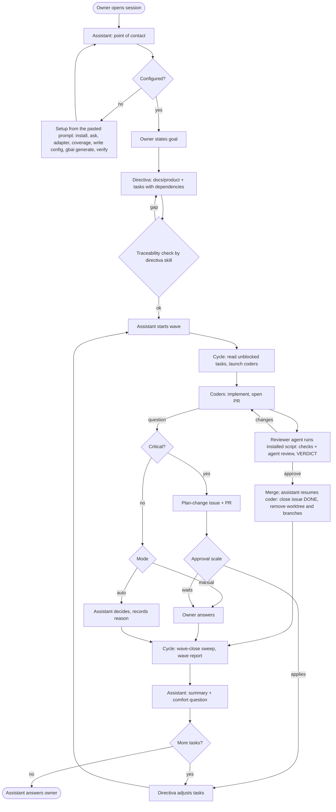

# App Flow

| field | value |
|---|---|
| status | Draft |
| owner | gbai-frontend |
| version | 0.4 |
| date | 2026-10-26 |
| linked docs | [PRD](PRD.md), [TRD](TRD.md), [DB_SCHEMA](DB_SCHEMA.md), [UX_UI](UX_UI.md), [stories](stories/README.md) |
| diagrams | [team-flow.html](diagrams/team-flow.html), [configuration-flow.html](diagrams/configuration-flow.html) |

gbai has no graphical UI. Its "screens" are the surfaces where the owner meets the system: the assistant conversation, an optional direct session, the CLI and the tracker or PR. This document describes one journey per user story. It adds no product behavior: every step comes from the PRD, TRD or a story, and every gap this document had to fill is marked **Proposed (auto)**.

## Auto-mode proposals

Written by gbai-frontend in auto mode (R6, R19). Every item is marked **Proposed (auto)** where it appears, with a one-line reason. The owner approves or rejects them in one pass.

| # | section | proposal | reason |
|---|---|---|---|
| A1 | Surfaces | Replace the template's "screens" table with a "surfaces" table (conversation, direct session, CLI, tracker / PR). | gbai has no GUI; these are the only places the owner interacts. |
| A2 | Journeys | Each journey uses the same shape: trigger, actors, steps, decision points, outcome, failure and escalation. | One shape makes the eleven journeys comparable and reviewable in one pass. |
| A3 | US-001 | A slot whose verify step fails stays unverified; the assistant names the failed operation and asks the owner how to fix the adapter; agents are not regenerated for that slot until verify passes. | The configuration flow ends in "ready or what failed"; generating agents from an unverified adapter would hide the failure. |
| A4 | US-004 | In manual mode, a coder question waiting for the owner blocks only its own task; the rest of the wave continues. | Mirrors operating rule 2 (only the affected task blocks) and goal 2 (work never stalls). |
| A5 | US-005 | "Mediation drags on" means three mediated exchanges on the same task without resolution; the assistant then offers a direct session once. | R14 does not quantify the threshold; a fixed, small number is easy to test and to tune later. |
| A6 | US-006 | The plan-change approval scale (TRD D7) is shown as one decision table reused by every journey that can raise a critical question. | Keeps the approval rules in one place instead of restating them per journey. |
| A7 | US-011 | A resumed wave first re-reads every wave task from the tracker and reconciles it with the memory ledger and traces before launching any coder; the cycle does this through its skill, with no gbai command (TRD D17, owner 2026-10-26). | R3 and R25 require resuming from tracker state and traces; reading first prevents relaunching DONE tasks. |
| A9 | CLI, J2, J7, J8, J10, Flow | Approved (owner 2026-10-26): the CLI is used only for the initial configuration (`gbai init`, `gbai config set`, `gbai generate`); planning templates and the traceability check live in the directiva skills; the reviewer agent invokes the installed reviewer scripts; worktrees are removed with git. | TRD D18, D19, D20. |
| A10 | Surfaces, J1, J4, J7, Flow | Approved (owner 2026-10-26): setup starts from a prompt pasted into Claude Code or Pi (no TUI); agents write config by editing the YAML directly and `gbai generate` validates it; there is no read-only `gbai config`; the reviewer scripts live in the user-level `gbai-reviewer` skill; preferences have a stable layer (global file) and a learning layer (memory, `user/preferences`). | TRD D18, D20, D21, D22; UX_UI 1.8. |
| A8 | Flow | One Mermaid flowchart covers the planning → wave → adjust loop; the two Archify diagrams stay the detailed references. | Avoids duplicating the existing diagrams while giving a text-diffable overview. |

## Surfaces

Proposed (auto) A1.

| surface | entry points | primary action | empty and error states |
|---|---|---|---|
| Assistant conversation (the single Orca terminal opened by default, R18) | New session (R1); first time: the setup prompt from the gbai documentation pasted into Claude Code or Pi (UX_UI 1.8) | Talk to the owner, start waves, route questions | No config: the assistant starts setup (US-001). Missing alias: asks once (R16). |
| Direct session (Orca terminal in a task worktree) | Owner accepts the assistant's offer (R14) | Owner talks to the working agent directly | Orca unavailable: the assistant keeps mediating and says why (Orca only in the first release). |
| CLI (`gbai …`, initial configuration only, TRD D18) | Terminal, assistant | Compile agents, validate the config and install the per-runtime artifacts (`gbai generate`, TRD D21); `gbai config set` is an optional owner convenience | Errors print what failed and the next step (see [UX_UI](UX_UI.md#4-messages-and-errors)). |
| Tracker and PR (team's tools via adapters) | Links in wave reports | Read task status, PR verdicts, plan-change PRs | Unverified writes are listed in the wave report (R24). |

## Plan-change approval scale

Proposed (auto) A6. Source: TRD D7, PRD 10.2 and operating rule 2. Applies in any mode whenever a critical question arises (R19).

| proposal scope | owner present | owner absent |
|---|---|---|
| One task | Debated with the owner | Applies automatically once the plan-change reviewer agrees |
| Group of tasks | Debated with the owner | Applies automatically only if the config allows group scope and the reviewer agrees; otherwise waits for the owner |
| Global plan | Debated with the owner | Waits for the owner unless `plan_change.global_without_owner` is true, and still needs the reviewer's agreement |
| Any scope beyond `plan_change.scope`, or rejected by the reviewer | Debated with the owner | Never applies automatically; waits for the owner |

While a proposal is debated or waits, only the affected task is BLOCKED (operating rule 2). Every proposal has its own issue and PR touching only `docs/product` and tasks.

## Journeys

Proposed (auto) A2. Actors: **owner**, **assistant**, **directiva** (pm, dev-lead, db-master, frontend), **cycle** (gbai-cycle), **coders**, **reviewer**, **plan-change reviewer**.

### J1 Configure the team — [US-001](stories/US-001-configure-the-team.md) (R12, R16, R8)

- **Trigger.** First setup: the owner copies the setup prompt (with a link) from the gbai documentation and pastes it into Claude Code or Pi (Approved (owner 2026-10-26), UX_UI 1.8, TRD D21). Later: the owner wants to change a slot.
- **Actors.** Owner, the owner's agent (the assistant once gbai is installed), a subagent of the working kind (verify step).
- **Steps** (configuration flow, [diagram](diagrams/configuration-flow.html)):
  1. On first setup the agent installs gbai following the linked documentation.
     - **Recommended stack.** Approved (owner 2026-10-26): the agent offers the gentle-ai stack (gentle-ai with ODD for the methodology slot, RDD as coder-side validation inside that adapter, Engram for the memory slot) as the recommended, not required, option, explains why, and installs it only if the owner accepts (TRD D21).
     - **Pi prerequisite.** Approved (owner 2026-10-26): when Pi is in `generation.targets`, the agent checks whether gentle-pi and `gentle-shell` are installed; if no subagent package is present, it explains that Pi core has no subagents and offers to install them, and installs them once the owner accepts. Another subagent package the owner already uses is acceptable. gbai never edits gentle-pi's own configuration (TRD D21, 9.6).
  2. The agent detects the git user; if the developer catalog has no alias, it asks once how to call the owner and stores it (R16).
  3. For each slot it **asks** how the slot is handled and with what, suggesting options from what is installed; it never applies a default (R12).
  4. It asks where each agent runs and which tracker is used, and explains whether and how the chosen agents can communicate.
  5. **Receive the adapter**: the owner points to a skill or document, or co-writes one with the agent.
  6. **Check coverage**: the agent checks every contract operation is explained and asks about gaps.
  7. **Write the config**: the agent edits the files directly (personal keys → global file, team keys → `gbai.yaml`); `gbai config set` remains an owner convenience (Approved (owner 2026-10-26), TRD D18).
  8. **Build the agents**: `gbai generate` validates both files against their JSON Schemas and adapter coverage, generates the runtime-native agent files and installs the per-runtime artifacts for each `generation.targets` runtime from its installer table (TRD D21), including the user-level `gbai-reviewer` skill (TRD D20); the methodology is linked as `gbai-methodology` (R8).
  9. **Verify**: a subagent of the working kind runs a harmless operation (for example, read one task).
- **Decision points.** Personal key or project key (global always wins for personal keys); runtime targets (`generation.targets`); mode; `plan_change.scope` and `global_without_owner` (the agent asks the owner to set both).
- **Outcome.** Config written, agents generated and committed, per-runtime artifacts installed, each slot verified.
- **Failure and escalation.** Coverage gap: the agent asks the owner, one gap at a time. Schema error from `gbai generate`: the agent fixes the key with the owner and reruns it. Pi target without a subagent package: `gbai generate` refuses to compile the Pi target and prints what to install; the agent offers the install (step 1) and reruns it (Approved (owner 2026-10-26)). Verify fails: Proposed (auto) A3, the slot stays unverified, the agent names the failed operation and asks how to fix the adapter.

### J2 Plan the product once — [US-002](stories/US-002-plan-the-product-once.md) (R2, R3, R20)

- **Trigger.** The owner states a goal.
- **Actors.** Owner, assistant, directiva.
- **Steps.**
  1. Directiva scaffolds the planning docs from the templates in its skills (no gbai command, TRD D19).
  2. For each doc it asks the template's fixed questions one at a time; the directiva agent fills the doc; the PM recommends likely user stories.
  3. Directiva creates every task in the tracker with blocked-by / unblocks dependencies (the work route map); each write is verified by re-read (R24).
  4. Directiva runs the traceability check from its skill instruction before each next planning step (TRD D19).
- **Decision points.** Manual mode: the owner answers the fixed questions. Auto mode: the agent proposes answers marked as proposals for one-pass approval.
- **Outcome.** `docs/product` complete; every task belongs to the dependency map.
- **Failure and escalation.** A story without requirement, a requirement without decision / task / verification, a task without story, or a dependency cycle **blocks** the next step; the assistant shows the gap and asks the owner or directiva to close it.

### J3 Run a wave without watching — [US-003](stories/US-003-run-a-wave-without-watching.md) (R4, R5, R15)

- **Trigger.** The plan has tasks whose dependencies are done.
- **Actors.** Assistant, cycle, coders, reviewer.
- **Steps** (TRD 5.1):
  1. The assistant starts the wave; the cycle reads the tasks and their blocked-by links through the `tasks` adapter and takes the unblocked ones (its skill, no gbai command).
  2. The cycle launches one coder per task (up to `parallelism`), each in its own worktree.
  3. Each coder implements, opens a PR linked to its task and goes through review (J8).
  4. Each coder reports HANDED (clean review) or BLOCKED with PR, questions and resources created; the cycle records its resume handle in the wave ledger.
  5. The cycle updates the tracker (in progress, BLOCKED, PR link; verified by re-read). After each merge the assistant resumes the owning coder, which closes its task (J10). At wave close the cycle sweeps what no coder closed (J10) and sends the wave report to the assistant.
  6. The assistant answers the owner with the report summary and the comfort question (J4).
- **Decision points.** Auto mode: no prompts during the run; only the final answer (R15).
- **Outcome.** The owner performed no launch, relay or copy step.
- **Failure and escalation.** Coder questions are carried in the report and never closed without an answer and resolver (R5). Unverified tracker writes are listed (R24).

### J4 Resolve questions by mode — [US-004](stories/US-004-resolve-questions-by-mode.md) (R5, R6, R17)

- **Trigger.** A coder or agent raises a question.
- **Actors.** Coder, cycle, assistant, owner, directiva.
- **Steps.**
  1. The question travels coder → cycle → assistant (R5).
  2. If it is critical, it becomes a plan-change proposal (J6).
  3. Otherwise: **manual** → the assistant asks the owner (one question, at the owner's interaction level); **auto** → the assistant decides, or asks directiva for a researched answer, and records the decision with its reason in memory (R6).
  4. The answer and who gave it are recorded and appear in the wave report.
  5. At wave close the assistant asks how comfortable the owner felt with the interactions and stores the answer for the next wave (R17): it edits `interaction_level` and `tone` in the global user file directly (validated at the next `gbai generate`). Observations it learns along the way go to the memory slot under `user/preferences`; one repeated about 3 times is proposed for the global file (asked in manual mode, applied and recorded in auto mode; TRD D22).
- **Decision points.** Manual vs auto; critical vs non-critical.
- **Outcome.** Every question closed with answer and resolver; preferences updated.
- **Failure and escalation.** Proposed (auto) A4: in manual mode, a question waiting for the owner blocks only its task.

### J5 Intervene in a task — [US-005](stories/US-005-intervene-in-a-task.md) (R14, R18)

- **Trigger.** The owner wants to steer a task.
- **Actors.** Owner, assistant, the working coder.
- **Steps.**
  1. Case A (default): the owner talks to the assistant, which mediates with the coder in one session.
  2. Case B: if mediation drags on (Proposed (auto) A5), the assistant offers a direct session; on acceptance it opens a named Orca session in the task worktree, briefed with prior context, and the owner switches to it.
  3. After either path the assistant resumes from the traces (commits, task, memory), coordinates with the coder and closes the task without redoing work.
- **Decision points.** Accept or decline the direct session; extra terminals open only on request (R18).
- **Outcome.** The task continues from where the owner left it.
- **Failure and escalation.** Orca unavailable: the assistant stays in Case A and says why.

### J6 Adjust the plan safely — [US-006](stories/US-006-adjust-the-plan-safely.md) (R7, R19)

- **Trigger.** A wave report, a mid-wave change request, or a critical question.
- **Actors.** Assistant, directiva, owner or plan-change reviewer.
- **Steps** (TRD 5.3):
  1. Non-critical adjustment: directiva adjusts tasks without recreating the plan; existing tasks keep their identity. A mid-wave change to a task in progress applies when its coder finishes the current round (operating rule 1).
  2. Research request: directiva returns a researched answer.
  3. Critical question: directiva opens its own issue and PR (plan docs and tasks only) and the affected task is BLOCKED.
  4. The proposal is debated with the owner if present, otherwise with the plan-change reviewer, which agrees or counter-proposes.
  5. It applies or waits according to the [approval scale](#plan-change-approval-scale).
- **Decision points.** The approval scale; owner present or absent.
- **Outcome.** The plan changes within the configured scope, with git history explaining what and why.
- **Failure and escalation.** Reviewer rejects or scope exceeded: never applied automatically; waits for the owner.

### J7 Use the team's own tools — [US-007](stories/US-007-use-the-teams-own-tools.md) (R8, R11)

- **Trigger.** A tech lead configures or switches methodology or tracker.
- **Actors.** Owner (tech lead), assistant, coders, cycle.
- **Steps.**
  1. The owner edits one line (`slots.methodology.adapter` or `slots.tasks.adapter`) or answers the assistant in setup.
  2. The assistant reruns setup for that slot: coverage check, config edit and `gbai generate`, verify (J1 steps 6–9; Approved (owner 2026-10-26), TRD D18).
  3. Coders load the methodology as `gbai-methodology`; the cycle reads and updates tasks through the tracker adapter.
- **Decision points.** Existing adapter or co-written one.
- **Outcome.** Agents use the team's tools without skill changes.
- **Failure and escalation.** Same as J1 (coverage gap, verify failure).

### J8 Trust what gets merged — [US-008](stories/US-008-trust-what-gets-merged.md) (R9, R10)

- **Trigger.** A coder opens or updates a PR.
- **Actors.** Coder, reviewer, cycle.
- **Steps** (TRD 5.2):
  1. Optional coder-side review per methodology.
  2. The coder messages the reviewer agent `PR #<n> head <sha> ready for review`; the reviewer agent validates the request and invokes the installed reviewer script (TRD D20).
  3. The script, in its own clone, home and cache with a clean environment, skips a head that moved, test-merges the PR, runs tests, build and lint as in CI plus an independent agent review, once per pushed head (R26), comments the verdict with the gbai marker and head SHA, and runs the merge gate (integration branch only, never main).
  4. The reviewer agent relays the script's `VERDICT` line to the coder.
  5. The coder fixes and pushes, or reports HANDED once the review is clean; the cycle links the PR. After the merge (owner merge or reviewer `auto_merge`) the assistant resumes the coder, which closes its task (J10, TRD D23).
- **Decision points.** Verdict approve / changes requested / blocked.
- **Outcome.** Only validated PRs merge; the task shows status and PR.
- **Failure and escalation.** After 4 fix rounds the task is BLOCKED and escalated to the assistant (operating rule 3).

### J9 Single point of contact — [US-009](stories/US-009-single-point-of-contact.md) (R1)

- **Trigger.** The owner opens a session.
- **Actors.** Owner, assistant, any agent.
- **Steps.**
  1. The session opens with the assistant as the point of contact.
  2. Requests about the flow are routed by the assistant; the owner relays nothing.
  3. The owner may address any directiva or development agent directly; the assistant does not block it.
- **Outcome.** The owner stops being the glue between agents.
- **Failure and escalation.** None specific; flow failures surface through the other journeys.

### J10 My machine stays clean — [US-010](stories/US-010-my-machine-stays-clean.md) (R13)

- **Trigger.** A task's PR merges; later, the wave closes.
- **Actors.** Coder, assistant, cycle.
- **Steps.**
  1. During the wave, each subagent reports what it created (worktrees, branches, containers, test databases) and the cycle appends it to the wave ledger in the `memory` slot, together with each coder's resume handle (TRD D15, D23).
  2. After every merge (owner merge or reviewer `auto_merge`), the assistant resumes the owning coder by its handle. The coder verifies the merge on the host, closes its task issue (it is the only writer of DONE), removes its worktree without force, then deletes its local branch and then its remote branch through the `repository_host` adapter, skipping `worktree.keep` entries. A step that fails becomes a leftover in its close report, never forced (TRD D23).
  3. At wave close the cycle, through its skill, sweeps only ledger entries no coder closed, including those of coders that cannot be resumed: worktrees with git worktree commands, merged branches and containers with ordinary git and container commands, except `worktree.keep` entries. The cycle does not write DONE.
  4. Anything that could not be cleaned, and any merged task left open, is listed in the wave report.
- **Decision points.** Auto mode deletes only resources recorded as created by the workflow (R23).
- **Outcome.** No manual cleanup after merges or waves.
- **Failure and escalation.** A deletion outside the workflow's resources is refused and reported.

### J11 Resume without losing work — [US-011](stories/US-011-resume-without-losing-work.md) (R25)

- **Trigger.** A wave was interrupted.
- **Actors.** Assistant, cycle.
- **Steps.**
  1. The assistant restarts the wave.
  2. A7: the cycle, through its skill, re-reads every wave task through the `tasks` adapter and reconciles it with the memory ledger and traces (TRD D17).
  3. DONE tasks are skipped; open PRs and worktrees are reattached; the rest continue as in J3.
- **Outcome.** The wave completes without the owner reconstructing state.
- **Failure and escalation.** A task whose tracker state and traces disagree is reported in the wave report rather than guessed.

## Flow

Proposed (auto) A8. Detailed references: [team-flow.html](diagrams/team-flow.html) (team, lanes and configurable points) and [configuration-flow.html](diagrams/configuration-flow.html) (detect, propose, activate, verify).

