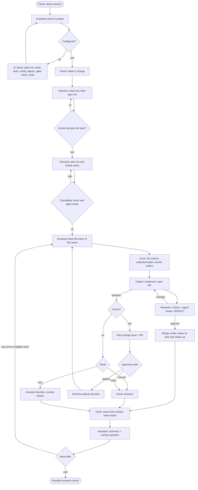

# App Flow

| field | value |
|---|---|
| status | Draft |
| owner | gabo-frontend |
| version | 0.8 |
| date | 2026-11-03 |
| linked docs | [PRD](PRD.md), [TRD](TRD.md), [UX_UI](UX_UI.md), intents [`docs/product/intents/`](intents/README.md), previous version [APP_FLOW 0.7](archive/APP_FLOW-0.7.md) |
| diagrams | [team-flow.md](diagrams/team-flow.md), [configuration-flow.html](diagrams/configuration-flow.html) |

gabo-ai has no graphical UI. Its "screens" are the surfaces where the owner meets the system: the assistant conversation, an optional direct session, the CLI and the tracker or PR. This document holds only the global flows of gabo-ai itself. Amended (owner 2026-11-03, per-change-sdlc): under the per-change model the UX and flow of each change belong to its intent's `spec.md` (section 3), and global design norms belong to an optional `DESIGN.md`; this document keeps the journey ids J1–J11 and the rule ids A3–A7, because skills cite them. The auto-mode proposal history, the story links and the superseded steps are kept in [APP_FLOW 0.7](archive/APP_FLOW-0.7.md).

## Rules

Approved in earlier versions; the ids are stable.

| id | rule |
|---|---|
| A3 | A slot whose verify step fails stays unverified: the assistant names the failed operation and asks the owner how to fix the adapter, and agents are not rebuilt for that slot until verify passes. |
| A4 | In manual mode, a coder question waiting for the owner blocks only its own task; the rest of the wave continues. |
| A5 | "Mediation drags on" means three mediated exchanges on the same task without resolution; the assistant then offers a direct session once. |
| A6 | The plan-change approval scale (TRD D7) is one decision table reused by every journey that can raise a critical question. |
| A7 | A resumed wave first re-reads every task of its intent from the tracker and reconciles it with the memory ledger and traces before launching any coder (TRD D17). |

## Surfaces

| surface | entry points | primary action | empty and error states |
|---|---|---|---|
| Assistant conversation (the single Orca terminal opened by default, R18) | New session (R1); first time, after `gabo init` the owner asks their agent to configure gabo-ai ([UX_UI 1.8](UX_UI.md#18-setup-entry)) | Talk to the owner, start waves, route questions | No config: the assistant starts setup (J1). Missing alias: it asks once (R16). |
| Direct session (Orca terminal in a task worktree) | The owner accepts the assistant's offer (R14) | The owner talks to the working agent directly | Orca unavailable: the assistant keeps mediating and says why. |
| CLI (`gabo init`, `gabo check`, `gabo version`, `gabo prompt`; PRD R31) | Terminal, assistant, reviewer, CI | `gabo init` copies or refreshes the skill catalog, writes the stamp, installs the user-level reviewer skill and prints the setup prompt; `gabo prompt` reprints it; `gabo check` validates read-only, including the intent folders | Failures in the [UX_UI section 4](UX_UI.md#4-messages-and-errors) shape. |
| Tracker and PR (the team's tools via adapters) | Links in wave reports | Read product cards, intent tasks, PR verdicts, plan-change PRs | Unverified writes are listed in the wave report (R24). |

## Plan-change approval scale

Proposed (auto) A6. Source: TRD D7, PRD 10.2 and operating rule 2. Applies in any mode whenever a critical question arises (R19).

| proposal scope | owner present | owner absent |
|---|---|---|
| One task | Debated with the owner | Applies automatically once the plan-change reviewer agrees |
| One intent | Debated with the owner | Applies automatically only if the config allows group scope and the reviewer agrees; otherwise waits for the owner |
| Several intents or the PRD/TRD conventions | Debated with the owner | Waits for the owner unless `plan_change.global_without_owner` is true, and still needs the reviewer's agreement |
| Any scope beyond `plan_change.scope`, or rejected by the reviewer | Debated with the owner | Never applies automatically; waits for the owner |

Scopes map to `plan_change.scope` (`task` < `group` < `global`): one task is one task inside one intent's `plan.md`; one intent is its `spec.md` and `plan.md` together; several intents or the PRD/TRD conventions is `global`. There is no global implementation plan.

While a proposal is debated or waits, only the affected task is BLOCKED (operating rule 2). Every proposal has its own issue and PR touching only `docs/product` and tasks.

## Journeys

Actors: **owner**, **assistant**, **directiva** (pm, dev-lead, db-master, frontend), **cycle** (gabo-cycle), **coders**, **reviewer**, **plan-change reviewer**. Each journey: trigger, steps, outcome, failure and escalation. Amended (owner 2026-11-11, [intent 0015](intents/0015-one-subagent-layer-on-every-engine/spec.md)), S1 to S4: the **cycle** is the wave skill the assistant runs in its own main session, not a separate agent, and the **reviewer** is the reviewer script each coder starts; wherever a journey says "the cycle", the assistant's main session does that step.

### J1 Configure the team (R8, R12, R16, R31–R36)

- **Trigger.** First setup through (a) `gabo init` in the terminal, then asking the agent to configure gabo-ai, or (b) the pasted setup prompt, which installs the CLI and runs `gabo init`. Later: the owner changes a slot, a runtime or the stack.
- **Steps** ([configuration flow](diagrams/configuration-flow.html)):
  1. The agent follows the setup prompt and loads the setup skill; it offers the recommended gentle-ai stack and, for Pi, a subagent package, installing only what the owner accepts.
  2. It detects the git user and asks once for an alias when the developer catalog has none (R16).
  3. It helps the owner choose and record the project's stack and tooling in the TRD; the owner decides, the assistant configures (PRD 10.1).
  4. For each slot it asks how the slot is handled, receives or co-writes the adapter and checks it covers the contract; it never applies a default (R12).
  5. The config-writer skill writes the global user file and `gabo.yaml`, including `plan_change.*` and `wave.after`.
  6. The runtime skill builds every agent of the neutral agent spec from fixed templates, each with its `gabo-version` line (R34).
  7. The agent runs `gabo check` and fixes every failure, then a subagent of the working kind runs a harmless operation per slot (A3).
  8. The project starts with an empty `docs/product/intents/`: no upfront schema, plan or stories.
- **Outcome.** Config written, agents built and committed, `gabo check` passing, each slot verified.
- **Failure and escalation.** A coverage gap or a `gabo check` failure is fixed with the owner, one at a time. A stamp newer than the CLI: only an interactive `gabo init` offers to update the CLI.

### J2 Plan one change (R2, R7, R20)

Amended (owner 2026-11-03, per-change-sdlc); earlier "Plan the product once".

- **Trigger.** The owner states a change, or a product card gets a new intent.
- **Steps.**
  1. `gabo-pm` writes `docs/product/intents/<NNNN-slug>/intent.md` from its template, asking the fixed questions one at a time.
  2. Directiva writes `spec.md`: requirements and acceptance criteria (`gabo-pm`), UX and flow (`gabo-frontend`) and data or config changes (`gabo-db-master`, also logged in MIGRATIONS).
  3. A human accepts the spec by filling its acceptance table. No agent accepts a spec, in any mode.
  4. `gabo-dev-lead` writes `plan.md` and creates its tasks in the tracker with the intent as parent and blocked-by / unblocks links; each write is verified by re-read (R24).
  5. Directiva runs the traceability check before each next step (TRD D19); `gabo check` enforces the stage order offline.
- **Outcome.** One accepted intent with a plan whose tasks are in the tracker. Specs are accepted one at a time; there is no batch.
- **Failure and escalation.** A traceability gap blocks the next step; the assistant shows it and asks the owner or directiva to close it.

### J3 Run a wave without watching (R4, R5, R15)

Amended (owner 2026-11-03, per-change-sdlc): a wave is one intent.

- **Trigger.** An intent with an accepted spec has unblocked tasks.
- **Steps** ([TRD 5.1](TRD.md#51-wave-run-r3-r4-r5-r10-r13)):
  1. The assistant picks the next eligible intent and starts its wave; the wave id is the intent id.
  2. The cycle reads that intent's unblocked tasks and launches one coder per task, up to `parallelism`, each in its own worktree.
  3. Each coder implements, opens a PR linked to its task and goes through review (J8), then reports HANDED or BLOCKED; the cycle records its resume handle in the wave ledger.
  4. The cycle updates the tracker (verified by re-read). After each merge the assistant resumes the owning coder, which closes its task (J10).
  5. The wave closes when every task of the intent is DONE or BLOCKED; the cycle sweeps what no coder closed and sends the wave report.
  6. The assistant answers the owner with the summary and the comfort question (J4), then follows `wave.after`: `next` starts the next eligible intent, `wait` (default) stops.
- **Outcome.** The owner performed no launch, relay or copy step, and may have been away for the whole wave.
- **Failure and escalation.** Questions travel in the report with answer and resolver (R5); unverified writes and tasks blocked across intents are listed.

### J4 Resolve questions by mode (R5, R6, R17)

- **Trigger.** A coder or agent raises a question.
- **Steps.** The question travels coder → cycle → assistant (Amended (owner 2026-11-11, intent 0015 S4): coder → assistant). A critical one becomes a plan-change proposal (J6). Otherwise, in manual mode the assistant asks the owner one question at a time; in auto mode it decides, or asks directiva for a researched answer, and records the decision with its reason. At wave close the comfort answer adjusts `interaction_level` and `tone`.
- **Outcome.** Every question closed with answer and resolver; preferences updated.
- **Failure and escalation.** A4.

### J5 Intervene in a task (R14, R18)

- **Trigger.** The owner wants to steer a task.
- **Steps.** Case A (default): the assistant mediates with the coder. Case B: after A5, the assistant offers a named Orca session in the task worktree, briefed with prior context. Afterwards it resumes from the traces without redoing work.
- **Outcome.** The task continues from where the owner left it.
- **Failure and escalation.** Orca unavailable: the assistant stays in Case A and says why.

### J6 Adjust the plan safely (R7, R19)

- **Trigger.** A wave report, a mid-wave change request, or a critical question.
- **Steps** ([TRD 5.3](TRD.md#53-plan-change-r19)):
  1. Non-critical adjustment: directiva adjusts the intent's `plan.md` and its tasks without re-planning; tasks keep their identity. A change to a task in progress applies when its coder finishes the current round (PRD 8.1, rule 1).
  2. Research request: directiva returns a researched answer.
  3. Critical question: directiva opens its own issue and PR (product documents and tasks only), and the affected task is BLOCKED.
  4. The proposal is debated with the owner if present, otherwise with the plan-change reviewer, and applies or waits by the [approval scale](#plan-change-approval-scale).
- **Outcome.** The plan changes within the configured scope, with git history explaining what and why.
- **Failure and escalation.** Rejected or beyond scope: never applied automatically; waits for the owner.

### J7 Use the team's own tools (R8, R11, R34, R35)

- **Trigger.** A tech lead configures or switches methodology, tracker or engine.
- **Steps.** The owner edits one line (`slots.methodology.adapter` or `slots.tasks.adapter`) or answers setup; the assistant reruns J1 steps 4–7 for that slot. Another engine uses its runtime skill, or the runtime builder writes one first.
- **Outcome.** Agents use the team's tools without skill changes.
- **Failure and escalation.** As in J1.

### J8 Trust what gets merged (R9, R10)

- **Trigger.** A coder opens or updates a PR.
- **Steps** ([TRD 5.2](TRD.md#52-review-r9)): optional coder-side review per methodology; the coder asks the reviewer agent for a review of the PR head; the reviewer script, in its own clone, home and cache, test-merges, runs the checks and an independent agent review once per head, comments the verdict and applies the merge gate (never main); the reviewer agent relays the `VERDICT` line; the coder fixes or reports HANDED. Amended (owner 2026-11-11, intent 0015 S3): the coder validates the request, starts the reviewer script itself and reads its `VERDICT` line; there is no reviewer agent.
- **Outcome.** Only validated PRs merge; the task shows status and PR.
- **Failure and escalation.** After 4 fix rounds the task is BLOCKED and escalated (PRD 8.1, rule 3).

### J9 Single point of contact (R1)

- **Trigger.** The owner opens a session.
- **Steps.** The session opens with the assistant as point of contact; it routes requests about the flow; the owner may address any agent directly.
- **Outcome.** The owner stops being the glue between agents.

### J10 My machine stays clean (R13, R23)

- **Trigger.** A task's PR merges; later, the wave closes.
- **Steps.** Each subagent reports what it created and the cycle appends it to the wave ledger with each coder's resume handle (TRD D15, D23). After each merge the assistant resumes the owning coder, which verifies the merge, closes its task issue, removes its worktree without force and deletes its branches. At wave close the cycle sweeps only ledger entries no coder closed, except `worktree.keep`.
- **Outcome.** No manual cleanup after merges or waves; leftovers are listed in the wave report.
- **Failure and escalation.** A deletion outside the workflow's resources is refused and reported.

### J11 Resume without losing work (R25)

- **Trigger.** A wave was interrupted.
- **Steps.** The assistant restarts the wave of the same intent first; the cycle applies A7, skips DONE tasks, reattaches open PRs and worktrees and continues as in J3.
- **Outcome.** The wave completes without the owner reconstructing state.
- **Failure and escalation.** A task whose tracker state and traces disagree is reported rather than guessed.

## Flow

Detailed references: [team-flow.md](diagrams/team-flow.md) and [configuration-flow.html](diagrams/configuration-flow.html). Those diagrams predate the per-change model and still show one global plan; this chart is the current overview.

