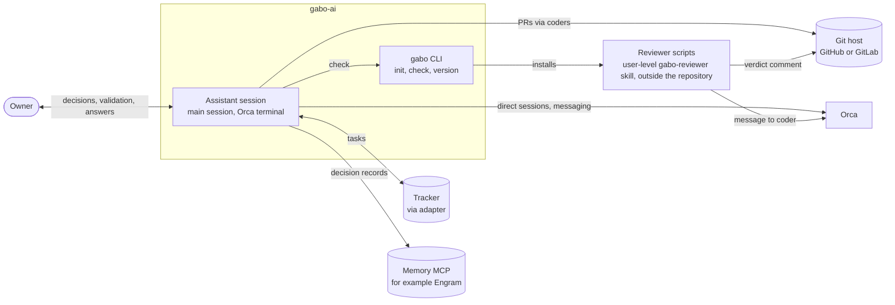
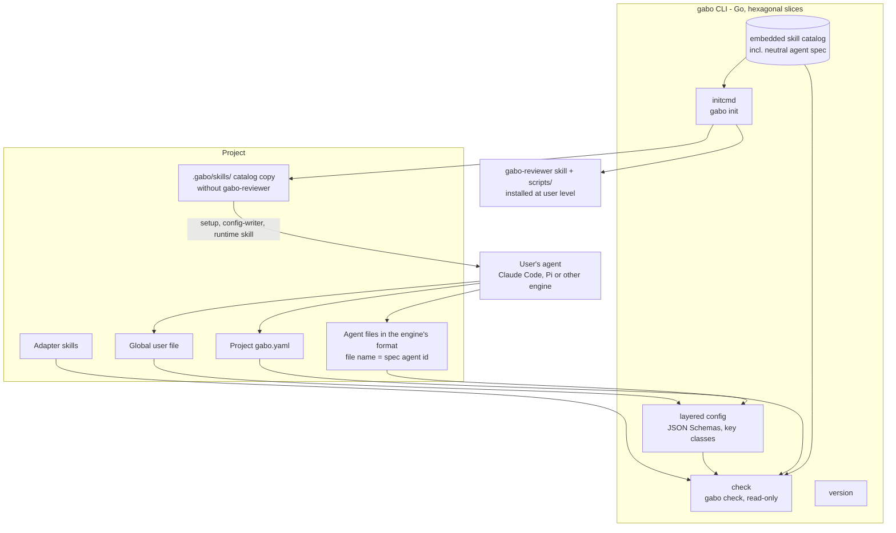
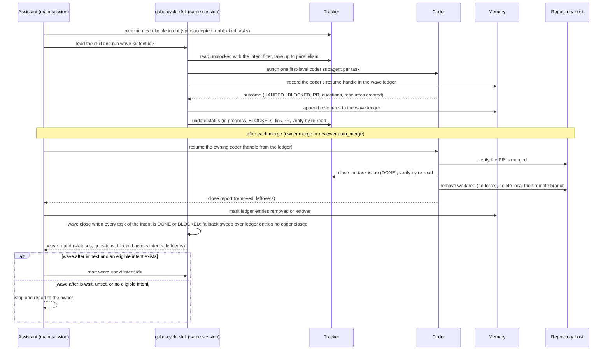
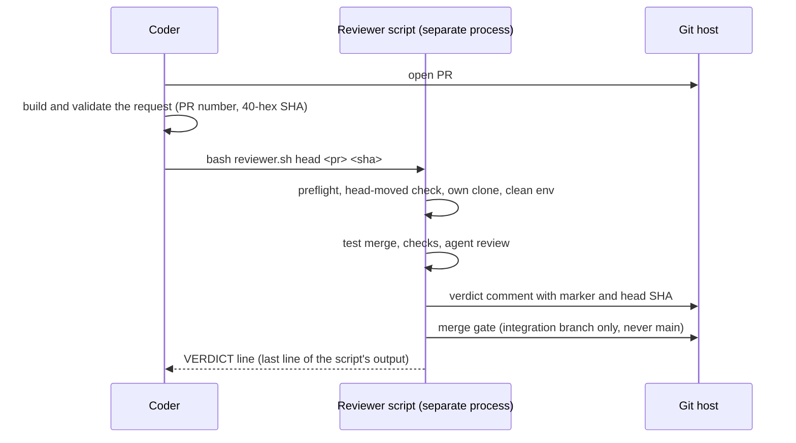
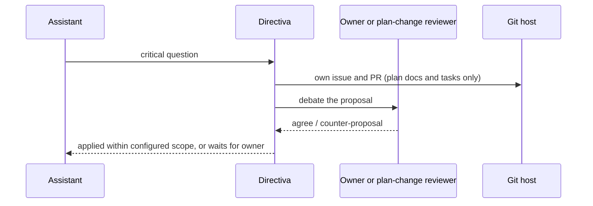

# Technical Requirements (TRD)

| field | value |
|---|---|
| status | Draft |
| owner | gabo-dev-lead |
| version | 0.10 |
| date | 2026-11-03 |
| linked docs | [PRD](PRD.md) (R1–R39), [MIGRATIONS](MIGRATIONS.md), intents [`docs/product/intents/`](intents/README.md), [APP_FLOW](APP_FLOW.md), diagrams `docs/product/diagrams/`, previous version [TRD 0.9](archive/TRD-0.9.md) |

The global technical conventions every intent of gabo-ai follows: the stack, the architecture, code and test conventions, the slot contracts, the configuration shapes and the MADR-style decisions. It holds no per-change design and no per-requirement mapping; those live in each intent's `spec.md` and `plan.md`. Decisions cite PRD requirement ids. The section numbers and decision ids are stable, because skills and tests cite them (for example TRD 9.2, 9.4, D7, D19). The auto-mode proposal table, the dated owner-decision notes and the requirement coverage table of earlier versions are kept in [TRD 0.9](archive/TRD-0.9.md).

## Amendment 2026-11-03: per-change model (feature `per-change-sdlc`)

Approved (owner 2026-11-03, feature `per-change-sdlc`, applied directly by the owner's decision). Each changed part carries the note **Amended (owner 2026-11-03, per-change-sdlc)**.

| # | change | where |
|---|---|---|
| T1 | A wave runs one accepted intent; `wave.after` (`next` or `wait`, unset means `wait`) decides whether the assistant chains the next intent. | 5.1, D12, 9.3 |
| T2 | Plan-change scopes: `task` is one task in one intent's `plan.md`, `group` is one whole intent, `global` is several intents or the PRD/TRD conventions. There is no global plan. | D7, 9.2 |
| T3 | Planning documents are the PRD, the TRD, per intent `intent.md`, `spec.md` and `plan.md`, the optional `DESIGN.md` and the MIGRATIONS log; user stories, the global implementation plan and the upfront schema are retired. | D14, 7 |
| T4 | The traceability check reads intents, specs, plans and tracker tasks; `gabo check` enforces the intent stage order. | D19, 9.4 |
| T5 | The configuration shapes formerly in DB_SCHEMA move to 9.3; data and config changes are logged in MIGRATIONS. | 7, 9.3 |
| T6 | The requirement coverage table is dropped: requirement-to-task traceability lives in each intent. | 10, 11 |

## 1. Introduction and quality goals

The TRD describes how gabo-ai implements the PRD: a Go CLI with four commands (`gabo init` copies the skill catalog and installs the user-level reviewer skill, `gabo check` validates read-only, `gabo version`, `gabo prompt` prints the setup prompt; D24, amended by plan change #148), plus contract, role, runtime and adapter skills from which the user's own agent writes the config and builds the agents, and with which it does everything during the work, and deterministic reviewer scripts bundled in the user-level `gabo-reviewer` skill (D20). Superseded (owner 2026-10-27, D24): a Go CLI that only compiles the initial configuration into runtime-native agents and installs per-runtime artifacts (D18, D21).

PRD goals and the requirements that carry them:

| PRD goal | requirement ids |
|---|---|
| Protect the human's energy | R1, R4, R15, R17, R18 |
| Work never stalls | R3, R4, R10, R13 |
| Questions surface | R5, R6, R19 |
| Plan per change, not upfront | R2, R7, R19, R20 |
| Adapts to the team | R8, R9, R11, R12, R14, R16, R31–R36 |

Quality goals come from the PRD quality requirements: security (R21–R23), reliability (R24–R25), cost (R26–R27), time to value (R28) and observability (R29–R30). The first release sets no performance targets.

## 2. Constraints

- **Stack.** The gabo CLI is Go. Amended (owner 2026-11-03, [intent 0003](intents/0003-pi-package/spec.md) open question 6): TypeScript and JavaScript are allowed only as thin connection layers (for example an engine extension or plugin) that collect facts, invoke the Go code and relay what it returns; they hold no rule logic, and every rule stays in Go.
- **Code architecture.** Hexagonal DDD: ports and adapters per vertical feature slice. Each slice lives in `apps/cli/internal/slices/<name>/` with `domain` (pure rules), `usecase` (orchestration through ports) and `adapters` (filesystem, git, process and CLI entry points). Approved (owner 2026-10-27, D24): the live Go parts are the layered config package (with the JSON Schemas), `initcmd` (`gabo init`), `check` (`gabo check`) and `version`, plus the embedded skill catalog. Superseded (owner 2026-10-27, D24): the live slices are layered config, `configcmd` (`gbai config set` only, an owner convenience at configuration time; the read-only `gbai config` is removed, [question 7](#13-open-questions)), the generator (`gbai generate`, with `gabo init` as the first generate, including the per-runtime installer table, D21) and `version`. The existing `plan`, `review`, `status`, `mcp`, `sessions`, `audit`, `provision`, `secrets`, `repo`, `worktree` and `doctor` slices are retired (D18).
- **Go CLI is init, check, version and prompt (D24, approved owner 2026-10-27; `prompt` added by plan change #148, owner request 2026-10-29).** `gabo init` copies the embedded skill catalog (except `gabo-reviewer`) byte for byte into the project, installs the user-level `gabo-reviewer` skill and prints the next step followed by the setup prompt, which is the only entry text (D25); it never touches an existing config and writes no config and no agent (amended owner 2026-11-04, intent 0006: it writes the project-level engine integration keys of 9.4, never `gabo.yaml`, the user config or the user's global engine config); on an existing project it refreshes the catalog copy only when the catalog's version stamp is older than the binary or missing (a newer stamp self-updates when interactive, else exits 1), and on every run installs the user-level reviewer skill when its own copy is missing or outdated. `gabo check` is read-only and engine-neutral (amended owner 2026-11-04, intent 0006 S11: except the read-only check of the declared full-tier engines' project integration keys, 9.4; for a flexible-tier engine it stays engine-neutral, D28): it validates the config files against the JSON Schemas (layered read, key classes), checks that every agent of the neutral agent spec exists, that every slot's adapter covers its contract, and that the catalog version stamp equals the CLI version. `gabo version` prints the version. `gabo prompt` prints the embedded setup prompt and nothing else (D25, PRD R39). The config and the agents are written by the runtime's own agent from skills (config writer, runtime skills, runtime builder). During the work, the only Go that runs is the read-only `gabo check` (agents, the reviewer, CI).
- **Superseded in part (owner 2026-10-27, D24): Go is an agent compiler only (D18, approved owner 2026-10-26).** Compiled Go keeps only the initial configuration: it validates the global user file and the project `gbai.yaml` (JSON Schema), compiles runtime-native agents, installs the per-runtime artifacts from one installer table (D21: skills, including the user-level `gbai-reviewer` skill with its scripts, the user's Markdown adapters, and the runtime's tool registrations), and recompiles after a key changes (edited in the YAML, or with `gbai config set <key> <value>`, then `gbai generate`). `gbai init` is the first generate; `gbai version` prints the version. Nothing in Go runs during the work itself.
- **Config writes (amended D18, owner 2026-10-26; amended D24, owner 2026-10-27).** During setup (through the `gabo-config-writer` skill) and during the work, agents write preferences and config by editing the YAML files directly; JSON Schema validation runs at the next `gabo check`. `gbai config set` is removed (D24). Superseded: validation at the next `gbai generate`, and `gbai config set` as an owner convenience.
- **Setup entry (D24, owner 2026-10-27).** The user runs `gabo init` in the project, opens their agent there and asks it to configure gabo-ai; the agent follows the setup prompt (the only entry text, D25) and the setup, config-writer and runtime skills, then runs `gabo check` and fixes what fails. Both entries stay (PRD open question 10 answered, R36): (a) `gabo init` from the terminal, then asking the agent; (b) pasting the setup prompt, whose agent installs the CLI and runs `gabo init`; the prompt has one source embedded in the CLI (D25). Superseded in part (owner 2026-10-27): the setup entry of D21 below, where the agent runs `gbai generate`.
- **Setup entry (D21, owner 2026-10-26).** No setup TUI. The user pastes a setup prompt with a link from the gabo-ai documentation into Claude Code or Pi; that agent installs gabo-ai, runs the setup question burst, writes the config and runs `gbai generate`. Approved (owner 2026-10-26): setup offers the gentle-ai stack (ODD, RDD, Engram) as the recommended, not required, option and installs it only if the user accepts; when Pi is in `generation.targets`, it checks for a Pi subagent package and, if none is present, explains why one is needed and offers to install the recommended gentle-pi and `gentle-shell`.
- **Pi subagent package (D21, Approved (owner 2026-10-26)).** Pi core has no subagents; Pi targets need a subagent package that provides them. gentle-pi (which adds the `subagent_*` tools) is recommended; another package (for example `pi-subagents-j0k3r`) is acceptable. Amended (owner 2026-10-27, D24): the `gabo-runtime-pi` skill refuses to build Pi agents when no subagent package is present and says what to install (earlier `gbai generate` refused the Pi target). gabo-ai never edits a subagent package's own configuration (for example `subagents.json`); it only places its agents and skills.
- **No glue CLI for agent work (owner 2026-10-26).** gabo-ai is skills, configuration and a simple CLI. Agents already have tools (tracker CLIs and MCPs, git, memory); the skills explain how to use them. Computing the next wave, keeping the resource ledger, cleaning up a wave and resuming a wave are done by the main session through the `gabo-cycle` skill (Amended (owner 2026-11-12, intent 0015 S1, S10, D1): earlier the cycle agent), the `tasks` adapter and the `memory` slot, not by gabo commands. The same holds (owner 2026-10-26) for status, audit, direct sessions, provisioning, secrets, repository setup, worktree removal, planning documents and the traceability check: agents do them with their own tools (gh, git, Orca, Railway MCP) guided by skills and adapters.
- **Tool-specific parts are never compiled.** Tracker, memory, notifications, direct sessions, methodology, repository host and reviewer placement are skills or instructions local to the repository. See [Dynamic configuration](#81-dynamic-configuration).
- **Supported runtimes.** Claude Code and Pi (D3), each through a shipped and tested runtime skill (D24), and OpenCode through `gabo-runtime-opencode` (D3; amended by [intent 0004](intents/0004-opencode-runtime/spec.md) S12, owner 2026-11-03). Amended (owner 2026-11-03, intents 0002 and 0004): the accepted runtimes are `claude`, `codex`, `pi` and `opencode`, in every role (`runtimes.coder`, `runtimes.assistant` and `runtimes.reviewer`), and all four are reviewer engines (D27); Codex comes through `gabo-runtime-codex` (intent 0002) and OpenCode through `gabo-runtime-opencode` (intent 0004). Another engine with subagents and skills, or an equivalent, can be added by the `gabo-runtime-builder` skill without a Go change or a release (PRD R35). Amended (owner 2026-11-04, D28): these four engines are the **full** compatibility tier (plugin or package, hooks, project-level integration set up by `gabo init`, and engine files read by `gabo check` for those with project keys, `claude`, `codex`, `pi`; OpenCode through its runtime skill and stage-gate plugin, with no engine-key check); any other engine is the **flexible** tier (gabo skills and configuration only, no plugin and no hooks, nothing engine-specific written by `gabo init`, engine-neutral `gabo check`). Amended (owner 2026-11-11, [intent 0017](intents/0017-any-runtime-engine-without-a-go-change/spec.md)): `runtimes.coder` and `runtimes.assistant` accept any engine name of the pattern `^[a-z][a-z0-9-]*$` whose runtime skill is valid, and `gabo check` checks the skill, so a builder engine needs a valid runtime skill and no Go change; `runtimes.reviewer` accepts only `claude`, `codex`, `pi` and `opencode` (D27); an accepted builder engine is flexible tier.
- **Nesting depth.** At most 3 below the assistant: assistant → cycle → coder → test runner. Amended (owner 2026-11-11, [intent 0015](intents/0015-one-subagent-layer-on-every-engine/spec.md)), S1, S2, D30: one subagent layer on every engine. The main session runs the `gabo-cycle` skill and launches every agent itself, coders included; no gabo agent launches another agent, and gabo depends on no engine nesting-depth setting (S8).
- **Runtime inheritance.** Subagents inherit the main session runtime. Other engines (for example pi) apply only to separately launched processes such as the reviewer. Amended (owner 2026-11-06, [intent 0013](intents/0013-several-engines-in-parallel-in-one-project/spec.md) S7, D3): `session` in `runtimes.coder` or `runtimes.reviewer` names that inherited engine; each built agent names its engine through the `{{engine}}` template slot. Amended (owner 2026-11-07, intent 0013 S18, D12): under gentle-pi a subagent cannot launch subagents, so a wave started from a Pi main session runs the `gabo-cycle` skill in that main session and launches each coder as a first-level subagent; Claude Code, Codex and OpenCode keep `gabo-cycle` as a subagent. Amended (owner 2026-11-07, intent 0013 S20, D14): a gentle-pi subagent has no `subagent_*` tools, so a Pi coder validates its review request like the reviewer agent and runs the user-level reviewer script itself through `bash`; Claude Code, Codex and OpenCode coders keep launching the reviewer agent. Amended (owner 2026-11-11, intent 0015 S1, S3, D1, D2): those two Pi rules become the rules of every engine: the main session runs the `gabo-cycle` skill and launches each coder as a first-level subagent, and every coder validates its review request and runs the user-level reviewer script itself through its shell; there is no `gabo-cycle` agent and no reviewer agent on any engine.
- **Reviewer runtime.** `runtimes.reviewer` has no default; the assistant asks the user (R12). Amended (owner 2026-11-06, [intent 0013](intents/0013-several-engines-in-parallel-in-one-project/spec.md) S11, D5): it is one engine, which reviews every wave, or `session`, where each wave's review runs on that wave's engine, passed to the scripts as an argument they accept only for an engine listed in `runtimes.assistant` on the integration branch.
- **Direct sessions.** Orca only in the first release (R14).
- **Auto-mode limits.** As set in the PRD Constraints (D13).

## 3. Context and scope

C4 system context.



## 4. Solution strategy and building blocks

### 4.1 Solution strategy

- Native subagents for agent communication; Orca only for the reviewer and direct sessions (D1). Amended (owner 2026-11-11, intent 0015 D1): one layer of native subagents, all launched by the main session (D30).
- Contract skills plus repository adapters for every tool-specific part; generic Go code only (D2, D4).
- Runtime-native agent files built by the user's agent from the neutral agent spec and fixed templates through a runtime skill, and committed (D3 amended, D24); `gabo check` detects missing agents and a stale catalog version. After a gabo upgrade the user runs `gabo init` and asks the agent to rebuild (9.4).
- One wave per accepted intent, computed by the cycle skill from that intent's tracker dependencies read through the `tasks` adapter, with `wave.after` deciding whether waves chain (D12, 5.1); no Go wave command. Amended (owner 2026-11-03, per-change-sdlc).
- An isolated reviewer as the mandatory merge gate (D6), run by deterministic scripts bundled in the `gabo-reviewer` skill and installed at user level by `gabo init` (D24), out of reach of PR code; the reviewer agent only validates the request and invokes the script (D20). Amended (owner 2026-11-11, intent 0015 S3, D2): the coder validates the request and invokes the script; there is no reviewer agent.
- Runtime knowledge lives in runtime skills (Claude Code, Pi) and the runtime builder, not in Go (D24; amended owner 2026-11-04, intent 0006: except the engine integration table that `gabo init` writes, 9.4; amended owner 2026-11-06, intent 0010: that table also holds the main-session keys and the OpenCode `experimental.subagent_depth`, so the runtime skills write no engine config key; Amended (owner 2026-11-11, intent 0015 S8, D6): gabo no longer writes or requires that OpenCode key); setup starts with `gabo init`, after which the user's agent configures gabo-ai, offering the recommended (not required) gentle-ai stack and, for Pi, a subagent package (gentle-pi recommended). Superseded (owner 2026-10-27): one Go installer table of what goes where per runtime (D21).
- Go only copies the catalog, installs the reviewer skill and validates (D24); every work-time operation is an agent using its own tools under a skill (D18).
- Plan changes in their own issue and PR, always debated (D7, D8).

### 4.2 Building blocks (C4 container view)



Approved (owner 2026-10-27, D24): layered config, `initcmd`, `check` and `version` are the only live Go parts. The agents and the config are written by the user's agent from skills; the user-level `gabo-reviewer` skill is installed by `gabo init` (D20). Plan templates live in the role skills (D19). Superseded (owner 2026-10-27): layered config, `configcmd` and the generator as the live slices, with the generator installing every artifact from its installer table (D18, D21).

### 4.3 Agent topology

| agent | how it runs | talks through |
|---|---|---|
| Assistant | Main session: the single Orca terminal opened by default (R1, R18) | Native subagent returns; Orca messaging for reviewer and direct sessions |
| Directiva (pm, dev-lead, db-master, frontend) | Native subagents of the assistant (R2, R7) | Return to the assistant |
| gabo-cycle | Amended (owner 2026-11-11, [intent 0015](intents/0015-one-subagent-layer-on-every-engine/spec.md)), S1, S2: a skill, not an agent; the main session loads it and runs one wave (R3, R4). Earlier: native subagent of the assistant | The wave report starts the assistant's wave close in the same session |
| Coders | Native in-process subagents, one per wave task; the cycle records each coder's resume handle in the wave ledger (R3, R10, D23). Amended (owner 2026-11-11, intent 0015 S1, S4): first-level subagents of the main session. Earlier: subagents of the cycle agent | Return to the main session running the cycle (task outcome and questions); after the task's PR merges, the assistant resumes the owning coder for the task close and receives its close report (D23) |
| Reviewer | Amended (owner 2026-11-11, intent 0015 S3, D2): the script of the user-level `gabo-reviewer` skill, started by the coder through its shell after the coder validates the request; the script runs isolated, as a separate process with its own clone, home and cache (R9, D20). Earlier: a reviewer agent validated the request, invoked the script and relayed its line | PR comment + `VERDICT` line read by the coder from the script's output |
| Plan-change reviewer | Fresh clean-context session that indexes the repository (R19) | Returns agree / counter-proposal |
| Direct session | Extra Orca terminal in the task worktree, opened only on the user's request (R14, R18) | Orca messaging |

```
Owner ─ Assistant (main session; runs the gabo-cycle skill itself)
          ├─ pm / dev-lead                          (subagents)
          ├─ db-master / frontend                   (subagents, on demand)
          ├─ plan-change reviewer                   (fresh session, only on a plan change)
          └─ coder × N                              (subagents, one per task, each in its worktree)
               └─ shell ── reviewer script (separate process, clean clone) ── PR comment + VERDICT ──> coder
```

Amended (owner 2026-11-11, [intent 0015](intents/0015-one-subagent-layer-on-every-engine/spec.md)), S1 to S3, D30: the tree above is the accepted one-layer topology (seven agents with the main session, nine before).

Subagents are launched in-process, not as split-pane teammates, unless the owner asks (D23).

## 5. Runtime view

User flows live in `docs/product/diagrams/`. Key internal sequences:

### 5.1 Wave run (R3, R4, R5, R10, R13)

Amended (owner 2026-11-03, per-change-sdlc). A wave is one accepted intent: the wave id is the intent id (`I####`), and the cycle takes only that intent's tasks, through the `tasks` contract's `read unblocked` with the `intent` filter. `parallelism` bounds the coders within that intent. A task of this intent blocked by a task of another intent stays blocked and is reported; the other intent's task is never pulled in. The assistant picks the next eligible intent (its spec accepted by a human, with unblocked tasks) in intent order, a resumed wave first. When the wave closes, `wave.after` in `gabo.yaml` decides: `next` starts the next eligible intent without asking the owner; `wait` (also when unset) stops and reports, and the next wave starts when the owner asks. With no eligible intent the assistant waits either way. Chaining is optional, so a single wave can run in the cloud while the owner is away.

Amended (owner 2026-11-06, [intent 0013](intents/0013-several-engines-in-parallel-in-one-project/spec.md) S8, S9, D4, D6). Owner, verbatim: "a wave claims its intent before starting (a second session refuses a claimed intent and says which session has it), tasks are claimed as today, each wave keeps its own ledger and worktree namespace and cleans only its own resources." Before it claims any task, the cycle claims the intent on its intent issue through the `tasks` operations `log progress` and `read one` (`intent claimed by session <engine>-<8 hex> (engine <engine>)`); the earliest claim not followed by its own release holds it, a losing session releases its claim and refuses, and the holder releases it at wave close. The assistant and `wave.after: next` pick only unclaimed intents. Each wave keeps its ledger `gabo/ledger/<wave>` (each line also names the session id) and its worktrees under `<repo-parent>/<repo-name>-worktrees/<wave>/`, and cleans only those. Amended (owner 2026-11-07, intent 0013 spec open question 1, verbatim: "si no la listo tomare tu propuesta para toda opcion no listada"): a claim has no timeout; it holds until the holding wave closes or resumes, or until the owner tells any assistant to release it (`intent released by owner for session <id>`).

Amended (owner 2026-11-11, [intent 0015](intents/0015-one-subagent-layer-on-every-engine/spec.md)), S1, S4, S5: the assistant and the cycle are one session. The main session loads the `gabo-cycle` skill and runs the cycle's steps itself; each coder is a first-level subagent that returns its outcome and questions to that session. The claim, the ledger, the trace, the resume and the wave report are unchanged. In the diagram, `A` and `C` are the same main session: `C` is the `gabo-cycle` skill it runs.



### 5.2 Review (R9)

Amended (owner 2026-11-11, [intent 0015](intents/0015-one-subagent-layer-on-every-engine/spec.md)), S3, D2: the coder validates the request and starts the reviewer script itself; no reviewer agent stands between them. Earlier, a reviewer agent validated the request, ran the script and relayed its `VERDICT` line.



Amended (owner 2026-11-06, [intent 0013](intents/0013-several-engines-in-parallel-in-one-project/spec.md) S11): with `runtimes.reviewer: session` the request is `PR <n> head <sha> engine <engine>` and the scripts review on that engine only when the integration branch lists it in `runtimes.assistant`; with a fixed engine the request is unchanged and that engine reviews every wave.

### 5.3 Plan change (R19)



## 6. Deployment view

- **First release.** Local: the assistant session, subagents and the reviewer run on the developer's machine.
- **Reviewer placement.** Configurable per repository: local, separate server, GitHub Actions, GitLab CI; first release local (D6). Approved (owner 2026-10-26): the local default is single-user mode (the owner's own account; the script's preflight refuses unless it runs from a clean checkout of the integration branch); the isolated two-user mode stays available through the `reviewer_placement` or `agent_host` adapter (D20). Placements beyond local are Later.
- **Cloud setup.** Running agents on a server is one more dynamic slot ("where the agents run") with its own adapter, like the reviewer placement. The existing cloud fields (Railway server, OS users, bot, Orca sessions) move out of the core config into that adapter. It is configured in a separate session with the assistant; the base config stays clean for local use.

## 7. Data

Amended (owner 2026-11-03, per-change-sdlc). gabo-ai has no database and no upfront schema. Its config files, their shapes and the files `gabo init` writes are under [Configuration shapes](#93-configuration-shapes). Every data or config change is logged step by step in [MIGRATIONS](MIGRATIONS.md) by the intent that makes it (its `spec.md` section 4). The former DB_SCHEMA document is archived in [`archive/DB_SCHEMA.md`](archive/DB_SCHEMA.md).

## 8. Crosscutting concepts

### 8.1 Dynamic configuration

Owner principle: tool-specific behavior is a skill or instruction local to the repository, configured by the user with their agent, never compiled code (R8, R11, R12).

#### Slots, contracts and adapters

- Each dynamic slot has a **contract** (the port), shipped by gabo-ai as its own skill. It states WHAT the agent must be able to do, for example for tasks: create, read unblocked, claim, log progress, change status, link PR, verify by re-reading.
- Each slot is filled by an **adapter**: a Markdown skill or document in the repository that states HOW to perform every contract operation with the user's tool (for example gh CLI, Plane MCP).
- The repository config records the adapter per slot, for example:

```yaml
slots:
  tasks:
    adapter: .gabo/adapters/tasks-gh.md
```

#### Setup flow per slot

1. **Ask.** The assistant asks, for example, "How will we manage tasks and with what?" (R12: no silent defaults).
2. **Receive or co-write the adapter.** The user answers with a tool and a skill or document that explains it, or writes one with the assistant.
3. **Check coverage.** Verify the adapter covers every contract operation; ask the user about gaps.
4. **Test.** Run one harmless operation through a subagent of the same kind that will do the work. This proves that tools and instructions reach subagents.
5. **Record, build and check (D24).** The `gabo-config-writer` skill writes the slot to the config by editing the YAML; the runtime skill rebuilds the affected agents; the agent runs `gabo check`, which validates the config and the adapter coverage, and fixes what fails. Superseded (owner 2026-10-27): write the slot with `gbai config set` or by editing the YAML and run the generator, which validates it (D18 amended).

#### Agent building (D24)

Approved (owner 2026-10-27, D24): after the questions, the user's agent builds the agents itself; gabo-ai has no generator.

- **Neutral agent spec.** One engine-independent file in the catalog lists each gabo-ai agent: id, role, skills it loads, tools it needs (by capability, for example "tracker", "git", "memory"), which agent launches it, and its template. Proposed (dev-lead 2026-10-27): `gabo-agent-templates/agents.yaml` in the embedded catalog.
- **Templates.** The `gabo-agent-templates` skill holds one engine-neutral body template per agent with named slots (adapter instructions, methodology link, identity); the agent fills only the slots and invents no content.
- **Runtime skill.** `gabo-runtime-claude`, `gabo-runtime-pi` and `gabo-runtime-codex` turn each template into the engine's agent format and location, naming each agent file after its spec id (for example `.claude/agents/gabo-coder.md`) inside the agent directory it declares in its frontmatter (`metadata.agent_dir`), which `gabo check` reads (9.4), and write the `gabo-version` line in each agent file, set tool lists, link adapters under fixed names (`gabo-tasks`, `gabo-methodology`, …) and place the needed catalog skills where the engine discovers them; they never place `gabo-reviewer` in the project, only link the user-level copy (D20). The verified facts formerly in the installer table (9.6) are the source for these skills. Amended (owner 2026-11-03, intent 0002 D2 and D6): a runtime without per-agent tool allowlists or a skill preload key, such as Codex, keeps the agent's limits (read-only, no merge) in its instructions and writes the skills it loads as one instruction line; it invents no key the engine lacks. Amended (owner 2026-11-03, [intent 0004](intents/0004-opencode-runtime/spec.md) S3 and D2): `gabo-runtime-opencode` builds the OpenCode agents in `.opencode/agents/<id>.md` and writes the version as the first body line, the HTML comment `<!-- gabo-version: <x.y.z> -->`, never as a frontmatter key, because OpenCode passes unknown agent options to the model provider; `gabo check` reads that comment like the other version lines. `gabo-runtime-builder` writes a new runtime skill for another engine (PRD R35). Amended (owner 2026-11-06, intent 0008): per [intent 0008](intents/0008-stricter-gabo-check/spec.md) S2 to S5 (owner, verbatim: "ademas los agentes que usan .agents/skills/**.md debemos usarlo" and "ok carpeta aparte"), Codex, OpenCode and Pi share `.agents/skills` as their skill directory (`metadata.skill_dir`), with one link per name and the same target for every engine, and a runtime skill that removes unneeded `gabo-*` links there keeps every link an engine declared in `runtimes.*` needs; only `gabo-runtime-claude` keeps `.claude/skills`, its own folder of links straight to `.gabo/skills`. `gabo-runtime-pi` and `gabo-runtime-opencode` declare their earlier directory as `metadata.former_skill_dir` (`.pi/skills`, `.opencode/skills`), remove on build each `gabo-*` symlink they made there and keep any other entry, and the `Skills:` line of their agent files names `.agents/skills/<name>/SKILL.md`. Each runtime skill also declares where its agent files list their skills (`metadata.agent_skills`) and, where the engine reads one, the agent's declared name (`metadata.agent_name`; `gabo-runtime-opencode` declares none), each as `frontmatter:<key>`, `toml:<key>` or `line:<prefix>` (intent 0008 D1); `gabo check` reads only these declarations, with no engine name in Go (9.4).
- **Main-session entry (Amended (owner 2026-11-06, intent 0009) S1 to S4, S7).** Per [intent 0009](intents/0009-main-session-defaults-to-the-gabo-assistant/spec.md), the owner's interactive main session runs as the gabo assistant, and only that session: role sessions (coders, reviewers) keep their role. The runtime skill of the engine in `runtimes.assistant` builds the entry on every build; the table of each engine's entry and the assistant agent template live once in `gabo-agent-templates` (`agents.yaml` `main_session`, never a spec agent; D4). Per engine:

  | engine | skill link (S1) | main-session entry |
  |---|---|---|
  | Claude Code | `.claude/skills/gabo-assistant` | S2: agent file `.claude/agents/gabo-assistant.md` and the one key `agent: "gabo-assistant"` merged into `.claude/settings.json`; `claude --agent <id>` still overrides it for role sessions |
  | OpenCode | `.agents/skills/gabo-assistant` | S2: agent file `.opencode/agents/gabo-assistant.md` with `mode: primary` and the one key `default_agent: "gabo-assistant"` merged into the project config file `gabo-runtime-opencode` resolves; `--agent` still picks a role |
  | Codex | `.agents/skills/gabo-assistant` | S3: the scoped block `<!-- GABO_ASSISTANT_START -->` … `<!-- GABO_ASSISTANT_END -->` in `AGENTS.override.md`, else `AGENTS.md` (created when neither exists) |
  | Pi | `.agents/skills/gabo-assistant` | S3: the same block in the first existing of `AGENTS.override.md`, `AGENTS.md`, `CLAUDE.md` (`AGENTS.md` created when none exists); Pi 1.4.0 loads only that first existing file per directory ([#324](https://github.com/testeos-z/gabo-ai/issues/324)) |

  Each link points to `.gabo/skills/gabo-assistant` and each entry names `.gabo/skills/gabo-assistant/SKILL.md`. The Claude Code agent body is a short assistant prompt, never an empty body with `skills` preloaded, because Claude Code 2.1.302 does not preload a main-session agent's skills (D2 choice A, [#321](https://github.com/testeos-z/gabo-ai/issues/321)). Codex and Pi have no project default agent, so their block is at most 2048 bytes, says first that a role-prompt or headless session (`codex exec`, `pi --print`) ignores it, replaces only the bytes between its markers and keeps every other byte. Only the one key or the block is written. Amended (owner 2026-11-06, [intent 0010](intents/0010-gabo-init-writes-the-main-session-key/spec.md) S1, S2, S4, S5): `gabo init` writes and removes the key (`agent`, `default_agent`), not the runtime skills, whose engine-config rule now allows no key; the runtime skills build the agent file, the link and, for Codex and Pi, the block (the block's writer is an open owner question, intent 0010 D3), and `gabo-setup` runs `gabo init` before the rebuild after it changes `runtimes.assistant`. The removal of other engines' keys below is `gabo init`'s too. Every build also removes the gabo entry of each other full-tier engine it finds, recognized only by its gabo identity (the markers, a key whose value is exactly `gabo-assistant`, an agent file `gabo-assistant` with a `gabo-version:` line, the link, kept in the shared `.agents/skills` while the assistant engine uses it), so a change of `runtimes.assistant` leaves nothing stale (S4); `gabo-setup` rebuilds the agents after it changes `runtimes.assistant`. Each runtime skill declares its entry in `metadata.main_session` (D5): `kind: agent` with the config files in resolution order and the `key` (`gabo-runtime-claude`: `.claude/settings.json`, `agent`; `gabo-runtime-opencode`: `opencode.json`, `opencode.jsonc`, `.opencode/opencode.json`, `.opencode/opencode.jsonc`, `default_agent`), or `kind: block` with the instructions files in order (`gabo-runtime-codex`: `AGENTS.override.md`, `AGENTS.md`; `gabo-runtime-pi`: `AGENTS.override.md`, `AGENTS.md`, `CLAUDE.md`); `gabo-runtime-builder` has a new runtime skill declare it or report that its engine has none. `gabo check` reads only these declarations (9.4). In gabo-ai itself `.claude/` is human-only, so the owner commits the entry (S6). Amended (owner 2026-11-06, [intent 0013](intents/0013-several-engines-in-parallel-in-one-project/spec.md) S3, S4, D7): `runtimes.assistant` may list several engines; every listed engine gets its own entry, and "every other full-tier engine" above reads "every full-tier engine not listed in `runtimes.assistant`", so no build or `gabo init` run removes a listed engine's entry; a shared link or block stays while any listed engine uses it. Amended (owner 2026-11-07, intent 0013 S16, D8): the block, which has no slot, names the session engine in one fixed line of its scope paragraph (loaded by Codex: `codex`; loaded by Pi: `pi`), so a Codex or Pi main session knows its engine; it stays verbatim and at most 2048 bytes.
- **Check.** The agent runs `gabo check` and fixes every failure before it reports done. Owner 2026-10-27: there is no template hash; instead each built agent file carries a `gabo-version: <x.y.z>` line (owner 2026-10-27) that `gabo check` compares with the catalog stamp; after a gabo upgrade `gabo check` reports new skills, the user runs `gabo init` and asks the agent to rebuild (9.4).

Agent files are committed so PRs show agent changes. A config change requires a rebuild of the affected agents by the runtime skill and a passing `gabo check`.

#### Generation (superseded, owner 2026-10-27, D24)

Kept for history. After the questions, gbai (generic Go code, the agent compiler, D18) validates the configuration and generates runtime-native files locally:

- agent definitions for the runtimes listed in `generation.targets`, Claude Code (`.claude/agents/*.md`) and Pi (`.pi/agents/*.md`), including the reviewer agent, whose runtime (`runtimes.reviewer`) the owner chooses during setup. Amended (owner 2026-11-12, intent 0015 S3, S10, D2): there is no reviewer agent; the reviewer is the script of the user-level `gabo-reviewer` skill, started by the coder, and the `runtimes.reviewer` runtime applies to that script's own agent review. Proposed (auto): Pi location and target key per DB_SCHEMA. Reason: the owner resolved both in DB_SCHEMA open questions 5 and 9. Approved (owner 2026-10-26): Pi core has no subagents, so Pi agents need a subagent package; with gentle-pi, `.pi/agents/` is a verified project discovery path in both plain Pi and `gentle-shell` (section 9.6, question 11 resolved);
- each agent's tool list, including the tracker MCP tools (a `tools` list restricts an agent to those tools);
- adapter instructions embedded in each role agent's body;
- fixed-name skill links (for example `gabo-tasks`, `gabo-methodology`);
- the per-runtime artifacts listed in the installer table (D21): the embedded skills, the user's Markdown adapters, the runtime's tool registrations, and the `gabo-reviewer` skill with its `scripts/` folder, installed at user level and never into the repository (approved owner 2026-10-26, D18, D20).

Generated files are committed so PRs show agent changes. A config change requires regeneration: edit the key in the YAML (or `gbai config set <key> <value>`), then `gbai generate`, which validates it. `gabo init` is the first generate.

#### Layered configuration

| file | holds | precedence |
|---|---|---|
| Global user file | Personal preferences, the stable personalization layer: alias or name, tone, interaction level, language (R16, R17, D22) | Personal keys: global always wins |
| Project `gabo.yaml` | Team and repository settings: `slots`, `reviewer`, `runtimes`, `developers`, `mode`, `plan_change`, `repo` (`generation` removed, D24) | Project keys: local wins |

#### Loading cost

- Role agents receive their adapters natively through the agent files the runtime skill builds (D24; earlier through generation).
- MCP servers are registered once per runtime; CLIs are on `PATH`.
- Skills not loaded cost only their one-line description.

### 8.2 Reliability

Every task write is followed by a verifying re-read. This rule lives in the cycle skill and mitigates models that skip or misreport a step (R3, R10).

### 8.3 Security and isolation

- The reviewer uses its own clone, home and cache, never the coder's (R9, D6). Approved (owner 2026-10-26): the reviewer scripts run their checks and the agent review in a scrubbed environment; in single-user mode the preflight refuses unless the scripts run from a clean checkout of the integration branch, and the merge gate never merges into main (D20).
- Auto mode merges only into the assigned integration branch, never main, and deletes only resources created in this workflow (D13).
- Approved (owner 2026-10-26): the reviewer scripts live in the user-level `gabo-reviewer` skill, outside the repository, so code in a PR cannot modify the scripts that review it (D20).
- The reviewer marker is trust-based in single-user mode (see Risks).
- Secrets and credentials never enter agent context or generated files (R21); see also R22–R23.

### 8.4 Observability

- Wave reports carry statuses, verdicts, questions with answer and resolver, interaction counts and cleanup leftovers.
- Auto-mode decisions are recorded in the memory provider with their reason (R6).
- The current state is read from the tracker, the PRs and the memory slot by the assistant (no Go status command, D18).
- Every wave produces a report (interactions, decisions, questions, cleanup leftovers) and every auto decision is queryable (R29–R30). No further logging, metrics or tracing in the first release.
- Approved (owner 2026-10-26), D22: personalization observations are kept in the `memory` slot under the topic `user/preferences`; the assistant reads them at session start.
- Proposed (auto): the assistant records the setup start time in memory and the first wave report states the elapsed time to its start (R28, success metric 5). Reason: R28 had no technical measurement point.

### 8.5 `gabo check` impact (intent 0008 S10)

Amended (owner 2026-11-06, [intent 0008](intents/0008-stricter-gabo-check/spec.md) S10). Owner, verbatim: "1. pondremos una regla cada cambio debe revisar si es necesario actualizar el check".

- Any change that adds or alters something an agent file, a runtime skill, the neutral agent spec, a slot contract or a project file gabo writes must update `gabo check` or say why not.
- Each intent's `plan.md` answers "Does the change need a `gabo check` update, and which task covers it?" in its fixed questions, and each task's acceptance states its `gabo check impact`.
- Each coder PR body states `gabo check impact: <none, with the reason / updated in <file>>`.

## 9. Interfaces (proposed (auto), awaiting owner)

Key names follow [9.3](#93-configuration-shapes) and the JSON Schemas in `schemas/`.

### 9.1 Slot contracts

Each contract is a gabo-ai skill; each operation must be covered by the adapter. The slot name is the key under `slots.<name>.adapter`.

| slot | operations | requirement ids |
|---|---|---|
| `tasks` | create (with blocked-by / unblocks and, amended (owner 2026-11-03, per-change-sdlc), an optional parent intent), read unblocked (optionally filtered by intent), read one, claim, log progress, change status (DONE / BLOCKED), link PR, verify by re-read | R2, R3, R10, R24 |
| `memory` | save decision (what, why, who, mode, wave, task), list decisions (filter by mode, wave, task), search, read one; save and read the per-wave resource ledger and wave traces (D15, D17); save and read preference observations under the fixed topic `user/preferences` in the global or project scope (D22). Recommended, not required (owner 2026-10-26): Engram | R6, R13, R17, R23, R25, R30 |
| `notifications` | notify owner, notify a developer by alias | R16 |
| `direct_sessions` | open session in a worktree with a brief, send message, read state, close; send message and read state take the handle of any session that agent_host reports, on this machine or a remote host (amended, owner 2026-11-11, intent 0019) | R14, R18 |
| `methodology` | instructions the coder loads as `gabo-methodology`; declares whether coder-side review (for example GGA, RDD) runs and how. Recommended, not required (owner 2026-10-26): gentle-ai ODD with RDD as the coder-side validation layer | R8, R9 |
| `repository_host` | open PR, comment on PR, read PR status and checks, merge into `repo.integration_branch`, delete branch | R9, R10, D13 |
| `reviewer_placement` | trigger a review run for a PR head (invoke the script of the user-level `gabo-reviewer` skill, D20), report where it ran and in which mode (single-user or isolated), return the verdict location and `VERDICT` line | R9, R26 |
| `agent_host` (local or cloud, optional) | start an agent session on the host, stop it, report where agents run; for a cloud host it holds server ids, OS user, bot identity and session prompts. Configured in a separate assistant session | Deployment view |

**Recommended adapters (Approved (owner 2026-10-26)).** A recommendation is an option setup offers first and installs only if the user accepts; it is never a silent default (R12).

Proposed (auto): `agent_host` contract row and the `memory` filters. Reason: 9.3 defines the slot, and R30 needs decisions listable by wave and task.

### 9.2 Inter-agent payloads

- **Coder → cycle (outcome).** `status` (HANDED, BLOCKED), task id, PR link, summary, open questions, resources created (worktrees, branches, containers, test databases), reviewer fix rounds used. HANDED means the review is clean and the coder stays resumable. The cycle appends the resources and the coder's resume handle to the wave ledger in the `memory` slot (D15, D23).
- **Coder → assistant (close report).** Returned when the assistant resumes the owning coder after its PR merged (D23): task id, PR, merged SHA, `status` DONE only once the merge is verified on the host and the task issue is closed (the coder is the only writer of DONE), and each ledger resource as removed or leftover with the reason. The assistant marks the ledger entries removed or leftover.
- **Cycle → assistant (wave report).** Wave id (the intent id, amended (owner 2026-11-03, per-change-sdlc)); tasks of the intent blocked across intents; per task: status, PR, verdict; questions raised with answer and resolver (R5); interaction count and reasons (R29); unverified task writes (R24); cleanup leftovers from coder task closes and the wave-close sweep, including merged tasks still open because no coder could close them (R13); plan-change proposals; a `Measures` section (section 9, after the plan-change proposals) of eight lines, each printed even when it reads `unknown (<source that lacked it>)`: wall time from the wave start in the trace to the report time; fix rounds per task; agent sessions as `gabo-assistant: 1 (the main session), gabo-coder: <n>`, counted from the `session started <agent> <task id> <UTC time>` trace lines; PRs opened and merged; plan-change proposals (count and scope); interactions; tokens, only as the engine reports them with the source named (else `unknown (claude: not reported to the agent)` on Claude Code and `unknown (<engine>: not verified)` on Codex, OpenCode and Pi), never a subagent's figure added into a total; each task's outcome. Amended (owner 2026-11-12, [intent 0022](intents/0022-measure-roles/spec.md) S8); the owner's comfort answer to apply next wave (R17).
- **Planning record (assistant, memory slot).** When `gabo-pm` or `gabo-dev-lead` returns, the assistant saves one record with `save wave trace` on the topic `gabo/trace/<I####>/planning`, reads it back, and lists a save that does not show up as unverified. Its lines: `agent` (the role that returned), `roles: separate` (or `merged (trial)`), `gaps: <n> (<ids>)` or `gaps: none`, `proposals: <n>` with the issue or PR and scope of each, or `proposals: none`, and the UTC time. It is a separate observation from the wave trace `gabo/trace/<wave>` and each save replaces the intent's previous record. Amended (owner 2026-11-12, [intent 0022](intents/0022-measure-roles/spec.md) S8).
- **Reviewer → PR.** One comment carrying the marker from `reviewer.signing`, the reviewed head SHA, the verdict (approve / changes requested / blocked) and per-check statuses (tests, build, lint, agent review). **Reviewer → coder.** Orca message relaying the script's final `VERDICT` line (PR, head SHA, verdict, merge result) and pointing to that comment (D20). Amended (owner 2026-11-11, intent 0015 S3): the coder reads that `VERDICT` line from the output of the script it started; no agent relays it. Proposed (auto): the marker carries the head SHA and the reviewer skips a head that already has a verdict. Reason: makes R26 (one verdict per pushed head) checkable.
- **Plan-change proposal.** Trigger question, scope (task: one task in one intent's `plan.md`; group: one whole intent, its `spec.md` and `plan.md`; global: several intents or the PRD/TRD conventions; amended (owner 2026-11-03, per-change-sdlc)), affected task ids, proposed change, rationale, debater (owner or plan-change reviewer) and outcome (agreed, counter-proposal, waiting for owner); delivered as its own issue and PR touching only `docs/product` and tasks (D7).
- **Auto decision record.** What was decided, question, choice, reason, mode, wave, task, resolver; written through the `memory` slot (R6, R30).

### 9.3 Configuration shapes

Amended (owner 2026-11-03, per-change-sdlc): the field-level shapes formerly in DB_SCHEMA sections 1–5 live here; the steps that built them are logged in [MIGRATIONS](MIGRATIONS.md). The JSON Schemas in `schemas/` (embedded in the CLI by `go generate ./internal/config`, a test fails when the copies differ) and the Go structs in `apps/cli/internal/config/` are the source of truth; a unit test asserts both accept and reject the same fixtures.

#### Files gabo-ai owns

| file | location | written by | committed |
|---|---|---|---|
| Global user file | `$XDG_CONFIG_HOME/gabo/config.yaml`, else `~/.config/gabo/config.yaml` | Agents editing the YAML (setup through `gabo-config-writer`), or the user | No |
| Project config | `gabo.yaml` at the git top level | Agents editing the YAML, or the user | Yes |
| Slot adapters | Paths from `slots.*.adapter`, suggested folder `.gabo/adapters/` | The user, or co-written with `gabo-adapter-writer` | Yes |
| Skill catalog copy | `.gabo/skills/<name>/`, the embedded catalog byte for byte except `gabo-reviewer` | `gabo init` only | Yes; human-only for the reviewer (9.4) |
| Catalog version stamp | `.gabo/VERSION`, one line with the bare version | `gabo init` only | Yes; human-only for the reviewer (9.4) |
| Builder-written runtime skills | `.gabo/runtimes/<name>/` | The user's agent through `gabo-runtime-builder` | Yes |
| Built agent files | The directory each runtime skill declares in `metadata.agent_dir` (for example `.claude/agents/<id>.md`, `.pi/agents/<id>.md`), each with a `gabo-version: <x.y.z>` line | The user's agent through the runtime skill | Yes |
| `gabo-reviewer` skill and scripts | `${XDG_DATA_HOME:-~/.local/share}/gabo/skills/gabo-reviewer/`, never in the repository | `gabo init`, when missing, when its `VERSION` differs, or when its content hash differs | No |
| Reviewer state | `review.state_dir`, else `$XDG_STATE_HOME/gabo/reviewer`; never inside the coder's checkout | The reviewer scripts | No (disposable) |

Tasks live in the tracker, decisions and ledgers in the memory provider, verdicts as PR comments; gabo-ai stores none of them.

#### Layering and key classes

- The loader reads the user layer, then the project layer (`gabo.yaml` at `git rev-parse --show-toplevel`, or the current directory outside a repository). Missing files are skipped; with no file at all, loading fails and lists the paths it tried. The former system layer `/etc/gabo/gabo.yaml` belongs to the `agent_host` adapter.
- Each file is decoded strictly (unknown keys fail in the file that holds them) and validated against its schema before the merge. Mappings merge key by key; scalars, lists and nulls in the higher layer replace the lower value; lists are never concatenated. Each file's `version` (0 to the newest supported; missing reads as 0) is checked on its own and not merged.
- **Personal keys** (`alias`, `interaction_level`, `tone`, `language`): the global file always wins; one set in `gabo.yaml` is ignored with one warning per key (D11). **Project keys**: every other key; the local file wins.
- `--config <file>` loads exactly that file, with no layering and no key-class filtering.
- No silent defaults (R12): a missing required key fails with `✗ <key> missing` and `next: run setup`; former code defaults are only suggestions the assistant offers.

#### Global user file

| key | type | required | meaning |
|---|---|---|---|
| `version` | integer | no (missing = 0) | Schema version of this file |
| `alias` | string | no | How the assistant addresses this person (R16, D11) |
| `interaction_level` | `low`, `balanced`, `high` | no | Preferred number of interactions (R17) |
| `tone` | string | no | Tone and speaking style (R17) |
| `language` | BCP 47 tag | no | Conversation language; generated artifacts stay English |

This file is the stable personalization layer (D22). The learning layer lives in the `memory` slot under `user/preferences`. Neither holds secrets or sensitive personal data (R21).

#### Project `gabo.yaml`

"Schema" marks the keys a complete file must set by the JSON Schema; setup asks for the others before writing them (R12).

| key | type | schema | meaning |
|---|---|---|---|
| `version` | integer | optional (missing = 0) | Schema version of this file |
| `mode` | `manual`, `auto` | optional; setup asks | Who resolves questions (R6) |
| `repo.name` | `owner/name` | required | Target repository |
| `repo.integration_branch` | string | required (suggestion `dev`) | Only branch auto mode merges into, never main (D13) |
| `runtimes.{coder, reviewer, assistant}` | `claude`, `codex`, `pi`, `opencode`; `runtimes.assistant` also a non-empty list of them without duplicates; `runtimes.coder` and `runtimes.reviewer` also `session` | required (suggestion `claude`) | Runtime per role; `runtimes.reviewer` is the only reviewer runtime key, the Pi reviewer reuses the owner's Pi login, and a `codex` or `opencode` reviewer needs an isolation pass marker (D27); `opencode` per [intent 0004](intents/0004-opencode-runtime/spec.md) S1 and D9. Amended (owner 2026-11-06, [intent 0013](intents/0013-several-engines-in-parallel-in-one-project/spec.md) S1, S2): `session` runs the role on the engine of the session running the wave and is valid only with `runtimes.assistant` set; the engine set is every listed assistant engine plus a fixed coder and a fixed reviewer engine |
| `slots.<name>.adapter` | relative path or skill name | optional; setup asks | Adapter for `tasks`, `memory`, `notifications`, `direct_sessions`, `methodology` (required, linked as `gabo-methodology`), `repository_host`, `reviewer_placement`, and the optional host slot `agent_host` (D2) |
| `reviewer.placement` | `local`, `server`, `github-actions`, `gitlab-ci` | optional; setup asks | Where the reviewer runs; first release `local` (D6) |
| `reviewer.signing` | mapping | optional | Marker of the verdict comment, for example `{marker: gabo-review}` |
| `coder.login` | string | optional | Coder login for the coder-merge audit rule |
| `review.checks` | list of commands | required | Checks run in order in a credential-free copy of the merged tree; no shell |
| `review.auto_merge` | boolean | optional | Reviewer merges on approve |
| `review.human_only_paths` | list of paths | required | Paths only a human may change; `.gabo/VERSION` and `.gabo/skills/` are human-only regardless (9.4) |
| `review.check_env` | list of env var names | optional | Variables the reviewer passes from its own environment to the checks, read from the base branch; never values (D27, R21) |
| `review.pi_credential_env` | env var name | optional | Credential variable passed only to the Pi review step instead of reusing the owner's Pi login (D27) |
| `review.state_dir` | absolute path | optional | Reviewer clone and workspaces |
| `developers` | git email → alias | optional | Developer catalog (D10, R16) |
| `plan_change.scope` | `task`, `group`, `global` | optional; setup asks | Widest plan scope agents may change (R19, D7): `task` is one task in one intent's `plan.md`, `group` one whole intent, `global` several intents or the PRD/TRD conventions. Amended (owner 2026-11-03, per-change-sdlc) |
| `plan_change.global_without_owner` | boolean | optional; setup asks | Whether a `global` change may apply without the owner, still after the plan-change reviewer agrees (D7) |
| `wave.after` | `next`, `wait` | optional (unset means `wait`) | What the assistant does when a wave closes: `next` starts the next eligible intent, `wait` stops and reports (5.1). Amended (owner 2026-11-03, per-change-sdlc) |
| `wave.max_coder_turns` | positive integer | optional (unset keeps today's behavior: no turn cap) | Most turns of one coder. Enforced by the engine where it documents a turn cap (`maxTurns` on Claude Code, `steps` on OpenCode); advisory on Codex and Pi, where the cycle passes it in the coder's launch input and the coder stops and reports. Reaching it pauses the wave, never BLOCKED or DONE. Spend is not capped by gabo. Amended (owner 2026-11-12, [intent 0020](intents/0020-spend-or-turn-cap-for-auto-mode/spec.md) S8) |
| `wave.max_coders` | positive integer | optional (unset keeps today's behavior: no coder limit) | Most coders launched in one wave in total, a resume not counting. Enforced by the cycle, which pauses before a launch that would exceed it. Amended (owner 2026-11-12, [intent 0020](intents/0020-spend-or-turn-cap-for-auto-mode/spec.md) S8) |
| `wave.max_fix_rounds` | integer 1 to 4 | optional (unset keeps today's behavior: 4 rounds) | Fix rounds a task may take without a clean review. Coder-enforced (advisory) on every engine: the cycle passes `fix round limit: <n>` in the coder's launch input, the coder stops and reports `STOPPED at fix round limit`, and the cycle pauses; the ceiling of 4 rounds stays absolute and the key can only lower it. `review.auto_merge` is untouched. Amended (owner 2026-11-12, [intent 0020](intents/0020-spend-or-turn-cap-for-auto-mode/spec.md) S8) |
| `parallelism` | positive integer | required (suggestion `3`) | Most coders at once within one intent's wave |
| `worktree.keep` | list | optional | Worktrees never closed (D15, D23) |

Cloud fields (Railway ids, OS user, bot, session prompts, `sessions.local_orca`, the system layer) are not core keys; they live in the `agent_host` adapter, and `gabo check` reports one in `gabo.yaml` as an error naming `slots.agent_host`. `generation.*` was removed (D24) and fails as an unknown key. The repository's own `gabo.yaml` and `apps/cli/gabo.example.yaml` are complete examples.

#### JSON Schema conventions

- Draft 2020-12, `additionalProperties: false` at every level, patterns that mirror the Go validators. A null or empty optional value means unset; a YAML number or boolean in a string key fails, so quote it.
- The project schema root is a complete `gabo.yaml`; `#/$defs/layer` is one file as the loader reads it, `#/$defs/file` a complete file with every key class. The user schema accepts the personal keys plus project keys as a fallback and requires nothing.
- No key holds a secret value; a credential is only the name of an environment variable in a key ending in `_env` (R21), enforced by a test.
- Additive optional keys do not bump `version`; a breaking change bumps it and ships a new schema file, and is logged in MIGRATIONS.
- Both files start with a `# yaml-language-server: $schema=<url>` comment written by the config writer, for editor validation.
- `gabo check` is the single validation point for agents, the reviewer and CI (9.4).

### 9.4 CLI: `gabo init`, `gabo check`, `gabo version` and `gabo prompt` (D24)

Approved (owner 2026-10-27) for the command surface (PRD R31–R33). Every location, name and flag below is **Proposed (dev-lead 2026-10-27)**, awaiting the owner in the plan-change PR.

**`gabo init`** (PRD R32). Owner 2026-10-27: one command for a fresh project and for refreshing after an upgrade; it never creates, edits or overwrites `gabo.yaml` or the global user file.

- **Engine integration (amended owner 2026-11-04, [intent 0006](intents/0006-engine-integration-at-init/spec.md) S1–S11, S15).** On every path that is not the newer-stamp error and has a `gabo.yaml` (intent 0006 S10), `gabo init` takes the engines from `runtimes.{coder, reviewer, assistant}` only (no `PATH` or machine detection) and writes the project-level gabo integration keys, never the user's global engine config: Claude Code `extraKnownMarketplaces."gabo-ai"` and `enabledPlugins."gabo@gabo-ai"` in `.claude/settings.json`; Codex `[marketplaces.gabo-ai]` and `[plugins."gabo@gabo-ai"]` in `.codex/config.toml`; Pi the `packages` entry `npm:@gabo-ai/pi@<version>` in `.pi/settings.json`. For Pi in `mode: auto`, `gabo init` also writes `.pi/gentle-ai/runtime-guardrails.json` with `{"autonomousMode": true}` at project level, keeping every other key and any boolean `autonomousMode` the owner set, and refusing a non-boolean `autonomousMode` with one `✗` line, no write and exit 1; `gabo check` warns when that file is missing or `autonomousMode` is `false`, and fails when `autonomousMode` is neither `true` nor `false` (amended, owner 2026-11-12, intent 0023 S5, S6, D4; #617). It only inserts missing keys or entries, keeps every existing byte and every user-set value (reported as kept), refuses symlinked or unparsable files with one `✗` line and exit 1 after the report, writes nothing for OpenCode (the stage-gate plugin stays with `gabo-runtime-opencode`) or for a flexible-tier engine (any name outside `claude`, `codex`, `pi`, `opencode`; D28), which it reports in one line as flexible tier (skills and configuration only), and ends with one `engine integration:` report naming each file written and what the user must still run. For Pi, the subagent-package refusal (`gabo refuses to build on Pi without a subagent package:` and the install text) is printed only when the package check finds no package (amended owner 2026-11-11, intent 0016 S1, S2, S5): `gabo init` runs `pi list` once (read-only, bounded by a deadline); a package is present when `pi list` names `npm:gentle-pi` (with or without `@<version>`) or a `git:` source of gentle-pi, or when `gentle-shell` is on `PATH` (S1); the refusal is printed otherwise, and in every case of S2 whatever `gentle-shell` is: a missing `pi`, and a `pi list` that exits non-zero or times out; `npm:@gabo-ai/pi` alone is no package. On a fresh project it writes no engine file and asks for a second `gabo init` once `gabo.yaml` exists. `gabo check` verifies the same keys read-only. It still never creates or edits `gabo.yaml`, the global user file or any agent.
- **Main-session and OpenCode keys (Amended (owner 2026-11-06, [intent 0010](intents/0010-gabo-init-writes-the-main-session-key/spec.md) S1 to S4, S8, D2, D5)).** On the same path, the engine rule also gets `runtimes.assistant`. When it is `claude`, `gabo init` merges `"agent": "gabo-assistant"` into `.claude/settings.json`; when it is `opencode`, `"default_agent": "gabo-assistant"` into the first existing of `opencode.json`, `opencode.jsonc`, `.opencode/opencode.json`, `.opencode/opencode.jsonc` (else a new `.opencode/opencode.json`, comments of a `.jsonc` kept). When a role runs on OpenCode it makes `experimental.subagent_depth` at least 3 in that file. Amended (owner 2026-11-11, intent 0015 S8, D6): `gabo init` no longer writes that key and prints no line for it, `gabo check` no longer requires it, and a value already in the file is left as it is; one subagent layer works at the engine's default depth. A user's own value is kept and reported, an unparsable file is refused with one `✗` line, as for the integration keys. For every full-tier engine that is not `runtimes.assistant`, declared or not, it deletes that key only where its value is exactly `gabo-assistant`. The keys and files match the runtime skills' `metadata.main_session` (a Go test). This supersedes "writes nothing for OpenCode" above for these two keys; the stage-gate plugin stays with `gabo-runtime-opencode`. A flexible-tier engine's key stays with its builder-written runtime skill until the owner answers intent 0010 open question 2.
- **Several assistant engines (Amended (owner 2026-11-06, [intent 0013](intents/0013-several-engines-in-parallel-in-one-project/spec.md) S2, S3, D7)).** The engine set is every engine listed in `runtimes.assistant` plus `runtimes.coder` and `runtimes.reviewer` when each is a fixed engine (`session` adds none). `gabo init` writes the main-session key of every listed `claude` or `opencode` engine and removes the gabo value only for a full-tier engine not listed; a removal line names the list joined with ", ".

- **Version stamp.** Next to the copied catalog, `init` writes `.gabo/VERSION`: exactly one line, the bare semantic version of the binary that copied the catalog (for example `0.4.0`, no `v`, no other text), ending in a newline. One value for the whole catalog, no per-skill hashes. It is committed and always human-only: the reviewer scripts treat `.gabo/VERSION` and the catalog subtree `.gabo/skills/` as human-only by built-in rule (T040), independent of `review.human_only_paths` (owner 2026-10-27, issue #79): a PR that changes either is merged by a human, because `gabo check` reads the spec from that copy and byte identity with the embedded catalog holds only when `gabo init` writes it (a newer binary does not re-verify an old copy).
- **Fresh project** (no `gabo.yaml`; if a stamp already exists, the older, equal and newer rules below decide first). Copies the embedded skill catalog byte for byte into `.gabo/skills/<name>/`, **except `gabo-reviewer`**, which never enters the repository (D20); writes the stamp; installs the user-level `gabo-reviewer` skill (below); ends with `next: open your agent in this project and paste this prompt`, followed by the embedded setup prompt printed verbatim (D25). There is no separate entry file: the setup prompt is the only entry text, for entry (a) and entry (b) alike.
- **Existing project, stamp older than the binary version** (or no stamp; a newer stamp is the self-update case below). Replaces `.gabo/skills/` with the embedded catalog (still without `gabo-reviewer`), rewrites the stamp, leaves the config untouched, prints `catalog updated <old> → <new>` and `next: ask your agent to rebuild the agents, then run gabo check`, and exits 0. The catalog copy is gabo-owned; the user's own adapters live outside `.gabo/skills/`. A missing stamp counts as different, so on a clone that has `gabo.yaml` but no catalog copy `gabo init` restores the catalog and exits 0 (no dead end for the setup prompt).
- **Existing project, stamp equals the binary version.** Compares the content hash of the embedded catalog with the one stamped in `.gabo/CATALOG_HASH` (the same digest function the user-level reviewer uses). Equal: changes nothing in the project, prints `catalog is current (<version>); nothing changed` and exits 0. Different or missing: refreshes the copy (still without `gabo-reviewer`), prints `catalog refreshed <version>: content differs from the embedded catalog` and the rebuild line `next: ask your agent to rebuild the agents, then run gabo check`, and exits 0. An older or missing stamp and a newer stamp behave as below and above; an older or missing stamp also writes the hash. The user-level reviewer rule below still applies. (Amended (owner 2026-11-11, intent 0016 S5; mechanism of intent 0015 T14): a dev build that shares the version no longer keeps a stale catalog copy.)
- **Stamp newer than the binary (owner 2026-10-27; secured after the review of PR #75).** Only `gabo init` may self-update. Precondition for even asking: stdin is a terminal, `CI` unset and `GABO_NO_SELF_UPDATE` unset. It then asks `this repo needs gabo <w>, you have <v>. Update? This affects all your projects.` (PRD O12, owner 2026-10-27, option A); on yes it updates itself to exactly the stamp version and continues; on no, an empty answer, or when the precondition fails, it changes nothing, prints the upgrade command below and exits 1. It never refreshes the catalog to an older version.
  - **Release assets.** `https://github.com/testeos-z/gabo-ai/releases/download/v<version>/gabo_<version>_<os>_<arch>.tar.gz` (Go `GOOS` and `GOARCH`), with `checksums.txt` and `checksums.txt.minisig` in the same release.
  - **Authentication.** minisign (Ed25519): `checksums.txt.minisig` must verify against the minisign public key pinned in the binary at build time, then the asset's SHA-256 must match its line in `checksums.txt`. A checksum without a valid signature from the pinned key is rejected. The release signing key is held by the owner.
  - **Replacement.** The verified binary is written beside the running one and renamed over it (atomic on the same filesystem), then `init` re-executes itself with the same arguments.
  - **Package-manager detection.** No self-update when the resolved executable path (symlinks followed) lies under a package-manager prefix (`/opt/homebrew/`, `/usr/local/Cellar/`, `/home/linuxbrew/`, `/nix/store/`, `/usr/bin/`, `/usr/sbin/`, `/snap/`) or its directory is not writable by the user, or when there is no network.
  - **Upgrade command.** `go install <module>/cmd/<binary>@v<version>` with the current module path and binary name, printed with the exact version: `go install github.com/testeos-z/gabo-ai/apps/cli/cmd/gabo@v<version>` (T062 switched it from the former module path and binary name). For a package-manager install it adds `installed by a package manager at <path>: upgrade it to <version> with that package manager`.
  - **Dependency.** Published releases with these assets, signed checksums and module tags `apps/cli/v<version>`; no plan task produces them yet (not designed here).
- **Determinism and versioning.** The same version always produces the same files. `.gabo/skills/` and `.gabo/VERSION` are committed (recommended, Proposed) so teammates get the catalog on clone; `.gabo/runtimes/` is committed too.
- **User-level reviewer (every run, PRD R32 as approved in PR #75).** On every run, fresh or existing project and whatever the repository stamp says, `gabo init` installs the `gabo-reviewer` skill with its `scripts/` folder into the engine-neutral user location `${XDG_DATA_HOME:-~/.local/share}/gabo/skills/gabo-reviewer/` (Proposed), never into the repository (D20), when the user copy is missing or differs from the embedded one. It decides by the user copy's own state: the user copy is replaced and reported when the `VERSION` file inside that folder differs from the binary version, or when it equals the binary version and the content hash in `REVIEWER_HASH` (next to `VERSION`, written before it) differs from the embedded reviewer's, a missing hash counting as different. A same-version refresh prints `reviewer skill refreshed <version> in <dir>: content differs from the embedded reviewer` and no `next:` line (amended owner 2026-11-11, intent 0016 S3, S4, S5). So a teammate's fresh clone and a pull of someone else's upgrade both get the current scripts at their next `gabo init`. `gabo check` does not look at the user copy, because CI has none. The runtime skill links it into the engine's user skill folder and points the reviewer agent at it. Amended (owner 2026-11-12, intent 0015 S3, S10, D2): there is no reviewer agent and no agent gets a reviewer link; the coder runs the script from this user location.
- No flags.

**Setup prompt (D25, PRD R36).** One file, `apps/cli/internal/setupprompt/setup-prompt.md` (Proposed (dev-lead 2026-10-27)), is the single source and the only entry text; it is embedded with `go:embed`. `gabo init` prints it verbatim after the next step on a fresh project and writes it nowhere. The documentation page `docs/setup-prompt.md` (Proposed) carries the same bytes between two marker comments, and a Go test fails when the published block differs from the embedded file, so the reviewer's `go test ./...` keeps them identical. The prompt is engine-neutral and idempotent. It tells the agent, in order: install the CLI from the documented link if `gabo` is missing; run `gabo init` if `.gabo/skills/` is missing; load `gabo-setup`, `gabo-config-writer`, `gabo-agent-templates` and the runtime skill for this engine (or `gabo-runtime-builder`) from `.gabo/skills/`; write the global user file and `gabo.yaml`; build every agent of the neutral agent spec; run `gabo check` and fix what fails; run the per-slot subagent smoke test. No new command or flag. Amended (owner 2026-11-06, intent 0009) S7: building the agents through the runtime skill of `runtimes.assistant` also writes the main-session entry of that engine (8.1: agent file and `agent` key for Claude Code, agent file and `default_agent` key for OpenCode, the scoped block for Codex and Pi) and removes the other engines' entries, so the prompt text is unchanged.

**After a gabo upgrade (owner 2026-10-27; answers PRD open question 11).** `gabo check` reports that new skills are available; the user runs `gabo init`, which refreshes the catalog and, by its own user-copy check, reinstalls the user-level `gabo-reviewer` skill, then asks the agent to rebuild the agents and reruns `gabo check`. No new command. Amended (owner 2026-11-06, intent 0009) S4: that rebuild, and the one `gabo-setup` runs after it changes `runtimes.assistant`, also refreshes the main-session entry and removes a stale one.

**`gabo check`** (PRD R33). Read-only; it writes nothing, anywhere. It checks config, agents exist, slot coverage, catalog version, agent version lines (PRD R33) and, since the per-change model, the intent folders and (intent 0012) the optional design norms. **Project-relative spec (review of PR #54 at 799220b).** The neutral agent spec and the contract operations are read from the project's own catalog copy (`.gabo/skills/`), never from the binary's embedded catalog, so a newer CLI checks an older project against that project's own version:

- **Config.** Reads the global user file and `gabo.yaml` through the layered config package, validates each layer and the merged result against their JSON Schemas, applies the key classes (a personal key in `gabo.yaml` is a warning; a former cloud key is an error naming `slots.agent_host`) and reports key path, file and next step.
- **Agents exist.** For each distinct value of `runtimes.{coder, reviewer, assistant}`, `gabo check` reads the agent directory that runtime's skill declares in its frontmatter (`metadata.agent_dir`, for example `.claude/agents` or `.pi/agents`; Proposed). It must be a repository-relative path that stays inside the repository: `gabo check` rejects an absolute path or any `..` segment with `✗ runtime <name>: agent_dir must stay inside the repository`. The runtime skill is `gabo-runtime-<runtime>` in `.gabo/skills/`, or, for one written by `gabo-runtime-builder`, in `.gabo/runtimes/` (Proposed; outside the catalog copy, so a refresh keeps it). In each declared directory only (not recursive, never the whole tree), every agent id of the neutral agent spec needs a file whose base name without extension equals the id; a same-named file anywhere else (a doc, a fixture, a template in the catalog) does not count. A missing agent fails with `next: ask your agent to build it with the runtime skill, then rerun gabo check`; a runtime without a runtime skill or without `metadata.agent_dir` fails with `next: ask your agent to write it with gabo-runtime-builder`. `gabo check` does not judge an agent's content; the runtime skill's probe agent covers that. **Agent version (owner 2026-10-27).** Each built agent file carries one line `gabo-version: <x.y.z>`, the gabo version of the catalog it was built from, placed in the format's comment or frontmatter as the runtime skill specifies; the file name stays fixed and holds no version; there are no hashes. Every agent whose version line is missing or differs from the catalog stamp fails with `✗ agent <id> built with <v>, catalog is <w>: ask your agent to rebuild`. The templates (`gabo-agent-templates`) and the runtime skills write the line.
- **Agent versions are never skipped (Amended (owner 2026-11-06, intent 0008) S7, D3).** Every agent file of every declared engine needs a `gabo-version:` line holding a version `x.y.z`; a missing line or another value fails with `✗ agent <id> (<runtime>): no gabo-version line`, with or without a stamp. With a valid stamp each must equal it (the `built with <v>, catalog is <w>` line above, unchanged). With no valid stamp, besides the stamp failure (`✗ no stamp: run gabo init`), it prints once `✗ agent versions not compared: no valid catalog stamp` with `next: run gabo init, then ask your agent to rebuild the agents`.
- **Per-agent skills (Amended (owner 2026-11-06, intent 0008) S1, S2, D2).** For each engine in `runtimes.*` whose runtime skill declares `metadata.agent_skills` (8.1), every spec agent's file must list exactly the spec `skills` of that agent plus the fixed-name links its template body names (its `{{methodology}}` and `{{adapter:<slot>}}` slots, read from the template in the project catalog copy), each once; in place of a fixed-name link the frontmatter `name` of that slot's adapter is accepted. A missing skill fails with `✗ agent <id> (<runtime>): skill <name> missing`, an extra one with `✗ agent <id> (<runtime>): skill <name> not in the agent spec`, each with `next: ask your agent to rebuild the agents, then rerun gabo check`. A full-tier runtime skill without `metadata.agent_skills` fails with `✗ runtime <rt>: gabo-runtime-<rt> declares no metadata.agent_skills` and `next: run gabo init to restore the catalog, then rerun gabo check`; a flexible-tier one (D28) gets one warning line naming the engine and is never failed by the per-agent skill or name rules. Amended (owner 2026-11-07, [intent 0014](intents/0014-agent-name-and-duplicate-skill-checks/spec.md) S2, D4 to D6; spec accepted by the owner 2026-11-07, release 0.2.10): a spec skill or fixed-name link listed more than once fails once per name with `✗ agent <id> (<runtime>): skill <name> listed twice` (the name as the first extra copy writes it) instead of `not in the agent spec`, with the same rebuild next step; the lines of one file come as `missing`, then `listed twice`, then `not in the agent spec`. A skill outside the wanted set keeps `not in the agent spec` for each copy (spec open question 3).
- **Declared agent names (Amended (owner 2026-11-06, intent 0008) S6).** Where the runtime skill declares `metadata.agent_name`, an agent file whose declared name differs from its spec id fails with `✗ agent <id> (<runtime>): declares name <name>` and the same rebuild next step (Codex finds an agent by its `name`, not its file name). A file that declares no name gets no line, and an engine without `metadata.agent_name` (OpenCode) is not checked. Amended (owner 2026-11-07, [intent 0014](intents/0014-agent-name-and-duplicate-skill-checks/spec.md) S1, D2; owner, verbatim: "que falle"; spec accepted by the owner 2026-11-07, release 0.2.10): a file that declares no name (no value at the declared place, a blank or non-string value, or a frontmatter or TOML that cannot be parsed) fails with `✗ agent <id> (<runtime>): declares no name` and the same rebuild next step, because Codex rejects a role file without a non-empty `name` and Claude Code skips a subagent file without one; this supersedes "gets no line". Both name lines (`declares no name`, `declares name <name>`) also apply to the main-session agent file `gabo-assistant`, compared against `gabo-assistant` (spec open question 1, resolved 2026-11-07, resolver: agent).
- **Skill links.** For each engine in `runtimes.*` whose runtime skill declares `metadata.skill_dir`, a link `<skill_dir>/<name>` to `.gabo/skills/<name>` for each skill a spec agent lists, and a link `<skill_dir>/gabo-<slot>` to each slot adapter that is a skill folder; a missing or wrong link fails with `✗ skill link <path> …`. Amended (owner 2026-11-06, intent 0008) S3: Codex, OpenCode and Pi share `.agents/skills` and Claude Code keeps `.claude/skills` (8.1).
- **Reviewer isolation (Amended (owner 2026-11-06, intent 0008) S8, D20).** For each engine in `runtimes.*`, a `<skill_dir>/gabo-reviewer` entry of any kind, or an agent file whose declared skills include `gabo-reviewer`, fails with `✗ <path>: gabo-reviewer must not be in the project` and `next: remove it; the reviewer runs from the user-level copy`. `<skill_dir>/gabo-reviewer-config` is not the reviewer and gets no line; the user-level reviewer link check is unchanged.
- **Leftover links (Amended (owner 2026-11-06, intent 0008) S4).** For each engine in `runtimes.*` whose runtime skill declares `metadata.former_skill_dir` (8.1), each `gabo-*` symlink left in that directory that points into `.gabo/skills/` or to a slot adapter folder of `gabo.yaml` fails with `✗ <path>: gabo link left after the move to .agents/skills` and the rebuild next step. Any other entry is the user's and is not reported; a missing directory prints nothing.
- **Main-session entry (Amended (owner 2026-11-06, intent 0009) S5, D5).** Read-only, against `gabo.yaml` and the `metadata.main_session` each runtime skill declares (8.1), with no engine name in Go. For the engine in `runtimes.assistant`: the `gabo-assistant` link in its `metadata.skill_dir` (`.claude/skills/gabo-assistant` for Claude Code, `.agents/skills/gabo-assistant` for Codex, OpenCode and Pi), then for `kind: agent` (Claude Code, OpenCode) the agent file `gabo-assistant` in its `metadata.agent_dir` and the key (`agent` in `.claude/settings.json`, `default_agent` in the first existing OpenCode config file) whose value is `gabo-assistant`, or for `kind: block` (Codex, Pi) exactly one complete `<!-- GABO_ASSISTANT_START -->` … `<!-- GABO_ASSISTANT_END -->` block in the first existing instructions file of its order. Each piece that is not there fails with `✗ <file>: gabo assistant entry missing for <engine>` when nothing of the entry is there, `✗ <file>: gabo assistant entry incomplete for <engine>` when only part is, and `✗ <file>: gabo assistant entry duplicated for <engine>` for two blocks, where `<file>` is the link, agent file or config or instructions file (with no such file, the order joined with ` or `). For every other full-tier runtime skill in the catalog copy, a gabo entry it declares that is still there (the link outside the assistant's own skill directory, an agent file `gabo-assistant` with a `gabo-version:` line, the key with the value exactly `gabo-assistant`, the block markers in a file the assistant's entry does not use) fails once per path with `✗ <file>: gabo assistant entry for <engine>, but runtimes.assistant is <value>`, for example a leftover block in `AGENTS.md` while `runtimes.assistant` is `claude`. Each of these lines comes with `next: ask your agent to rebuild the agents, then rerun gabo check`. A full-tier runtime skill without the declaration fails with `✗ runtime <rt>: gabo-runtime-<rt> declares no metadata.main_session` and `next: run gabo init to restore the catalog, then rerun gabo check`; a flexible-tier one (D28) gets one warning, `! runtime <rt>: gabo-runtime-<rt> declares no metadata.main_session; main-session entry not checked for <rt> (flexible tier)`, and no failure. A catalog whose agent spec has no `main_session` entry checks nothing. A correct build of any of the four engines prints no line. Amended (owner 2026-11-06, [intent 0010](intents/0010-gabo-init-writes-the-main-session-key/spec.md) S6, D7): for a full-tier `kind: agent` entry, the config-file piece (missing or incomplete) gets `next: run gabo init (it merges "<key>": "gabo-assistant" into <file>), then rerun gabo check`; a key set to another value prints `✗ <file>: <key> is "<value>", not "gabo-assistant"` with `next: change <key> to "gabo-assistant" in <file>, or remove it and run gabo init, then rerun gabo check`; a stale key gets `next: run gabo init (it removes "<key>": "gabo-assistant" from <file>), then rerun gabo check`; and the `experimental.subagent_depth` failure gets `next: run gabo init (it sets experimental.subagent_depth to 3 in <file>), then rerun gabo check`. `<key>` and `<file>` come from `metadata.main_session`; the link, agent-file and block pieces keep the rebuild hint.
- **Several engines (Amended (owner 2026-11-06, [intent 0013](intents/0013-several-engines-in-parallel-in-one-project/spec.md) S1, S2, S5, S6)).** Every rule above that reads "each engine in `runtimes.*`" or "each distinct value of `runtimes.{coder, reviewer, assistant}`" reads the engine set of 9.4 `gabo init` (every listed assistant engine plus a fixed coder and a fixed reviewer engine). The main-session rule checks the entry of every listed assistant engine, and a stale entry fails only for a full-tier engine not listed, its line naming the list joined with ", ". A built agent whose `{{engine}}` value differs from the engine of its agent directory fails with `✗ <file>: built for <value>, not <engine>` and the rebuild hint. With one engine per key the output is unchanged.
- **One layer (Amended (owner 2026-11-11, intent 0015 S7, D3, D4)).** The agent rules above run over the six spec agents (`gabo-pm`, `gabo-dev-lead`, `gabo-db-master`, `gabo-frontend`, `gabo-plan-reviewer`, `gabo-coder`); the main-session rule also requires the `gabo-cycle` and `gabo-wave-report` links in the skill directory of every engine listed in `runtimes.assistant`. A file in a declared agent directory named after a former gabo agent (`gabo-cycle`, `gabo-reviewer`) that carries a `gabo-version` line fails with `✗ <agent file>: agent <id> is no longer in the agent spec` and the rebuild next step. The reviewer link line keeps its shape and its `why:` names `the gabo-coder agent`. Everything else is unchanged.
- **The new rules keep the shape (Amended (owner 2026-11-06, intent 0008) S9).** The rules above keep `gabo check` read-only, keep the output shape and exit codes below, and are skipped like every spec-dependent check under `GABO_UPGRADE_PR=1`.
- **Engine integration keys (amended owner 2026-11-04, [intent 0006](intents/0006-engine-integration-at-init/spec.md) S11, PRD R33).** For each of `claude`, `codex` and `pi` in `runtimes.*`, a missing gabo integration key in the project file `gabo init` writes (9.4 `gabo init`, Engine integration) fails with `✗ <path>: <key> missing; run gabo init`; a key present with another value passes. For `pi` the line also names the hand fix, `run gabo init (a release build) or add "npm:@gabo-ai/pi@<version>" to packages`, because a source build of `gabo init` writes nothing for `pi`. Engines not declared are not checked, and a flexible-tier engine (D28) is never checked by this rule; this is the only engine-specific rule of `gabo check`, and it applies to full-tier engines only. With `GABO_UPGRADE_PR=1` the rule is skipped like every spec-dependent check (only the config schema validation runs; see Upgrade PRs below).
- **Slots (absorbs the former coverage check, T011).** Every `slots.<name>.adapter` path exists and its operation headings cover every operation heading of its contract skill, read from the project's catalog copy; missing operations are listed per slot.
- **Catalog version.** The stamp `.gabo/VERSION` against the CLI version. Older stamp: a warning everywhere, locally and in CI, `this project uses gabo <stamp>; run gabo init to upgrade it`, which never fails the check. Missing stamp: `no stamp: run gabo init` (failure). Newer stamp: `catalog version <w> is newer than gabo <v>` with the upgrade command above (failure). `gabo check` never self-updates. Agent version lines against the stamp stay strict everywhere (see Agents exist).
- **Upgrade PRs and the base minimum (CI and the reviewer).** CI and the reviewer never self-update. The base branch's `.gabo/VERSION` is a minimum, not an exact version: they need a gabo binary at least that version, and fail with the upgrade command when theirs is older; one global binary is enough (no version cache, no per-version binaries). A newer CLI is safe on an older project because `gabo check` reads the spec and contracts from the project's catalog copy. When the base branch has no stamp there is no minimum, and they use the CLI they have. A PR that changes `.gabo/VERSION` is an upgrade PR: the reviewer scripts and CI detect it from the base-to-head diff and run the CLI they have (at least the base minimum) with `GABO_UPGRADE_PR=1`, which runs only the config schema validation, skips every spec-dependent check (agents exist, slot coverage, both version checks and the intent 0008 per-agent skill, declared-name, reviewer isolation and leftover-link rules, and the intent 0009 main-session entry rule) and prints `upgrade PR: only config validated, human merge required`; the reviewer scripts add the list of changed paths outside the catalog subtree (`.gabo/skills/`) and the declared agent directories; the built-in human-only stamp path makes the owner merge it.
- **Intent folders.** Amended (owner 2026-11-03, per-change-sdlc): when `docs/product/intents/` exists, every folder in it is checked offline: a `NNNN-slug` name with a unique number, an `intent.md`, no `plan.md` before a `spec.md` whose acceptance table a human filled, unique `T<n>` task ids, `depends_on` and `unblocks` that resolve (including cross-intent `<NNNN>/T<n>`) and mirror each other, and no dependency cycle. Plain files in that folder are skipped; without the folder nothing is checked (D19).
- **Design norms (Amended (owner 2026-11-07, [intent 0012](intents/0012-design-norms-template/spec.md) S7, D4); owner, verbatim: "6. que si lo valide.").** When `docs/product/DESIGN.md` exists it is checked offline against the shape of `gabo-frontend/templates/DESIGN.md`; without it nothing is checked and nothing is printed. A file whose first `# ` heading is not `# Design norms` gets only the warning `! docs/product/DESIGN.md: not in the design norms shape (no "# Design norms" title); ask gabo-frontend to propose the conversion` (spec D6, proposed, owner open question 3). Otherwise each break is one line, in this order: `✗ docs/product/DESIGN.md: missing section "## <n>. <title>"` for each of the 15 sections; in sections 1 to 12, `✗ docs/product/DESIGN.md: section <n>: table columns must be | id | rule | level | rationale | verification | examples | source |` and `✗ docs/product/DESIGN.md: section <n> has no rules table and does not say "not applicable"`; per rule row, `✗ docs/product/DESIGN.md: section <n> row <k>: no rule id`, `✗ docs/product/DESIGN.md: rule <id> used twice`, `✗ docs/product/DESIGN.md: rule <id>: level "<level>" is not MUST, SHOULD or MAY`, `✗ docs/product/DESIGN.md: rule <id>: level <LEVEL> but the rule does not say <LEVEL>` (the keyword as an uppercase word) and `✗ docs/product/DESIGN.md: rule <id>: a MUST rule states no verification` (empty, `—`, `-` or a `<placeholder>`); `✗ docs/product/DESIGN.md: section 13 needs the table | rule id | exception | reason | owner | date |`, `✗ docs/product/DESIGN.md: exception for <id>: no such rule` and `✗ docs/product/DESIGN.md: exception for <id>: reason, owner and date (YYYY-MM-DD) required`; `✗ docs/product/DESIGN.md: section 14 needs the table | date | rule ids | change | decision |` and `✗ docs/product/DESIGN.md: changelog row <k>: date (YYYY-MM-DD), change and decision required` (changelog rule ids are not resolved: they may name retired rules). The group ends with `next: fix docs/product/DESIGN.md above (gabo-frontend keeps it), then rerun gabo check`. Like the intent folders it names no engine, runs whether or not the config is valid and is skipped under `GABO_UPGRADE_PR=1`; cells split on an unescaped `|` only (an escaped `\|` stays in the cell, unlike the plan task table parser). Proposed (dev-lead 2026-11-07): the file location and every line text, from `gabo-doc-guide` and the spec template link (spec 0012 evidence base).
- **Output and exit.** One line per failure in the [UX_UI section 4](UX_UI.md#4-messages-and-errors) shape (`✗ <what>` · `next: <step>`); exit 0 when nothing fails, 1 on any failure, 2 on a usage or read error. Without `--pre-write` it takes no flags and no arguments, and this output and these exit codes are unchanged by the hook mode below.
- **Hook mode `gabo check --pre-write <path>...`** (intent 0001 S11, D8; owner 2026-11-03; merged in PR #217). The one flag of `gabo check`, additive: it judges pending writes before they happen and is the single Go entry point for the engines' pre-write hooks, which hold no rule logic. Every argument after `--pre-write` is a path, also one that starts with `-`; a relative path resolves from the working directory, an absolute one is taken as given, and the project root is the git top level of the working directory. Writing `docs/product/intents/<NNNN-slug>/plan.md` (names compared without case) is blocked while that folder's `spec.md` is missing, cannot be read or has no filled row in its Acceptance table, with the same stage-gate code as the intent-folder check above; any other path, or one outside the root, passes. A path is judged both as written and at its symlink-resolved target, resolved component by component as the kernel does (a dangling link is followed to the target the write would create), and a path whose symlinks cannot be resolved counts as not accepted. It reads only the intent's `spec.md`, runs none of the other checks and writes nothing. Exit codes: 0 with no output when every write passes; 1 with one `✗ <path>: <reason>` line on standard output per blocked path, in argument order, and also when the project cannot be read (for example the working directory cannot be read: every path gets a line) or the lines cannot be written, so the hook fails closed; 2 on a usage error only (an empty path, an unknown flag, or, with no path, stdin that is empty or holds no tool call). With no path argument it reads the engine hook's tool-call JSON from stdin (merged in PR #224) and judges the paths that call would write: Claude Code's `tool_input.file_path`, or the `*** Add File:`, `*** Update File:` and `*** Move to:` headers of a Codex `apply_patch` in `tool_input.command`; a tool call that writes no file passes. Pi session facts on stdin are the next bullet (merged in PRs #242 and #243).
- **Session facts on stdin (`gabo check --pre-write` with no path, [intent 0003](intents/0003-pi-package/spec.md) S4 to S7, D9; owner 2026-11-03; merged in PRs #242 and #243).** An additive stdin shape for the engines' thin extensions (first the Pi package), next to the engine hook form above. Stdin holding one JSON object with the top-level key `gabo_facts` is read as session facts, whatever that key's value; any other stdin keeps the engine hook form and its output. Input: one flat object `{"gabo_facts": 1, "event": "session_start" | "tool_call", "engine": "pi", "tools": [<registered tool names>], "package_version": "x.y.z", "target_paths": [<paths>]}`, where `gabo_facts` is the schema version (only `1`), `tools` is required, `package_version` is optional and `target_paths` is required only for `tool_call` (a non-empty list of non-empty paths); unknown keys are ignored. Rules, all in Go: while no tool name is in the subagent tool list (`subagent_run`), `session_start` returns one `warning` whose text is the `gabo-runtime-pi` refusal, and a `tool_call` with a target under `.pi/agents/` (as written or symlink-resolved; unresolvable counts as under it) is blocked with that text; `session_start` adds one `info` notification naming both versions and the next step when `package_version` differs from the project's `.gabo/VERSION` (none when either is missing or unreadable); a `tool_call`'s `target_paths` go through the stage gate of the path-argument form above, each `✗` line one block reason. Output: exactly one JSON object on standard output, `{"notify": [{"level": "warning" | "info", "text": "…"}], "block": null | {"reason": "…"}}`, with `notify` never null; when several rules block one call, `block.reason` holds each reason on its own line, the subagent refusal first, and a project that cannot be read blocks a `tool_call` (fail closed). Exit codes: 0 without a block, 1 with a block (also when the object cannot be written), 2 on a usage or input error (malformed JSON, an unknown schema version, an `engine` other than `pi`, an unknown `event`, no `tools` list, a `tool_call` without `target_paths`) with one usage line on standard error and nothing on standard output. The extension only maps `notify` to its notifications and `block` to its block result, unchanged.

**`gabo version`** prints the version.

**`gabo prompt`** (PRD R39, D25; Proposed (auto), plan change #150). Prints `setupprompt.Text` to standard output byte for byte, with nothing before or after it (no `next:` line, no extra newline), and exits 0. Read-only: it writes no file, does not read or touch `gabo.yaml`, the global user file, `.gabo/skills/`, `.gabo/VERSION` or the user-level `gabo-reviewer` skill, and never self-updates; it behaves the same inside a gabo project, in an empty directory or outside any repository. It takes no flags or arguments. Use: `gabo prompt | pbcopy` (or `wl-copy`, `xclip`) to paste the entry text into an agent without running `gabo init`.

**Never.** Secret values (R21): the schemas and the setup prompt hold only env var names.

#### 9.4.1 Generator (superseded, owner 2026-10-27, D24)

Kept for history.

- **Input.** Merged configuration (project + global), slot adapters, contract skills, role skills, `generation.targets`.
- **Validation.** Approved (owner 2026-10-26): every generate validates each layer against its JSON Schema and the merged result, and checks adapter coverage; this replaces the removed `gbai doctor` command and the removed read-only `gbai config` (D18). It is also where edits agents made to the YAML during the work are validated.
- **Installer table (D21).** One Go table maps each runtime in `generation.targets` and each artifact kind to its install location and method; generate writes or registers only what the table lists.
- **Pi prerequisite (D21, Approved (owner 2026-10-26)).** For a Pi target, generate first checks that a subagent package is present; if none is, it refuses to compile the Pi target, names the missing prerequisite and prints what to install (`npm i -g gentle-pi` for `gentle-shell`, or `pi install npm:gentle-pi`; another subagent package is acceptable). It detects the active Pi agent home (section 9.6) and never edits the subagent package's own configuration.
- **Output.** The embedded skills, the user's adapters and the runtime's tool registrations, per the installer table; the `gabo-reviewer` skill with its `scripts/` folder at user level, never in the repository (D20); runtime-native agent files in `.claude/agents/` (Claude Code) and `.pi/agents/` (Pi) with tool lists and embedded adapter instructions, fixed-name skill links (`gabo-tasks`, `gabo-methodology`, …), and a deterministic file list so a rerun with unchanged input produces no diff.
- **Never.** Secret values (R21); only env var names and references.

### 9.5 Operating rules

From PRD 8.1; enforced in the role skills.

| rule | where enforced | requirement ids |
|---|---|---|
| A mid-wave task change applies when the coder finishes its current round; the coder is not interrupted | Cycle skill: re-reads the task before the coder's next round | R3, R7 |
| During a plan-change debate only the affected task is BLOCKED; the rest of the wave continues | Cycle skill marks the task BLOCKED through the `tasks` slot; assistant tracks the proposal | R19 |
| At most 4 reviewer fix rounds per PR, then the task is BLOCKED and the question escalates to the assistant | Coder skill counts rounds; outcome carries the count | R9, R10 |
| After a PR merges, the owning coder closes its task: verifies the merge on the host, closes the task issue (the only writer of DONE), removes its worktree without force, then deletes its local branch and its remote branch through `repository_host`; a failed step becomes a leftover, never forced (D23) | Coder skill (task close); assistant skill resumes the owning coder after every merge; cycle skill sweeps at wave close only the ledger entries no coder closed and never writes DONE | R10, R13, R23 |
| Amended (owner 2026-11-06, [intent 0013](intents/0013-several-engines-in-parallel-in-one-project/spec.md) S8, S9): a wave claims its intent before any task; a second session refuses a claimed intent and names the holding session; each wave cleans only the resources of its own ledger | Cycle skill claims and releases the intent through the `tasks` slot; assistant picks only unclaimed intents | R4, R13, R23, R40 |

### 9.6 Installer table (D21; superseded as Go code, owner 2026-10-27, D24)

Superseded (owner 2026-10-27, D24): there is no Go installer table. The verified rows below stay as the cited source facts for the `gbai-runtime-claude` and `gbai-runtime-pi` skills, which recheck them against the installed version when they build agents; the row marked unverified stays an open item for the Pi runtime skill.

Approved (owner 2026-10-26) for the table itself; each row's location was checked against the runtime's own documentation on 2026-10-26. A row marked **unverified** is an open item ([question 11](#13-open-questions)), not a fact, and T053 confirms it before relying on it (T044 withdrawn 2026-10-27). Approved (owner 2026-10-26): the Pi agent rows were verified against the installed gentle-pi 4.3.0 package docs, `docs/gentle-shell.md` lines 215–219 and `README.md` lines 480–522, read 2026-10-26. Team artifacts go to project scope and are committed; the `gabo-reviewer` skill goes to user scope only (D20). Secrets are never written: MCP entries carry env var names only (R21).

| runtime | artifact | scope | location or command | status and source |
|---|---|---|---|---|
| Claude Code | Skills (embedded gabo-ai skills; adapters published as skills) | project | `.claude/skills/<name>/SKILL.md` (user scope: `~/.claude/skills/<name>/SKILL.md`) | verified, https://code.claude.com/docs/en/skills |
| Claude Code | `gabo-reviewer` skill with `scripts/` | user | `~/.claude/skills/gabo-reviewer/SKILL.md` plus `scripts/`; the skill references them as `${CLAUDE_SKILL_DIR}/scripts/...` | verified (bundled files supported), https://code.claude.com/docs/en/skills |
| Claude Code | Agents | project | `.claude/agents/*.md` (user scope: `~/.claude/agents/`) | verified, https://code.claude.com/docs/en/sub-agents |
| Claude Code | MCP servers | project | `.mcp.json` at the repository root (approved once per user); user and local scopes live in `~/.claude.json`, written by `claude mcp add --scope user\|local` | verified, https://code.claude.com/docs/en/mcp |
| Claude Code | Plugins | user | `claude plugin marketplace add <source>`, then `claude plugin install <name>@<marketplace>`; stored under `~/.claude/plugins`; enabled through `enabledPlugins` in settings | verified, https://code.claude.com/docs/en/plugin-marketplaces |
| Pi | Skills (Agent Skills format) | project | `.pi/skills/` (also `.agents/skills/`); user scope is the active Pi agent home's `skills/` (plain Pi `~/.pi/agent/skills/`, `gentle-shell` `~/.gentle-shell/agent/skills/`; also `~/.agents/skills/`) | verified, https://github.com/earendil-works/pi/blob/main/packages/coding-agent/docs/skills.md |
| Pi | `gabo-reviewer` skill with `scripts/` | user | `<pi-agent-home>/skills/gabo-reviewer/` with `scripts/` (Pi skills may bundle scripts, references and assets). The installer detects the active home: `GENTLE_PI_AGENT_HOME`, then `PI_CODING_AGENT_DIR`, then plain Pi `~/.pi/agent`; standalone `gentle-shell` runs in `~/.gentle-shell/agent`, while `gentle-shell --link` reuses `~/.pi/agent` | verified, same source; home detection: installed gentle-pi 4.3.0 package docs, `docs/gentle-shell.md` lines 215–219 and `README.md` lines 480–522, read 2026-10-26 |
| Pi | Subagent package (prerequisite) | user | Pi core has no subagents. Recommended: gentle-pi, which adds the `subagent_*` tools and replaces `pi-subagents-j0k3r`; `npm i -g gentle-pi` provides the `gentle-shell` launcher (own home `~/.gentle-shell/agent`, settings `~/.gentle-shell/gentle-ai`; `--link` reuses `~/.pi/agent`), or `pi install npm:gentle-pi` installs it inside plain Pi (npm is used only because gentle-pi's postinstall needs it); requires Pi >= 1.2.0 and Node >= 22.19.0. Another subagent package is acceptable. Setup installs it after the user accepts; `gbai generate` never installs it, refuses Pi targets without one and never edits its configuration | verified, installed gentle-pi 4.3.0 package docs, `docs/gentle-shell.md` lines 215–219 and `README.md` lines 480–522, read 2026-10-26; core: https://github.com/earendil-works/pi/blob/main/packages/coding-agent/README.md; with npm on PATH, `pi install npm:gentle-pi` runs its postinstall (probed on #624, 2026-11-12) |
| Pi | Agents | project | `.pi/agents/*.md`. With gentle-pi, agents are discovered in `<cwd>/.pi/agents/`, `<cwd>/.pi/subagents/`, `~/.pi/agent/agents/` and `~/.pi/agent/subagents/` (project beats global, `subagents/` beats `agents/`), plus `subagents.json` at global and project level, which gabo-ai does not edit. The project path works in both plain Pi and `gentle-shell`. With another subagent package, T053 confirms its project discovery path before relying on it | verified (gentle-pi), installed gentle-pi 4.3.0 package docs, `docs/gentle-shell.md` lines 215–219 and `README.md` lines 480–522, read 2026-10-26 |
| Pi | MCP servers | project | `.pi/mcp.json` (read only after project trust), written by `pi mcp add -l`; user scope `~/.pi/agent/mcp.json` | verified, https://github.com/earendil-works/pi/blob/main/packages/coding-agent/docs/mcp.md |
| Pi | Packages and extensions | project | `pi install <npm:\|git:\|url\|path> --local` records the package in `.pi/settings.json` (user scope: `~/.pi/agent/settings.json`, npm packages under `~/.pi/agent/npm/`); single extensions also load from `~/.pi/agent/extensions/*.ts`; where git packages are cloned is **unverified** | verified except git clone path, https://github.com/earendil-works/pi/blob/main/packages/coding-agent/docs/packages.md |

Proposed (auto): files (skills, agents, MCP config) are written by the generator; registrations that have their own runtime command (plugins, Pi packages) are performed by invoking that command, so gabo-ai never edits a runtime's private state files. Reason: the runtime commands are the documented interface; private files may change between releases.

## 10. Architecture decisions

All decisions are MADR-style. D1–D14: accepted. D15–D17: accepted (owner 2026-10-26); D16 superseded by D19. D18–D22: approved (owner 2026-10-26). D23: accepted (owner 2026-10-27); it amends D15. D24: approved (owner 2026-10-27); it supersedes D18 and D21 in part and amends the wording of D2 and D3. D25: approved (owner 2026-10-27), mechanism proposed; it supersedes the pasted-prompt-only entry of D21. D26: approved (owner 2026-10-27). D27: accepted (owner 2026-10-28, plan change #138). D28: approved (owner 2026-11-04, compatibility tiers). D30: accepted (owner 2026-11-11, [intent 0015](intents/0015-one-subagent-layer-on-every-engine/spec.md)); it amends D1 and D20.

| id | decision | options considered | choice | consequences | status | requirement ids |
|---|---|---|---|---|---|---|
| D1 | Agent communication | Orca messaging between all sessions; native subagents | Native subagents; Orca only for the reviewer and direct sessions | Nesting depth limited to 3 below the assistant. Amended (owner 2026-11-11, intent 0015): one layer, see D30 | accepted; amended by D30 (owner 2026-11-11, intent 0015) | R1, R4, R18 |
| D2 | Dynamic parts | Compiled provider adapters; contract + adapter skills | Contract skill + adapter skill, linked under fixed names and embedded in the agent files (amended by D24, owner 2026-10-27: linked and embedded by the runtime skill; earlier via generation) | Switching tool means changing the adapter and rebuilding the affected agents (earlier: regenerating) | accepted | R8, R11, R12 |
| D3 | Agent files | Hand-written per runtime; generated and ignored; generated and committed | Runtime-native agent files, committed; the user chooses the runtimes: any of the supported runtimes (Claude Code and Pi; amended (owner 2026-11-03, [intent 0004](intents/0004-opencode-runtime/spec.md) S12): also OpenCode) or only the one in use. Amended (owner 2026-10-27, D24): the files are built by the user's agent through a runtime skill from the neutral agent spec and fixed templates (earlier: generated by the gabo CLI); `gabo check` verifies them | PRs show agent changes; a config change requires rebuilding the affected agents and a passing `gabo check` (earlier: regeneration) | accepted; wording amended by D24 (owner 2026-10-27); OpenCode added by intent 0004 (owner 2026-11-03) | R8, R11, R12, R34 |
| D4 | Task operations | Compiled tracker adapters; dynamic adapter skill | Dynamic adapter skill (gh CLI, Plane MCP, …); no compiled tracker adapters; every write verified by re-read | Adapter coverage must be checked at setup | accepted | R3, R10, R11 |
| D5 | Decision memory | Files in repo; memory provider via MCP | Memory provider via MCP (for example Engram), as a dynamic slot | — | accepted | R6, R17, R37, R38 |
| D6 | Reviewer | One script per placement; one script with placement adapters | One script with placement adapters (local, server, GitHub Actions, GitLab CI; configured per repo; first release local), always own clone, home and cache. Two layers: coder-side optional (GGA, gentle-ai RDD) and reviewer-side mandatory merge gate (tests, build, lint + independent agent review). Verdict commented on the PR and returned to the coder | Reviewer runs once per PR update | accepted; amended (owner 2026-10-27, D24): the reviewer needs a gabo binary at least the version in the integration branch's `.gabo/VERSION` (a minimum, never taken from the PR head; none when the base has no stamp), never self-updates, and leaves upgrade PRs to a human merge (9.4) | R9 |
| D7 | Plan changes | Plan edits inside code PRs; separate plan PRs | Config defines the widest changeable scope (`plan_change.scope`) and a boolean for the widest scope without the owner. Amended (owner 2026-11-03, per-change-sdlc): the scopes are `task`, one task inside one intent's `plan.md`; `group`, one whole intent, its `spec.md` and `plan.md` together; `global`, several intents or the PRD/TRD conventions; there is no global implementation plan. Each change in its own branch, issue and PR touching only `docs/product` and tasks; git history explains what and why. Approval scale ([APP_FLOW](APP_FLOW.md#plan-change-approval-scale)): one task applies automatically once the plan-change reviewer agrees; one intent applies automatically only if the config allows `group`, otherwise it waits for the owner; several intents or the PRD/TRD conventions wait for the owner unless `plan_change.global_without_owner` is true, and still need the plan-change reviewer's agreement. A change the plan-change reviewer rejects, or beyond `plan_change.scope`, never applies automatically; it goes to the owner | Plan changes never travel with code changes | accepted; scopes amended (owner 2026-11-03, per-change-sdlc) | R19, R27 |
| D8 | Plan-change reviewer | No debate in owner absence; same-session self-review; fresh session | Every plan change is debated: with the owner if present, else with a fresh clean-context session that indexes the repo and must agree or propose a different improvement. A dedicated skill defines its behavior | Added cost, limited to plan changes | accepted | R19 |
| D9 | Direct session | Any terminal manager; Orca | The assistant opens it with the Orca CLI in the task worktree with a context brief; first release Orca only | Other terminal managers are Later | accepted | R14 |
| D10 | Identity | Ask every session; catalog | Git email as catalog key → alias; the assistant asks once if missing | — | accepted | R16 |
| D11 | Personal preferences | Project file; global user file | Name, tone and interaction level in the global user config (the stable layer of D22) | — | accepted | R17 |
| D12 | Waves | Manual wave lists; computed | Computed from tracker dependencies (blocked by / unblocks). Amended (owner 2026-11-03, per-change-sdlc): a wave is one accepted intent, and it takes that intent's tasks whose dependencies are done (`read unblocked` with the `intent` filter); a blocker in another intent keeps its task blocked and is reported. `wave.after` (`next` or `wait`, unset means `wait`) decides whether the assistant chains the next eligible intent (5.1). Earlier: a wave was every task whose dependencies were done | Wave computation must handle cycles, dangling ids and cross-intent blockers | accepted; amended (owner 2026-11-03, per-change-sdlc) | R2, R3, R4 |
| D13 | Auto-mode limits | Unrestricted; bounded | Merge only into the assigned integration branch, never main; delete only resources created by the assistant or its subagents in this workflow | — | accepted | R15, R19, PRD Auto-mode limits |
| D14 | Planning document conventions | Adopt an existing tool (BMAD, Task Master); invent our own format; own templates built on open conventions | Own templates and fixed questions built on open conventions. Amended (owner 2026-11-03, per-change-sdlc): global documents are the conceptual PRD (ISO/IEC/IEEE 29148 header, evidence, appetite, assumptions, quality requirements, constraints, glossary; requirements as `id \| type \| what the product offers \| what the user gets \| priority`), the conventions-only TRD (arc42 with C4 diagrams and MADR-style decisions), the optional `DESIGN.md` and the MIGRATIONS log. Accepted (owner 2026-11-06, [intent 0012](intents/0012-design-norms-template/spec.md) S1 to S3): the optional `DESIGN.md` holds the design norms, one rules table per area as `id \| rule \| level \| rationale \| verification \| examples \| source` with RFC 2119 levels (MUST, SHOULD, MAY; a rule without a verification is SHOULD at most), the product principles, an exceptions table and a changelog; each change's surfaces, journeys, component inventory and concrete messages stay in its spec section 3, which cites the rule ids (component inventory per change: owner 2026-11-07, intent 0012 open question 1). Each change is an intent in `docs/product/intents/<NNNN-slug>/` with `intent.md`, `spec.md` (EARS requirements with acceptance criteria, UX and flow, data changes, a human acceptance record), `plan.md` (task table `id \| title \| spec refs \| depends_on \| unblocks \| acceptance \| size`) and review findings. Traceability chain: intent → spec requirement → plan task → tracker task → test. Earlier: user stories (INVEST, Given-When-Then), a global implementation plan with `T###` tasks and story links, an upfront DB schema and global UX/app-flow documents | Templates must keep stable table columns | accepted; amended (owner 2026-11-03, per-change-sdlc) | R2, R20 |
| D15 | Resource ownership for cleanup and deletion | Clean by naming convention; per-wave ledger | Per-wave resource ledger kept by the cycle skill in the `memory` slot (for example Engram): every worktree, branch, container or test database a subagent creates is reported in its outcome and appended by the cycle; at wave close the cycle cleans only ledger entries with ordinary git worktree, git and container commands per its skill (amended by D18: `gbai worktree close` is removed); auto mode deletes only ledger entries; anything not removed is a leftover in the report. No CLI command and no state dir. Reason: R13 and R23 need a record of what the workflow created, and agents already have the tools | Resources created outside the ledger are never deleted, only reported | accepted (owner 2026-10-26); amended by D23 (owner 2026-10-27): the owning coder removes its own worktree and branches after its PR merges, and the wave close is a fallback sweep over ledger entries no coder could close | R13, R23 |
| D16 | Traceability check | Agent-only review; generic Go check | Generic Go check in the `plan` slice over the `docs/product` tables (stories, requirements, decisions, plan tasks with `depends_on`); fails on a story without requirement, a requirement without decision, task or verification, a task without story, or a dependency cycle; the assistant runs it before each next planning step. Reason: R20 needs a deterministic block, and the inputs are gabo-ai's own templates; it also prevents dependency loops | Templates must keep stable table columns | superseded by D19 (owner 2026-10-26) | R2, R20 |
| D17 | Wave resume | Restart the wave; resume from traces | The cycle skill recomputes the wave from tracker state (through the `tasks` adapter) plus the memory ledger and traces, skips DONE tasks, re-attaches open PRs and worktrees and continues. No CLI command and no state dir. Reason: R25 had no technical mechanism | Depends on verified task writes (D4) and the ledger (D15) | accepted (owner 2026-10-26) | R14, R25 |
| D18 | Scope of the Go CLI | Go CLI for setup and work-time operations (status, audit, sessions, provision, secrets, repo setup, worktree close, MCP server, doctor, plan, review); Go CLI as an agent compiler only | Agent compiler only: validate config (global user file + `gabo.yaml`, JSON Schema), compile runtime-native agents into `.claude/agents/` and `.pi/agents/`, install the per-runtime artifacts (D21: embedded skills, the user's Markdown adapters, the user-level `gabo-reviewer` skill with its scripts, tool registrations); change a key and recompile with `gbai generate`; `gabo init` is the first generate; plus `gabo version` and `gbai config set`. Amended (owner 2026-10-26): the read-only `gbai config [--json]` is removed (question 7); agents write preferences and config by editing the YAML directly, during setup and during the work, and JSON Schema validation runs at the next `gbai generate`; `gbai config set` is an owner convenience at configuration time only, not a required writer (question 10). Every removed command's job is done by agents with their own tools (gh, git, Orca, Railway MCP) guided by skills and adapters; `doctor` validation folds into generate. Reason: agents already have the tools; Go keeps only what must be deterministic before the work starts | Existing slices are retired; skills carry the operating instructions | approved (owner 2026-10-26); superseded in part by D24 (owner 2026-10-27): the agent compiler, `gbai generate`, `gbai config set` and the generation targets are removed; config validation now runs in `gabo check` | R8, R11, R12, R21 |
| D19 | Traceability check and plan templates | Generic Go check (D16); skill instruction | Supersedes D16. The templates and their fixed questions live in the directiva skills; the traceability check is an instruction in those skills that the agent runs before each next planning step (before the next document, before creating or updating tasks, and before returning) and that blocks the step on a gap. Amended (owner 2026-11-03, per-change-sdlc): it reads the intent folders (`intent.md`, the spec requirements and acceptance record, the plan task table) and the tracker tasks through the `tasks` contract, ignores rows marked removed, and a gap is: an intent without spec; an accepted spec without plan; a plan task without a tracker task, or the reverse; a task whose parent is not exactly one intent; a requirement in the spec not covered by any plan task; a dependency cycle; a dangling id, including a cross-intent `<NNNN>/T<n>` reference; a `depends_on`/`unblocks` mismatch. `gabo check` deterministically enforces the intent stage order and the plan tables offline (9.4). Reason: D18 removes `gbai plan`; the inputs stay gabo-ai's own templates | The tracker side of the check is not deterministic Go; templates must keep stable table columns so the agent can read them | approved (owner 2026-10-26); gap list amended (owner 2026-11-03, per-change-sdlc) | R2, R20, R33 |
| D20 | Reviewer execution | Go reviewer runner (the now removed `gbai review run`); deterministic scripts installed into the repository (proposed `.gabo/reviewer/`); deterministic scripts bundled in a user-level skill | Amended (owner 2026-10-26, question 8): the scripts live in the `scripts/` folder of the `gabo-reviewer` skill, which the compiler installs at user level for the reviewer's runtime (D21), not in the repository, so PR code cannot modify the scripts that review it. The scripts follow the vulcam pr-reviewer pattern: head-moved check, test merge of the PR into the integration branch, checks, agent review, verdict comment with marker and head SHA, merge gate (integration branch only, never main), all in a clean environment, ending with one `VERDICT` line. The generated reviewer agent only validates the request (PR number, 40-hex SHA) and invokes the script, then relays the `VERDICT` line. Amended (owner 2026-11-07, [intent 0013](intents/0013-several-engines-in-parallel-in-one-project/spec.md) S20, D14): on Pi the coder does those three steps itself, since a gentle-pi subagent cannot launch the reviewer agent. Amended (owner 2026-11-11, intent 0015 S3, D2; D30): on every engine the coder does those three steps itself and there is no reviewer agent; the scripts, their isolation and their user-level location are unchanged. Local default is single-user mode: the owner's own account, preflight refuses unless the scripts run from a clean checkout of the integration branch; isolated two-user mode stays available through the `reviewer_placement` or `agent_host` adapter. The Go review slice is retired | The marker is trust-based in single-user mode; the scripts need their own tests; the user-level copy is not versioned with the repository, so `gbai generate` reinstalls it from the embedded skill and reports a differing copy | approved (owner 2026-10-26); amended by D24 (owner 2026-10-27): `gabo init` installs the skill in the engine-neutral user location and never into the in-repository catalog copy, on every `gabo init` run when the user copy is missing or its own `VERSION` differs from the binary, whatever the repository stamp says (section 9.4); the runtime skill links it and builds the reviewer agent from its template; never by `gbai generate`. Amended (owner 2026-10-27; review of PR #54 at 799220b): the base (integration) branch's `.gabo/VERSION` is a minimum for the reviewer scripts and CI, never taken from the PR head, so a PR cannot lower what the reviewer runs; they never self-update and fail with the upgrade command when their binary is older; `gabo check` reads the spec and contracts from the project's catalog copy, so one newer global binary serves older projects; with no base stamp there is no minimum; on an upgrade PR they run the CLI they have with `GABO_UPGRADE_PR=1`, validate only the config, report `upgrade PR: only config validated, human merge required` with the changed paths outside the catalog and agent directories, and leave the merge to a human; the stamp `.gabo/VERSION` and the catalog subtree `.gabo/skills/` are always human-only by built-in rule (owner 2026-10-27, issue #79; section 9.4) | R9, R22, R26, R32 |
| D21 | Setup entry and per-runtime installation | Setup TUI in Go (former M4); setup by the user's agent from a pasted prompt, with a Go installer table | Approved (owner 2026-10-26): no TUI. The gabo-ai documentation publishes a setup prompt with a link; the user pastes it into Claude Code or Pi, and that agent installs gabo-ai, runs the setup question burst, writes the config and runs `gbai generate`. `gbai generate` installs the per-runtime artifacts for each runtime in `generation.targets` from one Go table of what goes where (Claude Code: skills, agents, MCP servers, plugins; Pi: skills, agents, MCP servers, packages and extensions), section 9.6. Amended (Approved (owner 2026-10-26)): setup recommends, but does not require, the gentle-ai stack (ODD in the methodology slot, RDD as coder-side validation inside the methodology adapter, Engram in the memory slot) and installs it only if the user accepts. Pi targets require a subagent package as a prerequisite: when Pi is in `generation.targets`, setup checks whether gentle-pi and `gentle-shell` are installed and, if no subagent package is present, explains why and offers to install them; another subagent package is acceptable. `gbai generate` refuses to compile Pi targets when no subagent package is present and prints what to install. gabo-ai never edits gentle-pi's own configuration; it only places its agents and skills | Adding a runtime or artifact kind means adding table rows; rows must be checked against the runtime docs, and unverified rows stay open items | approved (owner 2026-10-26); superseded in part by D24 (owner 2026-10-27): the Go installer table and the pasted-prompt-plus-`gbai generate` entry are removed; the verified rows of 9.6 become source facts of the runtime skills; the gentle-ai and Pi subagent-package recommendations stay | R8, R12, R28 |
| D22 | Personalization layers | Preferences only in the global file; only in memory; two layers | Approved (owner 2026-10-26): a stable layer in the global user file (alias or name, `language`, `tone`, `interaction_level`), read by every compiled agent; a learning layer of observations in the `memory` slot (Engram or claude-mem, per adapter) under the fixed topic `user/preferences`, read by the assistant at session start. An observation repeated about 3 times is proposed for the stable layer: the assistant asks in manual mode, and in auto mode applies it and records the decision in memory. The wave-close comfort answer adjusts `interaction_level` and `tone`. Personal observations use the global memory scope, project ones the project scope. Secrets and sensitive data are never stored | The memory contract gains a preferences topic; the stable layer is edited directly and validated at the next `gbai generate` (D18 amended) | approved (owner 2026-10-26); amended by D24 (owner 2026-10-27): the stable layer is validated at the next `gabo check` | R16, R17, R21 |
| D23 | Task close after merge | Cycle cleans every ledger entry at wave close (D15 as first accepted); the owning coder closes its task after its PR merges, with a wave-close fallback sweep | Accepted (owner 2026-10-27), amends D15: the coder that owns a task closes it after its PR merges. The assistant resumes the owning coder after every merge (owner merge or reviewer `auto_merge`), using the coder's resume handle that the cycle records in the wave ledger. The coder verifies the merge on the host, closes the task issue through the `tasks` adapter (the coder is the only writer of DONE), removes its worktree without force, then deletes its local branch and then its remote branch through the `repository_host` contract; it touches only the resources it created for that task and reported in its outcome, and skips `worktree.keep` entries. A step that fails becomes a leftover in its close report, never forced. The cycle's wave close becomes a fallback sweep over ledger entries a coder could not close, including those of coders that cannot be resumed; the cycle no longer writes DONE. Subagents are launched in-process, not as split-pane teammates, unless the owner asks. Reason: between a merge and the next wave close, worktrees and branches stayed orphaned with no owner (after PRs #41, #42 and #45); the actor that created the resources holds the context to remove them (issue #46) | Two cleanup actors (the coder per task, the cycle sweep), both limited to ledger resources; a coder must stay resumable after HANDED; a merged task whose coder cannot be resumed stays open and is reported in the wave report for the owner, because the sweep does not write DONE; PRD R10 still names the cycle as the status writer and needs a PM wording follow-up for the DONE write | accepted (owner 2026-10-27) | R10, R13, R23 |
| D24 | CLI surface and agent building (model B) | Go agent compiler with a per-runtime installer table (D18, D21); a small CLI with agents built by the user's agent from skills (four commands since plan change #150: `gabo init`, `gabo check`, `gabo version`, `gabo prompt`; three before it) | Approved (owner 2026-10-27, plan change #51, PRD R31–R35): the CLI keeps only `gabo init` (copies the embedded skill catalog byte for byte into a neutral project location, except `gabo-reviewer`, installs the user-level `gabo-reviewer` skill, prints the next step and the setup prompt, never touches an existing config; owner 2026-10-27: the setup prompt is the entry text, no separate entry file; a one-line version stamp next to the catalog copy, and on an existing project the catalog is refreshed only when the stamp is older than the binary or missing; when the stamp is newer than the binary, only an interactive `gabo init` updates itself to exactly that version from a release asset whose checksum file is minisign-signed by the key pinned in the binary, otherwise it prints the upgrade command; `gabo check`, CI and the reviewer never self-update; it never moves the catalog to an older version), `gabo check` (read-only, engine-neutral: config against the JSON Schemas with the layered read and key classes, every agent of the neutral agent spec present, every slot's adapter covering its contract, the catalog version stamp equal to the CLI version; owner 2026-10-27: no hashes, but each built agent file carries a `gabo-version: <x.y.z>` line (owner 2026-10-27) that `gabo check` compares with the catalog stamp; after an upgrade the user runs `gabo init` and asks the agent to rebuild) and `gabo version`. Amended Proposed (auto) (owner request 2026-10-29, plan change #148, PRD R31 and R39; this plan change #150): a fourth command, `gabo prompt`, prints the embedded setup prompt (D25) to standard output and nothing else, exits 0, is read-only (no file, config, catalog, stamp or user-level reviewer skill touched) and works with or without a project; the CLI help lists exactly `init`, `check`, `version` and `prompt`. Removed: `gbai generate` and `--check`, `gbai config set`, the Claude and Pi generation targets and the per-runtime installer table. The user's agent writes the config (`gabo-config-writer`) and builds the agents from the neutral agent spec and the `gabo-agent-templates` skill through a runtime skill (`gabo-runtime-claude`, `gabo-runtime-pi`, shipped and tested) or a runtime skill it writes with `gabo-runtime-builder` (official docs first, checked against the installed version and its CLI help, sources and versions cited, one question when unclear, doc links asked when there is no web access, probe agent plus `gabo check`, refuses engines without subagent and skill support). Skill catalog changes: new `gabo-config-writer`, `gabo-agent-templates`, `gabo-runtime-claude`, `gabo-runtime-pi`, `gabo-runtime-builder`, `gabo-doc-guide`, `gabo-adapter-writer`, `gabo-plan-reviewer` (the one plan-change reviewer skill, replacing the planned `gbai-plan-change-reviewer`), adapters `gabo-reviewer-placement-local`, `gabo-agent-host-local`, `gabo-agent-host-railway-orca`, `gabo-direct-sessions-orca`; optional `gabo-wave-report`; `gbai-orca-inbox` removed. Simplified (owner 2026-10-27): the catalog copy lives in `.gabo/skills/` (moved from the former folder by D26) and excludes `gabo-reviewer`; the setup prompt is the only entry text (no separate entry file, D25); `generation.targets` is dropped and the runtimes come from `runtimes.{coder, reviewer, assistant}`; there is no template hash; instead each built agent file carries a `gabo-version: <x.y.z>` line (owner 2026-10-27) that `gabo check` compares with the catalog stamp, `gabo check` checks config, that every spec agent exists (agent files named after their spec id), slot coverage and the catalog version stamp, with no flags; after a gabo upgrade the user asks the agent to rebuild (9.4). Proposed (dev-lead 2026-10-27): the user-level reviewer skill in `${XDG_DATA_HOME:-~/.local/share}/gabo/skills/gabo-reviewer/`, linked by the runtime skill. Reason: adding a runtime must need no Go change and no release; technical simplicity, less over-engineering. Amended (owner 2026-11-04, [intent 0006](intents/0006-engine-integration-at-init/spec.md) D2, section 5): `gabo init` also writes the project-level engine integration keys (9.4), so the engine integration table (keys, file paths and report texts for `claude`, `codex`, `pi` and `opencode`) lives in Go; agent building, links and every other runtime knowledge stay in the runtime skills. Amended (owner 2026-11-06, [intent 0010](intents/0010-gabo-init-writes-the-main-session-key/spec.md) D1, D5): that table also holds the main-session keys (`agent` for Claude Code, `default_agent` for OpenCode) and OpenCode's `experimental.subagent_depth`, so `gabo init` is the only writer of full-tier engine config keys and the runtime skills build agent files and links only | Adding a runtime is a skill, not a release; agent building is no longer deterministic Go, so the fixed templates, the runtime skills' probe agents and `gabo check` (config, spec agents in the declared agent directories, slot coverage, catalog version stamp) carry the guarantee; `gabo check` is the single validation point for agents, the reviewer and CI; the Go generator, `configcmd` and installer-table tasks are withdrawn | approved (owner 2026-10-27); details proposed (dev-lead 2026-10-27); amended (owner 2026-11-04, intent 0006) | R8, R9, R11, R12, R21, R31, R32, R33, R34, R35, R39 |
| D25 | Setup prompt single source | Prompt kept only in the docs; a `gabo prompt` command; prompt embedded in the CLI and printed by `gabo init`, with the docs copy checked by a test | Approved (owner 2026-10-27) for the single source and both entries (PRD R36, PRD open question 10 answered); mechanism Proposed (dev-lead 2026-10-27): the prompt is one embedded file and the only entry text (owner 2026-10-27: no separate entry file); `gabo init` prints it verbatim after its next step on a fresh project and writes it nowhere; the documentation publishes the same bytes between marker comments and a Go test asserts they equal the embedded file (section 9.4). Amended Proposed (auto) (owner request 2026-10-29, plan change #148, PRD R39; this plan change #150): `gabo prompt` is one more way to print the single entry text: it prints the same embedded file (`setupprompt.Text`) verbatim, so `gabo init`, `gabo prompt` and the docs page all carry the same bytes; the option "a `gabo prompt` command" is now taken in addition to the embedded file, not instead of it. Reason: one text to maintain; `go:embed` cannot read files outside the Go module, so the docs copy is enforced by a test instead | A prompt change touches the embedded file and the docs page in the same PR or the test fails; entry (b) works before the CLI is installed because the docs page carries the text | approved (owner 2026-10-27); mechanism proposed (dev-lead 2026-10-27) | R12, R32, R36, R39 |
| D26 | Product and CLI name | Keep gbai; rename to gabo-ai | Approved (owner 2026-10-27): the product is gabo-ai and the CLI is invoked as `gabo`; the full rename scope is: the CLI binary and alias `gabo`; the Go module path `github.com/testeos-z/gabo-ai/apps/cli`; skills `gbai-*` → `gabo-*` (embedded catalog, repository adapters, agent files and every reference); the project config `gbai.yaml` → `gabo.yaml`; the global user directory `gbai` → `gabo`; the in-repository catalog folder `.gbai/` → `.gabo/`; the user-level reviewer location `${XDG_DATA_HOME:-~/.local/share}/gbai/` → `.../gabo/`; the setup prompt, CLI help and messages, and product docs (dated history excepted). The configured reviewer signing marker value is data, not a name, and is not renamed. Implemented in one plan task (T062) after the Go slices are retired, so no task renames code another deletes; `gabo check` reports a config still under an old file name instead of reading it silently | One mechanical rename touching every package, skill and config path; tasks written after it use the new names | approved (owner 2026-10-27) | R11, R12 |
| D27 | Reviewer engine and check environment | Keep offering a Pi reviewer with an API key variable; reject Pi until the scripts support it, then reuse the owner's Pi login; pass a fixed environment to checks; pass named variables from the reviewer's environment | Reject `runtimes.reviewer: pi` in config, schema and `gabo check` until the reviewer scripts have a Pi engine (T072); the Pi engine reuses the owner's existing Pi login and model config as the Claude path reuses HOME, with its own clean clone, read-only review and none of the PR's hooks or MCP, and `review.pi_credential_env` optional (T073). `review.check_env` lists env var names (never values) that the reviewer passes from its own environment into the checks, read from the base branch; a listed variable missing at review time fails the checks (T074). Amended (owner 2026-11-03, intents 0002 and 0004, all four engines in all roles): `runtimes.reviewer` accepts `claude`, `codex`, `pi` and `opencode`; the reviewer scripts run `codex exec` (intent 0002 S12) or OpenCode (intent 0004 S15) with the same isolation; a `codex` or `opencode` reviewer passes `reviewer.sh preflight` only when its isolation pass marker (`${XDG_CONFIG_HOME:-$HOME/.config}/gabo/reviewer-isolation/<engine>`) matches the installed `<engine> --version` (intent 0002 T2), and `gabo-cycle` runs that preflight before it claims any task of a wave (intent 0002 T3); `claude` and `pi` need no marker | No configured gate the scripts cannot run; integration tests get only what the owner lists; a missing variable is a visible failure, never a skip; `skills/gabo-reviewer/` changes stay human-merged | accepted (owner 2026-10-28, plan change #138); amended (owner 2026-11-03, intents 0002 and 0004) | R9, R21, R22 |
| D28 | Engine compatibility tiers | A: every engine treated alike, engine-neutral only / B: only the four supported engines / C: two tiers, full for the supported engines and flexible for any other | Approved (owner 2026-11-04, verbatim: "si cambie el PRD ahora buscaremos dos tipos de compatibilidad - full con los motores soportados y flexible con cualquier otro que solo seran skills y configuraciones"): C. Full: `claude`, `codex`, `pi`, `opencode`, with plugins or packages, hooks and the project-level integration of `gabo init` (9.4); the engine-file checks of `gabo check` (9.4 Engine integration keys) cover the full-tier engines that have project keys (`claude`, `codex`, `pi`), and OpenCode is full tier through its runtime skill and stage-gate plugin, with no engine-key check. Flexible: any other engine, gabo skills and configuration only (no plugin, no hooks); `gabo init` writes nothing engine-specific and prints one flexible-tier line; `gabo check` stays engine-neutral. Resolves the PRD R33 conflict: engine-file checks apply only to the full tier. | A new engine works without a gabo-ai release but without hooks, so the plan stage gate (`gabo check --pre-write`) is not enforced by the engine; the flexible tier is usable once the engine's runtime skill is valid: `gabo.yaml` accepts any engine name of the pattern `^[a-z][a-z0-9-]*$` in `runtimes.coder` and `runtimes.assistant` and `gabo check` checks the skill ([intent 0017](intents/0017-any-runtime-engine-without-a-go-change/spec.md), owner acceptance 2026-11-11); `runtimes.reviewer` stays on the four engines (D27). | Approved | R32, R33, R35 |
| D29 | Several engines in parallel in one project | A: one engine per role / B: a `sessions:` block per engine / C: `runtimes.assistant` one engine or a list, `runtimes.coder` and `runtimes.reviewer` one engine or `session`, intent claim per wave | Approved (owner 2026-11-06, [intent 0013](intents/0013-several-engines-in-parallel-in-one-project/spec.md), verbatim: "aprobado que entre en 0.2.10"): C, with the config the owner approved; the engine set, the `{{engine}}` slot, the claim through the existing `tasks` operations and the reviewer engine argument are Proposed (auto) in spec D2 to D6 | Single values keep their meaning; several assistants keep their entries; two sessions never run one intent | accepted | R4, R13, R22, R32, R33, R40 |
| D30 | Agent topology: one subagent layer on every engine | A: the main session runs the `gabo-cycle` skill and launches every agent, coders included, and each coder runs the reviewer script through its shell / B: nested subagents, assistant → cycle → coder → reviewer agent, with a flat exception for Pi (D1 as built in 0.2.10, intent 0013 S18 and S20) / C: coders as separate processes through `agent_host` | Accepted (owner 2026-11-11, [intent 0015](intents/0015-one-subagent-layer-on-every-engine/spec.md); the owner approved the graph, verbatim after seeing it: "perfecto, podemos crear los issues y sub issues apra este intent ?", and accepted the spec, asked "¿Aceptas el spec del intent 0015?", verbatim: "si,"): A. Reason: Claude Code allows three layers only by default and lets the user turn nesting off (`CLAUDE_CODE_MAX_SUBAGENT_SPAWN_DEPTH`), OpenCode defaults to one layer and gentle-pi allows one, so B needs a per-engine depth setting and a second path; the cycle agent and the reviewer agent pass messages on without adding judgment. `gabo-cycle` stays a skill, the `gabo-reviewer` agent is removed, and the neutral agent spec lists six agents, all launched by the main session, none with a subagent-launch tool | The main session holds the wave's context; it is bounded because the wave's state lives in the tracker, the ledger and the trace, so the session can compact or be resumed (D17). One wave path for every engine; a project must rebuild its agents after the upgrade. Token and time savings are expected but unmeasured until the spec's probe P1 | accepted (owner 2026-11-11); amends D1 and D20 | R1, R3, R4, R9, R22 |

### Requirement coverage

Removed (owner 2026-11-03, per-change-sdlc): the TRD holds no per-requirement mapping. Requirement-to-task traceability lives in each intent (spec requirement → plan task → tracker task), checked by D19. The last coverage table is in [TRD 0.9](archive/TRD-0.9.md#requirement-coverage).

## 11. Testing strategy (proposed (auto), awaiting owner)

Test layers and what each covers; quality requirements R21–R30 are checked as listed below. Each intent's `spec.md` names the checks of its own acceptance criteria.

- **Unit (Go, per slice domain).** Config: personal vs project precedence, strict keys, a local-only config without cloud keys loads, missing required keys fail with "run setup" and no silent default is applied (R12); JSON Schema and Go validation accept and reject the same fixtures. Approved (owner 2026-10-27, D24): `gabo init` copies the catalog byte for byte and idempotently without `gabo-reviewer`, prints the setup prompt, installs the user-level `gabo-reviewer` skill into a temporary home and never touches an existing config; `gabo check` is tested on fixture projects for schema and key-class errors, missing agents, slot coverage gaps and a catalog version mismatch, and a test asserts it writes nothing; the catalog copy is tested to exclude `gabo-reviewer`; a help test lists exactly `init`, `check` and `version` (R31). Superseded (owner 2026-10-27): generator golden files per runtime driven by the installer table.
- **Integration (skill-level).** Approved (owner 2026-10-26): wave work is agent behavior guided by skills, not Go use cases (D18), so these checks run the role agents against fake adapters: a scripted fake tracker for wave start, status update, PR link and re-read verification; a fake memory for decision records; operating rules (change applied after the current round, only the affected task BLOCKED, BLOCKED after 4 fix rounds).
- **Thin connection layers (`bun test`, owner 2026-11-03, [intent 0003](intents/0003-pi-package/spec.md)).** TypeScript and JavaScript connection layers (TRD 2 Stack) are tested with `bun test` in their own package (first `packages/pi/`): a fake engine API and a fake `gabo` on `PATH` that records its argv and stdin prove they pass the facts and relay gabo's output unchanged, and source tests prove they hold no rule logic. The rules themselves are tested once, in Go.
- **Reviewer script tests (D20).** Shell tests against fake `gh` and `git`: preflight refusals (dirty checkout, wrong branch, wrong login), head-moved skip, one verdict per head, verdict comment with marker and head SHA, merge gate never targets main, clean environment, final `VERDICT` line.
- **Traceability (D19).** Skill review of the directiva skills; the check is exercised when the plan documents are written and reviewed (dependency cycles, dangling ids, `depends_on` / `unblocks` mismatches).
- **Contract coverage check.** Part of `gabo check` (D24): an adapter document addresses every operation of its contract; runs during setup, in the reviewer's `review.checks` and in CI (earlier inside `gbai generate` and `gbai generate --check`).
- **Runtime skills (D24).** Test: each shipped runtime skill (Claude Code, Pi) builds a probe agent and the full neutral agent spec in a sample repository, and `gabo check` passes; demo: `gabo-runtime-builder` writes a runtime skill for a third engine from cited docs and ends with a passing `gabo check` (R34, R35).
- **Setup walkthrough (D24).** Demo: `gabo init`, then asking Claude Code and Pi to configure gabo-ai, reaches a passing `gabo check` and verified slots without manual steps beyond the owner's answers. The pasted setup prompt variant (entry (b), D25) is walked through too. Superseded (owner 2026-10-27): the setup prompt walkthrough ending in `gbai generate` (D21).
- **Subagent smoke test.** The setup step that runs a harmless operation through a subagent of the working kind is kept as a repeatable step of the `gabo-setup` skill, run by the assistant (no gabo command, D18).
- **End-to-end.** One mini wave in a sample repository: two dependent tasks, coders, reviewer verdict, tracker updates, coder task close after each merge, wave-close sweep and wave report; repeated with an interruption to prove resume.
- **Skill-level checks (D15, D17, D23).** The ledger, task close, sweep and resume are skill behavior, not Go code, so they have no Go unit tests; they are checked inside the end-to-end mini wave: the memory ledger lists every created resource and each coder's resume handle, a resumed coder closes its task after the merge (issue DONE, worktree, local then remote branch) and reports failures as leftovers, the wave-close sweep touches only ledger entries no coder closed and never writes DONE, only ledger entries are cleaned, a resource outside the ledger is reported and not deleted, and an interrupted wave resumes without reworking DONE tasks.
- **gabo-ai's own PRs.** The reviewer scripts run `go test ./...`, build, lint, the reviewer script tests and, once the runtime skills that declare agent directories exist, `gabo check` as the mandatory merge gate (D24; earlier config schema validation and the generator no-diff check). `gabo check` joins `review.checks` in T052, after the Claude Code runtime skill builds gabo-ai's own agents, so it does not fail between the waves of T047 and T052.

**Verification methods.** "test" maps to unit, integration or end-to-end tests; "inspection" to the contract coverage check and document or skill review; "demo" to the end-to-end mini wave, the setup walkthrough and the subagent smoke test. Each intent's spec states which method proves each of its acceptance criteria; the former per-requirement mapping is in [TRD 0.9](archive/TRD-0.9.md#requirement-coverage).

**Quality requirements.**

| req | check |
|---|---|
| R21 | Test: scan generated agent files, plan documents and reports for secret patterns; inspection: config holds only env var names |
| R22 | Test: the reviewer script uses a clone, home and cache distinct from the coder's worktree and a scrubbed environment; inspection of the reviewer skill |
| R23 | Skill-level check in the end-to-end mini wave: a resource outside the ledger is not deleted and is reported |
| R24 | Test: a fake tracker that drops a write makes the wave report list it as unverified |
| R25 | Skill-level check in the end-to-end mini wave, plus demo: an interrupted wave resumes without reworking DONE tasks |
| R26 | Test: a second run on the same head SHA produces no second verdict |
| R27 | Test: plan-change reviewer sessions equal proposals debated without the owner; inspection of the skill |
| R28 | Demo: first wave report states time from setup start |
| R29 | Test: wave report contains interactions with reasons, decisions, questions with resolver and leftovers |
| R30 | Test: listing auto decisions returns reason, wave and task for each |

## 12. Risks and technical debt (proposed (auto), awaiting owner)

Proposed (auto). Reason: risks extended for D15–D17 and operating rules; technical debt recorded from the current code on `feat/gbai-single-user-reviewer`.

| risk | mitigation |
|---|---|
| Model skips or misreports a step | Verifying re-read after every task write; contract checklist in each role skill |
| Incomplete adapters | Coverage check at setup; the assistant asks for gaps; subagent smoke test |
| Nesting-depth limit (assistant → cycle → coder → test runner) | Keep the topology flat beyond depth 3; the reviewer runs as a separate process. Amended (owner 2026-11-11, intent 0015 D30): the topology is one layer, so no engine depth limit applies |
| The main session holds the wave's context once it runs the cycle itself (intent 0015 D1) | The wave's state lives in the tracker, the ledger and the trace; the cycle writes the trace after every state change, so the session can compact or a new session can resume as the holder (D17); exploring, writing and code stay in subagents |
| Runtime differences between the Claude Code and Pi agent formats | Per-runtime runtime skills tested with a probe agent and `gabo check` (D24; earlier per-runtime generator output with golden tests); Pi agents need a subagent package; the gentle-pi discovery paths are verified (9.6, question 11 resolved) and the `gabo-runtime-pi` skill refuses to build Pi agents without a subagent package (D24; earlier `gbai generate` refused Pi targets) |
| Reviewer and plan-change reviewer cost | Plan-change reviewer only for plan changes (R27); one verdict per head SHA (R26); at most 4 fix rounds |
| Built agent files drift from config or templates | The runtime skill rebuilds the affected agents on every config change; after a gabo upgrade `gabo check` fails on the catalog version stamp until the user runs `gabo init` and asks the agent to rebuild (9.4); `gabo check` flags missing agents in the reviewer's checks and CI; an agent whose `gabo-version` line differs from the catalog stamp fails `gabo check` (owner 2026-10-27) |
| Agent building is no longer deterministic Go (D24): a model may fill a template wrongly or invent content | Fixed templates with named slots, `gabo check` in the merge gate and a probe agent per runtime skill; `gabo check` does not verify the filled body, so the reviewer's agent review reads agent-file diffs |
| A runtime skill written by `gabo-runtime-builder` encodes wrong engine facts | It cites source and version for each fact, checks them against the installed version and its CLI help, asks when unclear, and must pass a probe agent and `gabo check` before it is written (PRD R35) |
| The copied catalog in `.gabo/skills/` falls behind after a gabo upgrade | `gabo check` fails on an older or missing stamp; `gabo init` replaces the copy when the stamp is older or missing (9.4; answers PRD open question 11) |
| Trust-based reviewer marker in single-user mode | Document the limit; recommend a separate reviewer identity or `reviewer.signing` where available |
| Traceability check is a skill instruction, not deterministic code (D19) | Stable template columns; the directiva skills run it before each next planning step; the plan reviewer reads the tables. Amended (owner 2026-11-12, intent 0015 S10): earlier the reviewer agent also read them |
| Reviewer scripts drift from the coder that starts them (D20) | Every `gabo init` run reinstalls the user-level scripts when their own `VERSION` or content hash differs from the binary's, and the agent rebuilds the coder from its template when `gabo check` reports agent versions behind the catalog stamp (9.4); reviewer script tests. Amended (owner 2026-11-12, intent 0015 S3, S10, D2): earlier the scripts could drift from a reviewer agent, which no longer exists |
| The user-level `gabo-reviewer` skill differs between machines or from the gabo version in use (D20) | Every `gabo init` run installs or replaces it when the user copy is missing or its own `VERSION` or content hash differs from the binary's, independent of the repository stamp, and reports a differing copy (9.4); `gabo check` does not compare it (CI has no user-level copy); the verdict comment states the gabo version |
| A project copy of `gabo-reviewer` would let PR code change what reviews it (D20) | `gabo init` excludes `gabo-reviewer` from the catalog copy, the runtime skills never place it in the project and only link the user-level copy, and the scripts' preflight refuses a copy inside the repository (T040) |
| An agent writes an invalid YAML value during the work (D18 amended) | Validation at the next `gabo check` (D24), which names the key, file and next step; agents change only keys their skill names |
| User-level Pi paths depend on the active agent home (plain Pi `~/.pi/agent` versus `gentle-shell` `~/.gentle-shell/agent`), so the user-level `gabo-reviewer` skill can land in a home the user does not run (D21) | `gabo init` installs it in the engine-neutral user location and the `gabo-runtime-pi` skill links it into the active home, which it detects (D24; earlier T044 detected the active home) (`GENTLE_PI_AGENT_HOME`, `PI_CODING_AGENT_DIR`, then `~/.pi/agent`, plus `gentle-shell`), golden tests per home; team artifacts stay in the project `.pi/agents/` and `.pi/skills/`, which work in both |
| When the user adopts the recommended gentle-ai stack, gentle-ai (and gentle-pi on Pi) ships its own ODD workflow and native review, which may overlap with the gabo-ai cycle and reviewer (owner 2026-10-26: to verify, not decided) | Intended split: RDD is the coder-side validation layer configured in the methodology slot, and the gabo reviewer stays the PR-side merge gate (two validation layers, PRD R9). To verify in the end-to-end mini wave: no duplicated orchestration, no second merge decision, and gentle-ai's own workflow does not replace the gabo-ai cycle |
| Runtime install locations change between Claude Code or Pi releases (D21) | The runtime skills cite source and version for every location and recheck them against the installed version and its CLI help; unverified facts stay open items (D24; earlier one Go installer table) |
| The learning layer stores something sensitive (D22) | The assistant skill forbids secrets and sensitive data in `user/preferences`; observations are short behavioral notes only (R21) |
| Resource created outside the ledger is never cleaned | Every subagent outcome lists created resources and the cycle appends them to the memory ledger; leftovers appear in the wave report (D15) |
| A coder cannot be resumed after its PR merges (session ended, resume handle lost) | The wave-close sweep removes its ledger entries; the merged task stays open and is listed in the wave report for the owner, because only the coder writes DONE (D23) |
| Memory ledger missing or incomplete (memory provider unavailable) | Cleanup deletes only ledger entries, so a missing entry leaves a leftover, never a wrong deletion; resume falls back to tracker state and open PRs (D17) |
| A plan-change debate waiting for the owner blocks a task indefinitely | Only the affected task is BLOCKED; the wave report lists pending proposals each wave |

**Technical debt** (current code and skills versus the approved design):

| id | debt | conflicts with | fix direction |
|---|---|---|---|
| TD1 | Config validation requires `server.railway.{project_id, environment_id, service_id}`, so a local-only config fails to load | Deployment view, MIGRATIONS step 2 | Make cloud keys optional, then move them to the `agent_host` adapter |
| TD2 | `applyDefaults` silently sets `runtimes.reviewer: pi` and `repo.integration_branch: dev` (and other defaults) | R12 | Required keys fail with "run setup"; defaults become suggestions (MIGRATIONS step 5) |
| TD3 | Cloud fields (`server.*`, `users.*`, `bot.*`, `sessions.*`) and the system layer `/etc/gabo/gabo.yaml` are still in the core config | D2, Deployment view | MIGRATIONS step 4 |
| TD4 | Plan templates in `apps/cli/internal/slices/plan/templates/` lack the new sections (evidence, appetite, quality requirements, MADR fields, coverage) and the fixed questions | R20, D14, D19 | Move the templates into the directiva skills, add the new sections and fixed questions; D19 depends on stable table columns |
| TD5 | The `gabo-coder` skill hardcodes ODD test-first instead of loading `gabo-methodology` | R8, D2 | The coder skill only instructs loading the methodology slot |
| TD6 | Resolved 2026-10-26: stories US-001 and US-007 referenced the legacy `coder.methodology` key and now use `slots.methodology.adapter` | R8 (updated 2026-10-26), archived DB_SCHEMA open question 2 | PM updates both stories to `slots.methodology.adapter` |
| TD7 | Go slices for work-time commands still exist (`status`, `audit`, `sessions`, `provision`, `secrets`, `repo`, `worktree`, `mcp`, `doctor`, `plan`, `review`), the read-only `gbai config` output exists, and `gabo init` registers the gabo-ai MCP server | D18, D20 | Retire them; `init` becomes the first generate; the review slice is retired once the installed reviewer scripts are in use |
| TD8 | `configcmd`, the `gabo init` MCP registration and its runtime-specific skill placement exist, and no `check` slice exists | D24 | T042 removes `configcmd` and the MCP registration; T039 rewrites `gabo init`; T047 and T011 add `gabo check` |

## 13. Open questions

1. Resolved: the adapter replaces the provider manifest. Detection is done by the assistant while asking; the gabo-ai program keeps only generic code, including the agent builder that generates runtime-native agent files.
2. Resolved: cloud setup is a dynamic slot with its own adapter, configured in a separate session with the assistant (see Deployment view).
3. Resolved: answered by the PRD operating rules (a mid-wave task change applies after the coder's current round; only the affected task blocks during a plan-change debate; at most 4 reviewer fix rounds, then BLOCKED and escalated).
4. Resolved: quality goals map to PRD R21–R30 (see section 1).
5. Resolved: security per PRD R21–R23 (see Crosscutting concepts).
6. Resolved: observability per PRD R29–R30 (see Crosscutting concepts).
7. Resolved (owner 2026-10-26): the read-only `gbai config [--json]` is removed; the assistant reads the effective configuration from the files and `gbai generate` reports schema and coverage errors (D18; PRD open question 7). Updated (owner 2026-10-27, D24): `gabo check` reports schema, agent and coverage errors; `gbai generate` and the installer table are removed and setup starts with `gabo init`.
8. Resolved (owner 2026-10-26): the reviewer scripts live in the `scripts/` folder of the `gabo-reviewer` skill, installed at user level, not in the repository, so PR code cannot modify them; `.gabo/reviewer/` is dropped (D20; PRD open question 8).
9. Resolved (owner 2026-10-26): the setup TUI is removed with milestone M4; setup starts from a prompt pasted into Claude Code or Pi, and `gbai generate` installs per-runtime artifacts from an installer table (D21; PRD open question 9). Updated (owner 2026-10-27, D24): `gabo check` reports schema, agent and coverage errors; `gbai generate` and the installer table are removed and setup starts with `gabo init`.
10. Resolved (owner 2026-10-26): agents write preferences and config, including a learned catalog alias (R16) or the comfort answer (R17), by editing the YAML directly; JSON Schema validation runs at the next `gbai generate`; `gbai config set` is an owner convenience at configuration time only (D18 amended; Implementation plan A5 superseded).
11. Resolved (owner 2026-10-26) for Pi agents: Pi core has no subagents; gentle-pi adds them, discovers agents in `<cwd>/.pi/agents/`, `<cwd>/.pi/subagents/`, `~/.pi/agent/agents/` and `~/.pi/agent/subagents/` (project beats global, `subagents/` beats `agents/`) plus `subagents.json`, and ships the `gentle-shell` launcher with its own home `~/.gentle-shell/agent` (installed gentle-pi 4.3.0 package docs, `docs/gentle-shell.md` lines 215–219 and `README.md` lines 480–522, read 2026-10-26). gentle-pi is the recommended subagent package and setup offers to install it; another package is acceptable; `gbai generate` refuses Pi targets without one; user-level paths follow the active Pi agent home, which the `gabo-runtime-pi` skill detects (T053; earlier T044) (section 9.6, D21). Still open (verification): where `pi install` clones git packages; the `gabo-runtime-pi` skill (T053) confirms it before relying on it (T044 withdrawn 2026-10-27).

12. Resolved (owner 2026-10-27, D24 details simplified): catalog copy in `.gabo/skills/` without `gabo-reviewer`; the setup prompt is the only entry text (no `.gabo/START.md`); `generation.targets` dropped in favor of `runtimes.*`; no template hash, but each built agent file carries a `gabo-version: <x.y.z>` line (owner 2026-10-27) that `gabo check` compares with the catalog stamp and a one-line catalog version stamp (`.gabo/VERSION`, Proposed name) that `gabo init` refreshes and `gabo check` compares; `gabo check` without flags. Still Proposed (dev-lead 2026-10-27): the user-level reviewer location `${XDG_DATA_HOME:-~/.local/share}/gabo/skills/gabo-reviewer/` (section 9.4).
13. Open (owner): what `gabo-doc-guide` covers. Proposed (dev-lead 2026-10-27): a map of the gabo-ai documents (product docs, setup prompt, skills) telling an agent which to read for which question, with no new content.
14. Resolved (owner 2026-10-27, PRD open question 11): `gabo init` writes a version stamp next to the catalog copy; on an existing project it refreshes the copy when the stamp is older than the binary or missing, never touching the config (amended owner 2026-11-11, intent 0016 S5: with a stamp equal to the binary version, `gabo init` compares the content hash of the embedded catalog with the one stamped in `.gabo/CATALOG_HASH`; equal prints `catalog is current (<version>); nothing changed` and changes nothing; different or missing refreshes the copy and prints `catalog refreshed <version>: content differs from the embedded catalog` and the rebuild `next:` line; an older or missing stamp and a newer stamp behave as before, and an older or missing stamp also writes the hash); with a newer stamp an interactive run self-updates and any other run exits 1 with the upgrade command; it never moves the catalog to an older version. Independent of the stamp, every run installs the user-level `gabo-reviewer` skill when the user copy is missing, or replaces it when its `VERSION` differs, or when it equals and the content hash in its `REVIEWER_HASH` (next to `VERSION`, written before it) differs from the embedded reviewer's, a missing hash counting as different, and prints `reviewer skill refreshed <version> in <dir>: content differs from the embedded reviewer` with no `next:` line; `gabo check` still does not look at the user copy. `gabo check` fails on a stamp mismatch; the user then runs `gabo init` and asks the agent to rebuild. PRD open question 10 is answered (both entries stay, single prompt source, D25).
15. Resolved (owner 2026-10-27, PRD open question 12): the rename to gabo-ai with the CLI alias `gabo`, `gabo-*` skills, `gabo.yaml` and the global user directory `gabo` (D26); applied by plan task T062.

## 14. Glossary

See [PRD glossary](PRD.md#14-glossary).
