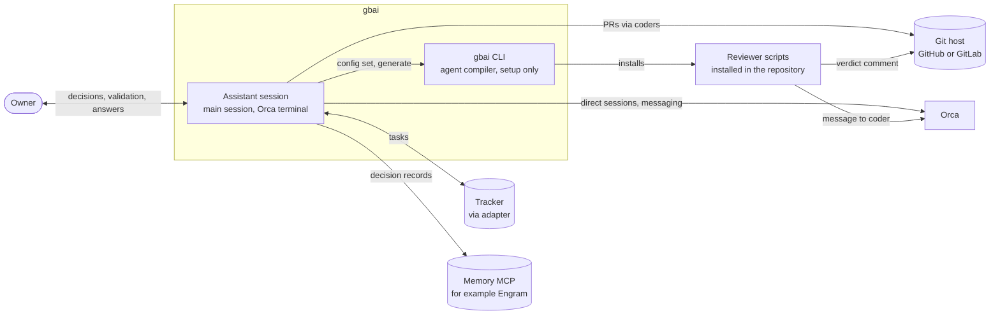
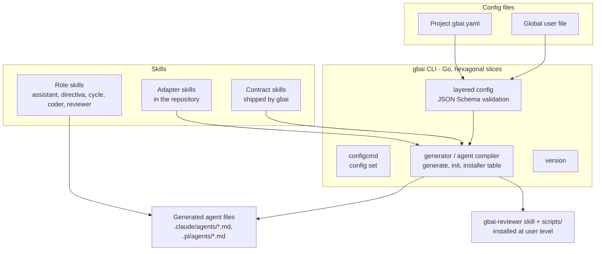
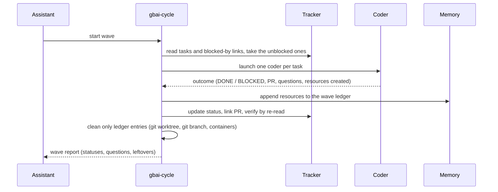
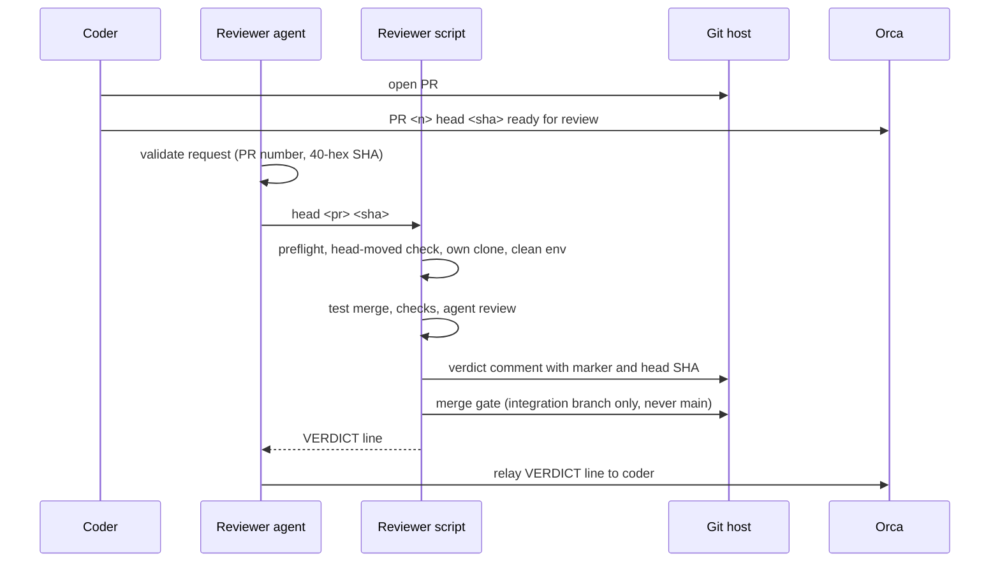
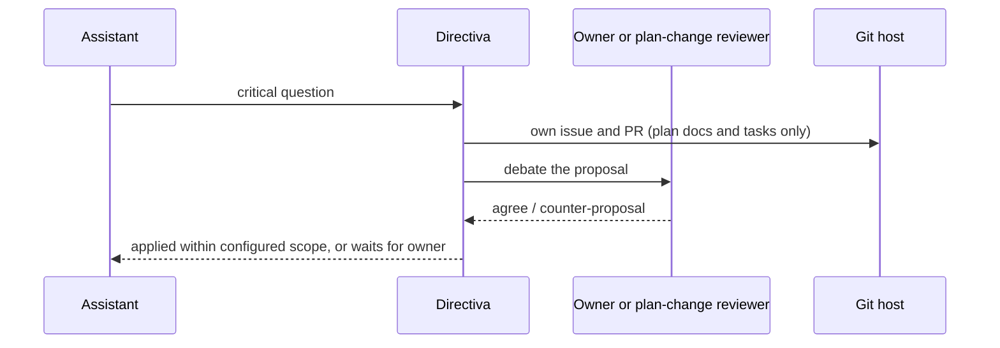

# Technical Requirements (TRD)

| field | value |
|---|---|
| status | Draft |
| owner | gbai-dev-lead |
| version | 0.7 |
| date | 2026-10-26 |
| linked docs | [PRD](PRD.md) (R1–R30), stories `docs/product/stories/` (US-001–US-011), [DB_SCHEMA](DB_SCHEMA.md), diagrams `docs/product/diagrams/` |

Every decision traces to PRD requirement ids.

## Auto-mode proposals (awaiting owner)

This version was completed by the dev-lead in auto mode. Each item is marked **Proposed (auto)** where it appears, with a one-line reason. Approved decisions D1–D14 keep their meaning and ids. The owner approves or rejects these in one pass.

| # | section | proposal |
|---|---|---|
| A1 | 9 Interfaces | Finalized: key names aligned to DB_SCHEMA, `agent_host` contract added, operating rules (9.5) added. |
| A2 | 9.2 Inter-agent payloads | Reviewer verdict marker carries the reviewed head SHA (R26). |
| A3 | 9.1 / 9.2 | Auto decisions are recorded with wave, task, question, choice and reason (R30). |
| A4 | 10 D15 | Per-wave resource ledger drives cleanup and auto-mode deletions (R13, R23). Accepted (owner 2026-10-26): the cycle keeps it in the memory slot through its skill; no CLI, no state dir. |
| A5 | 10 D16 | Traceability check is generic Go in the `plan` slice (R20). Accepted (owner 2026-10-26), then superseded by D19 (owner 2026-10-26): the check is a skill instruction. |
| A6 | 10 D17 | Wave resume recomputes from tracker state and memory traces (R25). Accepted (owner 2026-10-26): done by the cycle skill; no CLI, no state dir. |
| A7 | 8.4 Observability | Time to first wave measured from setup start to first wave start (R28). |
| A8 | 11 Testing strategy | Finalized: layers linked to the PRD verification column; R21–R30 mapped to tests and inspections. |
| A9 | 12 Risks and technical debt | Finalized: new risks plus technical debt TD1–TD7 from the current config and skills. |
| A10 | 10 Requirement coverage | Coverage table requirement → decisions, sections, stories, verification. |
| A11 | 8.1 Generation | Pi agents generated in `.pi/agents/`; targets read from `generation.targets`. |

**Owner decisions (2026-10-26).** Approved (owner 2026-10-26): the gbai Go CLI is only an agent compiler for the initial configuration (D18); the traceability check and the plan templates live in the skills (D19, supersedes D16); the reviewer runs on deterministic scripts the compiler installs into the repository (D20). Every Go command used during the work itself is removed; sections 2, 3, 4, 5, 6, 8, 9, 10, 11 and 12 are updated accordingly.

**Owner decisions (2026-10-26, second pass).** Approved (owner 2026-10-26): the read-only `gbai config [--json]` is removed (question 7); the reviewer scripts live in the `scripts/` folder of the `gbai-reviewer` skill, installed at user level and not in the repository (question 8, D20 amended); the setup TUI is removed and setup starts from a prompt pasted into Claude Code or Pi, after which `gbai generate` installs the per-runtime artifacts from one installer table (question 9, D21); agents write config by editing the YAML directly and validation runs at the next `gbai generate` (question 10, D18 amended); personalization has a stable layer and a learning layer (D22).

**Owner decisions (2026-10-26, third pass).** Approved (owner 2026-10-26): gbai recommends, but does not require, the gentle-ai stack (gentle-ai with ODD in the methodology slot, RDD as coder-side validation inside the methodology adapter, Engram in the memory slot); setup offers it as the recommended option and installs it only if the user accepts. Pi targets need a subagent package: gentle-pi with its `gentle-shell` launcher is recommended and setup offers to install it when missing; another subagent package is acceptable; `gbai generate` refuses Pi targets only when no subagent package is present. gbai never edits a subagent package's own configuration (D21 amended, question 11 resolved).

## 1. Introduction and quality goals

The TRD describes how gbai implements the PRD: a Go CLI that only compiles the initial configuration into runtime-native agents and installs per-runtime artifacts (D18, D21), plus contract, role and adapter skills for everything the agents do during the work, and deterministic reviewer scripts bundled in the user-level `gbai-reviewer` skill (D20).

PRD goals and the requirements that carry them:

| PRD goal | requirement ids |
|---|---|
| Protect the human's energy | R1, R4, R15, R17, R18 |
| Work never stalls | R3, R4, R10, R13 |
| Questions surface | R5, R6, R19 |
| A living plan | R2, R7, R19, R20 |
| Adapts to the team | R8, R9, R11, R12, R14, R16 |

Quality goals come from the PRD quality requirements: security (R21–R23), reliability (R24–R25), cost (R26–R27), time to value (R28) and observability (R29–R30). The first release sets no performance targets.

## 2. Constraints

- **Stack.** The gbai CLI is Go.
- **Code architecture.** Hexagonal DDD: ports and adapters per vertical feature slice. Each slice lives in `apps/cli/internal/slices/<name>/` with `domain` (pure rules), `usecase` (orchestration through ports) and `adapters` (filesystem, git, process and CLI entry points). Approved (owner 2026-10-26): the live slices are layered config, `configcmd` (`gbai config set` only, an owner convenience at configuration time; the read-only `gbai config` is removed, [question 7](#13-open-questions)), the generator (`gbai generate`, with `gbai init` as the first generate, including the per-runtime installer table, D21) and `version`. The existing `plan`, `review`, `status`, `mcp`, `sessions`, `audit`, `provision`, `secrets`, `repo`, `worktree` and `doctor` slices are retired (D18).
- **Go is an agent compiler only (D18, approved owner 2026-10-26).** Compiled Go keeps only the initial configuration: it validates the global user file and the project `gbai.yaml` (JSON Schema), compiles runtime-native agents, installs the per-runtime artifacts from one installer table (D21: skills, including the user-level `gbai-reviewer` skill with its scripts, the user's Markdown adapters, and the runtime's tool registrations), and recompiles after a key changes (edited in the YAML, or with `gbai config set <key> <value>`, then `gbai generate`). `gbai init` is the first generate; `gbai version` prints the version. Nothing in Go runs during the work itself.
- **Config writes (amended D18, owner 2026-10-26).** During setup and during the work, agents write preferences and config by editing the YAML files directly; JSON Schema validation runs at the next `gbai generate`. There is no single required writer: `gbai config set` is an owner convenience at configuration time only.
- **Setup entry (D21, owner 2026-10-26).** No setup TUI. The user pastes a setup prompt with a link from the gbai documentation into Claude Code or Pi; that agent installs gbai, runs the setup question burst, writes the config and runs `gbai generate`. Approved (owner 2026-10-26): setup offers the gentle-ai stack (ODD, RDD, Engram) as the recommended, not required, option and installs it only if the user accepts; when Pi is in `generation.targets`, it checks for a Pi subagent package and, if none is present, explains why one is needed and offers to install the recommended gentle-pi and `gentle-shell`.
- **Pi subagent package (D21, Approved (owner 2026-10-26)).** Pi core has no subagents; Pi targets need a subagent package that provides them. gentle-pi (which adds the `subagent_*` tools) is recommended; another package (for example `pi-subagents-j0k3r`) is acceptable. `gbai generate` refuses to compile Pi targets when no subagent package is present and prints what to install. gbai never edits a subagent package's own configuration (for example `subagents.json`); it only places its agents and skills.
- **No glue CLI for agent work (owner 2026-10-26).** gbai is skills, configuration and a simple CLI. Agents already have tools (tracker CLIs and MCPs, git, memory); the skills explain how to use them. Computing the next wave, keeping the resource ledger, cleaning up a wave and resuming a wave are done by the cycle agent through its skill, the `tasks` adapter and the `memory` slot, not by gbai commands. The same holds (owner 2026-10-26) for status, audit, direct sessions, provisioning, secrets, repository setup, worktree removal, planning documents and the traceability check: agents do them with their own tools (gh, git, Orca, Railway MCP) guided by skills and adapters.
- **Tool-specific parts are never compiled.** Tracker, memory, notifications, direct sessions, methodology, repository host and reviewer placement are skills or instructions local to the repository. See [Dynamic configuration](#81-dynamic-configuration).
- **Supported runtimes.** Claude Code and Pi (D3).
- **Nesting depth.** At most 3 below the assistant: assistant → cycle → coder → test runner.
- **Runtime inheritance.** Subagents inherit the main session runtime. Other engines (for example pi) apply only to separately launched processes such as the reviewer.
- **Reviewer runtime.** `runtimes.reviewer` has no default; the assistant asks the user (R12).
- **Direct sessions.** Orca only in the first release (R14).
- **Auto-mode limits.** As set in the PRD Constraints (D13).

## 3. Context and scope

C4 system context.



## 4. Solution strategy and building blocks

### 4.1 Solution strategy

- Native subagents for agent communication; Orca only for the reviewer and direct sessions (D1).
- Contract skills plus repository adapters for every tool-specific part; generic Go code only (D2, D4).
- Runtime-native agent files generated from configuration and committed (D3).
- Waves computed by the cycle skill from tracker dependencies read through the `tasks` adapter (D12); no Go wave command.
- An isolated reviewer as the mandatory merge gate (D6), run by deterministic scripts bundled in the `gbai-reviewer` skill and installed at user level by the compiler, out of reach of PR code; the reviewer agent only validates the request and invokes the script (D20).
- One Go installer table of what goes where per runtime (D21); setup starts from a prompt pasted into the user's agent, which offers the recommended (not required) gentle-ai stack and, for Pi targets, a subagent package (gentle-pi recommended).
- Go only compiles the initial configuration; every work-time operation is an agent using its own tools under a skill (D18).
- Plan changes in their own issue and PR, always debated (D7, D8).

### 4.2 Building blocks (C4 container view)



Approved (owner 2026-10-26): layered config, `configcmd` and the generator are the only live slices besides `version` (D18). The generator also installs, from its installer table (D21), the embedded skills, the user's adapters, the user-level `gbai-reviewer` skill with its scripts (D20) and each runtime's tool registrations. Plan templates live in the role skills (D19).

### 4.3 Agent topology

| agent | how it runs | talks through |
|---|---|---|
| Assistant | Main session: the single Orca terminal opened by default (R1, R18) | Native subagent returns; Orca messaging for reviewer and direct sessions |
| Directiva (pm, dev-lead, db-master, frontend) | Native subagents of the assistant (R2, R7) | Return to the assistant |
| gbai-cycle | Native subagent of the assistant; runs one wave (R3, R4) | Return to the assistant (wave report) |
| Coders | Native subagents of the cycle, one per wave task (R3, R10) | Return to the cycle (task outcome) |
| Reviewer | Generated reviewer agent that validates the request and invokes the script of the user-level `gbai-reviewer` skill; the script runs isolated with its own clone, home and cache (R9, D20) | PR comment + `VERDICT` line relayed to the coder through Orca |
| Plan-change reviewer | Fresh clean-context session that indexes the repository (R19) | Returns agree / counter-proposal |
| Direct session | Extra Orca terminal in the task worktree, opened only on the user's request (R14, R18) | Orca messaging |

```
Owner ─ Assistant (main session, Orca terminal)
          ├─ pm / dev-lead / db-master / frontend   (subagents)
          ├─ plan-change reviewer                   (fresh session)
          └─ gbai-cycle                             (subagent)
               └─ coder × N                         (subagents, one per task)
                    └─ test runner                  (subagent)
        Reviewer agent ── reviewer script ── PR comment + VERDICT ──> coder
```

## 5. Runtime view

User flows live in `docs/product/diagrams/`. Key internal sequences:

### 5.1 Wave run (R3, R4, R5, R10, R13)



### 5.2 Review (R9)



### 5.3 Plan change (R19)



## 6. Deployment view

- **First release.** Local: the assistant session, subagents and the reviewer run on the developer's machine.
- **Reviewer placement.** Configurable per repository: local, separate server, GitHub Actions, GitLab CI; first release local (D6). Approved (owner 2026-10-26): the local default is single-user mode (the owner's own account; the script's preflight refuses unless it runs from a clean checkout of the integration branch); the isolated two-user mode stays available through the `reviewer_placement` or `agent_host` adapter (D20). Placements beyond local are Later.
- **Cloud setup.** Running agents on a server is one more dynamic slot ("where the agents run") with its own adapter, like the reviewer placement. The existing cloud fields (Railway server, OS users, bot, Orca sessions) move out of the core config into that adapter. It is configured in a separate session with the assistant; the base config stays clean for local use.

## 7. Data

Config files and their schemas are detailed in [DB_SCHEMA.md](DB_SCHEMA.md); gbai has no database. High-level shapes are under [Configuration shapes](#93-configuration-shapes).

## 8. Crosscutting concepts

### 8.1 Dynamic configuration

Owner principle: tool-specific behavior is a skill or instruction local to the repository, configured by the user with their agent, never compiled code (R8, R11, R12).

#### Slots, contracts and adapters

- Each dynamic slot has a **contract** (the port), shipped by gbai as its own skill. It states WHAT the agent must be able to do, for example for tasks: create, read unblocked, claim, log progress, change status, link PR, verify by re-reading.
- Each slot is filled by an **adapter**: a Markdown skill or document in the repository that states HOW to perform every contract operation with the user's tool (for example gh CLI, Plane MCP).
- The repository config records the adapter per slot, for example:

```yaml
slots:
  tasks:
    adapter: .gbai/adapters/tasks-gh.md
```

#### Setup flow per slot

1. **Ask.** The assistant asks, for example, "How will we manage tasks and with what?" (R12: no silent defaults).
2. **Receive or co-write the adapter.** The user answers with a tool and a skill or document that explains it, or writes one with the assistant.
3. **Check coverage.** Verify the adapter covers every contract operation; ask the user about gaps.
4. **Test.** Run one harmless operation through a subagent of the same kind that will do the work. This proves that tools and instructions reach subagents.
5. **Record and generate.** Write the slot to the config by editing the YAML (or with `gbai config set`) and run the generator, which validates it (D18 amended).

#### Generation

After the questions, gbai (generic Go code, the agent compiler, D18) validates the configuration and generates runtime-native files locally:

- agent definitions for the runtimes listed in `generation.targets`, Claude Code (`.claude/agents/*.md`) and Pi (`.pi/agents/*.md`), including the reviewer agent, whose runtime (`runtimes.reviewer`) the owner chooses during setup. Proposed (auto): Pi location and target key per DB_SCHEMA. Reason: the owner resolved both in DB_SCHEMA open questions 5 and 9. Approved (owner 2026-10-26): Pi core has no subagents, so Pi agents need a subagent package; with gentle-pi, `.pi/agents/` is a verified project discovery path in both plain Pi and `gentle-shell` (section 9.6, question 11 resolved);
- each agent's tool list, including the tracker MCP tools (a `tools` list restricts an agent to those tools);
- adapter instructions embedded in each role agent's body;
- fixed-name skill links (for example `gbai-tasks`, `gbai-methodology`);
- the per-runtime artifacts listed in the installer table (D21): the embedded skills, the user's Markdown adapters, the runtime's tool registrations, and the `gbai-reviewer` skill with its `scripts/` folder, installed at user level and never into the repository (approved owner 2026-10-26, D18, D20).

Generated files are committed so PRs show agent changes. A config change requires regeneration: edit the key in the YAML (or `gbai config set <key> <value>`), then `gbai generate`, which validates it. `gbai init` is the first generate.

#### Layered configuration

| file | holds | precedence |
|---|---|---|
| Global user file | Personal preferences, the stable personalization layer: alias or name, tone, interaction level, language (R16, R17, D22) | Personal keys: global always wins |
| Project `gbai.yaml` | Team and repository settings: `slots`, `reviewer`, `runtimes`, `developers`, `mode`, `plan_change`, `generation`, `repo` | Project keys: local wins |

#### Loading cost

- Role agents receive their adapters natively through generation.
- MCP servers are registered once per runtime; CLIs are on `PATH`.
- Skills not loaded cost only their one-line description.

### 8.2 Reliability

Every task write is followed by a verifying re-read. This rule lives in the cycle skill and mitigates models that skip or misreport a step (R3, R10).

### 8.3 Security and isolation

- The reviewer uses its own clone, home and cache, never the coder's (R9, D6). Approved (owner 2026-10-26): the reviewer scripts run their checks and the agent review in a scrubbed environment; in single-user mode the preflight refuses unless the scripts run from a clean checkout of the integration branch, and the merge gate never merges into main (D20).
- Auto mode merges only into the assigned integration branch, never main, and deletes only resources created in this workflow (D13).
- Approved (owner 2026-10-26): the reviewer scripts live in the user-level `gbai-reviewer` skill, outside the repository, so code in a PR cannot modify the scripts that review it (D20).
- The reviewer marker is trust-based in single-user mode (see Risks).
- Secrets and credentials never enter agent context or generated files (R21); see also R22–R23.

### 8.4 Observability

- Wave reports carry statuses, verdicts, questions with answer and resolver, interaction counts and cleanup leftovers.
- Auto-mode decisions are recorded in the memory provider with their reason (R6).
- The current state is read from the tracker, the PRs and the memory slot by the assistant (no Go status command, D18).
- Every wave produces a report (interactions, decisions, questions, cleanup leftovers) and every auto decision is queryable (R29–R30). No further logging, metrics or tracing in the first release.
- Approved (owner 2026-10-26), D22: personalization observations are kept in the `memory` slot under the topic `user/preferences`; the assistant reads them at session start.
- Proposed (auto): the assistant records the setup start time in memory and the first wave report states the elapsed time to its start (R28, success metric 5). Reason: R28 had no technical measurement point.

## 9. Interfaces (proposed (auto), awaiting owner)

Proposed (auto). Reason: reviewed against PRD R1–R30, stories US-001–US-011 and DB_SCHEMA; key names follow DB_SCHEMA.

### 9.1 Slot contracts

Each contract is a gbai skill; each operation must be covered by the adapter. The slot name is the key under `slots.<name>.adapter`.

| slot | operations | requirement ids |
|---|---|---|
| `tasks` | create (with blocked-by / unblocks), read unblocked, read one, claim, log progress, change status (DONE / BLOCKED), link PR, verify by re-read | R2, R3, R10, R24 |
| `memory` | save decision (what, why, who, mode, wave, task), list decisions (filter by mode, wave, task), search, read one; save and read the per-wave resource ledger and wave traces (D15, D17); save and read preference observations under the fixed topic `user/preferences` in the global or project scope (D22). Recommended, not required (owner 2026-10-26): Engram | R6, R13, R17, R23, R25, R30 |
| `notifications` | notify owner, notify a developer by alias | R16 |
| `direct_sessions` | open session in a worktree with a brief, send message, read state, close | R14, R18 |
| `methodology` | instructions the coder loads as `gbai-methodology`; declares whether coder-side review (for example GGA, RDD) runs and how. Recommended, not required (owner 2026-10-26): gentle-ai ODD with RDD as the coder-side validation layer | R8, R9 |
| `repository_host` | open PR, comment on PR, read PR status and checks, merge into `repo.integration_branch`, delete branch | R9, R10, D13 |
| `reviewer_placement` | trigger a review run for a PR head (invoke the script of the user-level `gbai-reviewer` skill, D20), report where it ran and in which mode (single-user or isolated), return the verdict location and `VERDICT` line | R9, R26 |
| `agent_host` (cloud, optional) | start an agent session on the host, stop it, report where agents run; holds server ids, OS user, bot identity and session prompts. Configured in a separate assistant session | Deployment view |

**Recommended adapters (Approved (owner 2026-10-26)).** A recommendation is an option setup offers first and installs only if the user accepts; it is never a silent default (R12).

Proposed (auto): `agent_host` contract row and the `memory` filters. Reason: DB_SCHEMA defines the slot, and R30 needs decisions listable by wave and task.

### 9.2 Inter-agent payloads

- **Coder → cycle (outcome).** `status` (HANDED, DONE, BLOCKED), task id, PR link, summary, open questions, resources created (worktrees, branches, containers, test databases), reviewer fix rounds used. The cycle appends them to the wave ledger in the `memory` slot (D15).
- **Cycle → assistant (wave report).** Wave id; per task: status, PR, verdict; questions raised with answer and resolver (R5); interaction count and reasons (R29); unverified task writes (R24); cleanup leftovers (R13); plan-change proposals; the owner's comfort answer to apply next wave (R17).
- **Reviewer → PR.** One comment carrying the marker from `reviewer.signing`, the reviewed head SHA, the verdict (approve / changes requested / blocked) and per-check statuses (tests, build, lint, agent review). **Reviewer → coder.** Orca message relaying the script's final `VERDICT` line (PR, head SHA, verdict, merge result) and pointing to that comment (D20). Proposed (auto): the marker carries the head SHA and the reviewer skips a head that already has a verdict. Reason: makes R26 (one verdict per pushed head) checkable.
- **Plan-change proposal.** Trigger question, scope (task, group, global), affected task ids, proposed change, rationale, debater (owner or plan-change reviewer) and outcome (agreed, counter-proposal, waiting for owner); delivered as its own issue and PR touching only `docs/product` and tasks (D7).
- **Auto decision record.** What was decided, question, choice, reason, mode, wave, task, resolver; written through the `memory` slot (R6, R30).

### 9.3 Configuration shapes

High level only; field-level details are in [DB_SCHEMA.md](DB_SCHEMA.md).

- Global user file: `version`, `alias`, `interaction_level` (`low`, `balanced`, `high`), `tone`, `language` (the stable personalization layer, D22).
- Project `gbai.yaml`: `version`, `mode`, `slots.<name>.adapter` (including `slots.methodology` and the cloud slot `slots.agent_host`), `reviewer.{placement, signing}`, `runtimes.{coder, reviewer, assistant}` (`runtimes.reviewer` is the only reviewer runtime key), `plan_change.{scope, global_without_owner}`, `developers` (git email → alias), `generation.targets` (concrete list, for example `[claude, pi]`), `repo.{name, integration_branch}`, `review.*`, `parallelism`, `worktree.keep`.
- Cloud fields (Railway ids, OS user, bot, session prompts, `sessions.local_orca`, system layer) are not core keys; they live in the `agent_host` adapter.
- Required keys have no code default; a missing required key fails with "run setup" (R12).

### 9.4 Generator

- **Input.** Merged configuration (project + global), slot adapters, contract skills, role skills, `generation.targets`.
- **Validation.** Approved (owner 2026-10-26): every generate validates each layer against its JSON Schema and the merged result, and checks adapter coverage; this replaces the removed `gbai doctor` command and the removed read-only `gbai config` (D18). It is also where edits agents made to the YAML during the work are validated.
- **Installer table (D21).** One Go table maps each runtime in `generation.targets` and each artifact kind to its install location and method; generate writes or registers only what the table lists.
- **Pi prerequisite (D21, Approved (owner 2026-10-26)).** For a Pi target, generate first checks that a subagent package is present; if none is, it refuses to compile the Pi target, names the missing prerequisite and prints what to install (`npm i -g gentle-pi` for `gentle-shell`, or `pi install npm:gentle-pi`; another subagent package is acceptable). It detects the active Pi agent home (section 9.6) and never edits the subagent package's own configuration.
- **Output.** The embedded skills, the user's adapters and the runtime's tool registrations, per the installer table; the `gbai-reviewer` skill with its `scripts/` folder at user level, never in the repository (D20); runtime-native agent files in `.claude/agents/` (Claude Code) and `.pi/agents/` (Pi) with tool lists and embedded adapter instructions, fixed-name skill links (`gbai-tasks`, `gbai-methodology`, …), and a deterministic file list so a rerun with unchanged input produces no diff.
- **Never.** Secret values (R21); only env var names and references.

### 9.5 Operating rules

From PRD 8.1; enforced in the role skills.

| rule | where enforced | requirement ids |
|---|---|---|
| A mid-wave task change applies when the coder finishes its current round; the coder is not interrupted | Cycle skill: re-reads the task before the coder's next round | R3, R7 |
| During a plan-change debate only the affected task is BLOCKED; the rest of the wave continues | Cycle skill marks the task BLOCKED through the `tasks` slot; assistant tracks the proposal | R19 |
| At most 4 reviewer fix rounds per PR, then the task is BLOCKED and the question escalates to the assistant | Coder skill counts rounds; outcome carries the count | R9, R10 |

### 9.6 Installer table (D21)

Approved (owner 2026-10-26) for the table itself; each row's location was checked against the runtime's own documentation on 2026-10-26. A row marked **unverified** is an open item ([question 11](#13-open-questions)), not a fact, and T044 confirms it before implementing it. Approved (owner 2026-10-26): the Pi agent rows were verified against the installed gentle-pi 4.3.0 package docs, `docs/gentle-shell.md` lines 215–219 and `README.md` lines 480–522, read 2026-10-26. Team artifacts go to project scope and are committed; the `gbai-reviewer` skill goes to user scope only (D20). Secrets are never written: MCP entries carry env var names only (R21).

| runtime | artifact | scope | location or command | status and source |
|---|---|---|---|---|
| Claude Code | Skills (embedded gbai skills; adapters published as skills) | project | `.claude/skills/<name>/SKILL.md` (user scope: `~/.claude/skills/<name>/SKILL.md`) | verified, https://code.claude.com/docs/en/skills |
| Claude Code | `gbai-reviewer` skill with `scripts/` | user | `~/.claude/skills/gbai-reviewer/SKILL.md` plus `scripts/`; the skill references them as `${CLAUDE_SKILL_DIR}/scripts/...` | verified (bundled files supported), https://code.claude.com/docs/en/skills |
| Claude Code | Agents | project | `.claude/agents/*.md` (user scope: `~/.claude/agents/`) | verified, https://code.claude.com/docs/en/sub-agents |
| Claude Code | MCP servers | project | `.mcp.json` at the repository root (approved once per user); user and local scopes live in `~/.claude.json`, written by `claude mcp add --scope user\|local` | verified, https://code.claude.com/docs/en/mcp |
| Claude Code | Plugins | user | `claude plugin marketplace add <source>`, then `claude plugin install <name>@<marketplace>`; stored under `~/.claude/plugins`; enabled through `enabledPlugins` in settings | verified, https://code.claude.com/docs/en/plugin-marketplaces |
| Pi | Skills (Agent Skills format) | project | `.pi/skills/` (also `.agents/skills/`); user scope is the active Pi agent home's `skills/` (plain Pi `~/.pi/agent/skills/`, `gentle-shell` `~/.gentle-shell/agent/skills/`; also `~/.agents/skills/`) | verified, https://github.com/earendil-works/pi/blob/main/packages/coding-agent/docs/skills.md |
| Pi | `gbai-reviewer` skill with `scripts/` | user | `<pi-agent-home>/skills/gbai-reviewer/` with `scripts/` (Pi skills may bundle scripts, references and assets). The installer detects the active home: `GENTLE_PI_AGENT_HOME`, then `PI_CODING_AGENT_DIR`, then plain Pi `~/.pi/agent`; standalone `gentle-shell` runs in `~/.gentle-shell/agent`, while `gentle-shell --link` reuses `~/.pi/agent` | verified, same source; home detection: installed gentle-pi 4.3.0 package docs, `docs/gentle-shell.md` lines 215–219 and `README.md` lines 480–522, read 2026-10-26 |
| Pi | Subagent package (prerequisite) | user | Pi core has no subagents. Recommended: gentle-pi, which adds the `subagent_*` tools and replaces `pi-subagents-j0k3r`; `npm i -g gentle-pi` provides the `gentle-shell` launcher (own home `~/.gentle-shell/agent`, settings `~/.gentle-shell/gentle-ai`; `--link` reuses `~/.pi/agent`), or `pi install npm:gentle-pi` installs it inside plain Pi; requires Pi >= 1.2.0 and Node >= 22.19.0. Another subagent package is acceptable. Setup installs it after the user accepts; `gbai generate` never installs it, refuses Pi targets without one and never edits its configuration | verified, installed gentle-pi 4.3.0 package docs, `docs/gentle-shell.md` lines 215–219 and `README.md` lines 480–522, read 2026-10-26; core: https://github.com/earendil-works/pi/blob/main/packages/coding-agent/README.md |
| Pi | Agents | project | `.pi/agents/*.md`. With gentle-pi, agents are discovered in `<cwd>/.pi/agents/`, `<cwd>/.pi/subagents/`, `~/.pi/agent/agents/` and `~/.pi/agent/subagents/` (project beats global, `subagents/` beats `agents/`), plus `subagents.json` at global and project level, which gbai does not edit. The project path works in both plain Pi and `gentle-shell`. With another subagent package, T044 confirms its project discovery path before adding a row | verified (gentle-pi), installed gentle-pi 4.3.0 package docs, `docs/gentle-shell.md` lines 215–219 and `README.md` lines 480–522, read 2026-10-26 |
| Pi | MCP servers | project | `.pi/mcp.json` (read only after project trust), written by `pi mcp add -l`; user scope `~/.pi/agent/mcp.json` | verified, https://github.com/earendil-works/pi/blob/main/packages/coding-agent/docs/mcp.md |
| Pi | Packages and extensions | project | `pi install <npm:\|git:\|url\|path> --local` records the package in `.pi/settings.json` (user scope: `~/.pi/agent/settings.json`, npm packages under `~/.pi/agent/npm/`); single extensions also load from `~/.pi/agent/extensions/*.ts`; where git packages are cloned is **unverified** | verified except git clone path, https://github.com/earendil-works/pi/blob/main/packages/coding-agent/docs/packages.md |

Proposed (auto): files (skills, agents, MCP config) are written by the generator; registrations that have their own runtime command (plugins, Pi packages) are performed by invoking that command, so gbai never edits a runtime's private state files. Reason: the runtime commands are the documented interface; private files may change between releases.

## 10. Architecture decisions

All decisions are MADR-style. D1–D14: accepted. D15–D17: accepted (owner 2026-10-26); D16 superseded by D19. D18–D22: approved (owner 2026-10-26).

| id | decision | options considered | choice | consequences | status | requirement ids |
|---|---|---|---|---|---|---|
| D1 | Agent communication | Orca messaging between all sessions; native subagents | Native subagents; Orca only for the reviewer and direct sessions | Nesting depth limited to 3 below the assistant | accepted | R1, R4, R18 |
| D2 | Dynamic parts | Compiled provider adapters; contract + adapter skills | Contract skill + adapter skill, linked under fixed names and embedded via generation | Switching tool means changing the adapter and regenerating | accepted | R8, R11, R12 |
| D3 | Agent files | Hand-written per runtime; generated and ignored; generated and committed | Runtime-native generation of agent files, committed; the user chooses the targets: both supported runtimes (Claude Code and Pi) or only the one in use | PRs show agent changes; a config change requires regeneration | accepted | R8, R11, R12 |
| D4 | Task operations | Compiled tracker adapters; dynamic adapter skill | Dynamic adapter skill (gh CLI, Plane MCP, …); no compiled tracker adapters; every write verified by re-read | Adapter coverage must be checked at setup | accepted | R3, R10, R11 |
| D5 | Decision memory | Files in repo; memory provider via MCP | Memory provider via MCP (for example Engram), as a dynamic slot | — | accepted | R6, R17 |
| D6 | Reviewer | One script per placement; one script with placement adapters | One script with placement adapters (local, server, GitHub Actions, GitLab CI; configured per repo; first release local), always own clone, home and cache. Two layers: coder-side optional (GGA, gentle-ai RDD) and reviewer-side mandatory merge gate (tests, build, lint + independent agent review). Verdict commented on the PR and returned to the coder | Reviewer runs once per PR update | accepted | R9 |
| D7 | Plan changes | Plan edits inside code PRs; separate plan PRs | Config defines changeable scope (one task, task group, global) and a boolean for global changes without the owner. Each change in its own branch, issue and PR touching only `docs/product` and tasks; git history explains what and why. Approval scale: one task applies automatically once the plan-change reviewer agrees; a task group applies automatically only if the config enables it, otherwise it waits for the owner; the global plan waits for the owner unless the global boolean is on, and still needs the plan-change reviewer's agreement. A change the plan-change reviewer rejects never applies automatically; it goes to the owner | Plan changes never travel with code changes | accepted | R19 |
| D8 | Plan-change reviewer | No debate in owner absence; same-session self-review; fresh session | Every plan change is debated: with the owner if present, else with a fresh clean-context session that indexes the repo and must agree or propose a different improvement. A dedicated skill defines its behavior | Added cost, limited to plan changes | accepted | R19 |
| D9 | Direct session | Any terminal manager; Orca | The assistant opens it with the Orca CLI in the task worktree with a context brief; first release Orca only | Other terminal managers are Later | accepted | R14 |
| D10 | Identity | Ask every session; catalog | Git email as catalog key → alias; the assistant asks once if missing | — | accepted | R16 |
| D11 | Personal preferences | Project file; global user file | Name, tone and interaction level in the global user config (the stable layer of D22) | — | accepted | R17 |
| D12 | Waves | Manual wave lists; computed | Computed from tracker dependencies (blocked by / unblocks); a wave is the set of tasks whose dependencies are done | Wave computation must handle cycles and dangling ids | accepted | R2, R3 |
| D13 | Auto-mode limits | Unrestricted; bounded | Merge only into the assigned integration branch, never main; delete only resources created by the assistant or its subagents in this workflow | — | accepted | R15, R19, PRD Auto-mode limits |
| D14 | Planning document conventions | Adopt an existing tool (BMAD, Task Master); invent our own format; own templates built on open conventions | Own templates and fixed questions built on open conventions: PRD on ISO/IEC/IEEE 29148 (header, evidence, appetite, assumptions and dependencies, quality requirements, constraints, glossary; requirements as `id \| type \| EARS requirement \| acceptance \| priority \| stories \| verification`); user stories on INVEST with Given-When-Then; TRD on arc42 with C4 diagrams and MADR-style decisions (consequences, status); plan tasks in `T###` notation with `[P]` and story links. Traceability chain: story → requirement → decision → task → test | Traceability chain story → requirement → decision → task → test | accepted | R2, R20 |
| D15 | Resource ownership for cleanup and deletion | Clean by naming convention; per-wave ledger | Per-wave resource ledger kept by the cycle skill in the `memory` slot (for example Engram): every worktree, branch, container or test database a subagent creates is reported in its outcome and appended by the cycle; at wave close the cycle cleans only ledger entries with ordinary git worktree, git and container commands per its skill (amended by D18: `gbai worktree close` is removed); auto mode deletes only ledger entries; anything not removed is a leftover in the report. No CLI command and no state dir. Reason: R13 and R23 need a record of what the workflow created, and agents already have the tools | Resources created outside the ledger are never deleted, only reported | accepted (owner 2026-10-26) | R13, R23 |
| D16 | Traceability check | Agent-only review; generic Go check | Generic Go check in the `plan` slice over the `docs/product` tables (stories, requirements, decisions, plan tasks with `depends_on`); fails on a story without requirement, a requirement without decision, task or verification, a task without story, or a dependency cycle; the assistant runs it before each next planning step. Reason: R20 needs a deterministic block, and the inputs are gbai's own templates; it also prevents dependency loops | Templates must keep stable table columns | superseded by D19 (owner 2026-10-26) | R2, R20 |
| D17 | Wave resume | Restart the wave; resume from traces | The cycle skill recomputes the wave from tracker state (through the `tasks` adapter) plus the memory ledger and traces, skips DONE tasks, re-attaches open PRs and worktrees and continues. No CLI command and no state dir. Reason: R25 had no technical mechanism | Depends on verified task writes (D4) and the ledger (D15) | accepted (owner 2026-10-26) | R14, R25 |
| D18 | Scope of the Go CLI | Go CLI for setup and work-time operations (status, audit, sessions, provision, secrets, repo setup, worktree close, MCP server, doctor, plan, review); Go CLI as an agent compiler only | Agent compiler only: validate config (global user file + `gbai.yaml`, JSON Schema), compile runtime-native agents into `.claude/agents/` and `.pi/agents/`, install the per-runtime artifacts (D21: embedded skills, the user's Markdown adapters, the user-level `gbai-reviewer` skill with its scripts, tool registrations); change a key and recompile with `gbai generate`; `gbai init` is the first generate; plus `gbai version` and `gbai config set`. Amended (owner 2026-10-26): the read-only `gbai config [--json]` is removed (question 7); agents write preferences and config by editing the YAML directly, during setup and during the work, and JSON Schema validation runs at the next `gbai generate`; `gbai config set` is an owner convenience at configuration time only, not a required writer (question 10). Every removed command's job is done by agents with their own tools (gh, git, Orca, Railway MCP) guided by skills and adapters; `doctor` validation folds into generate. Reason: agents already have the tools; Go keeps only what must be deterministic before the work starts | Existing slices are retired; skills carry the operating instructions | approved (owner 2026-10-26) | R8, R11, R12, R21 |
| D19 | Traceability check and plan templates | Generic Go check (D16); skill instruction | Supersedes D16. The plan templates and their fixed questions live in the directiva skills; the traceability check (story without requirement; requirement without decision, task or verification; task without story; dependency cycle, dangling id or `depends_on` / `unblocks` mismatch) is an instruction in those skills that the agent runs before each next planning step and that blocks the step on a gap. Reason: D18 removes `gbai plan`; the inputs stay gbai's own templates | The check is no longer deterministic Go; templates must keep stable table columns so the agent can read them | approved (owner 2026-10-26) | R2, R20 |
| D20 | Reviewer execution | Go reviewer runner (the now removed `gbai review run`); deterministic scripts installed into the repository (proposed `.gbai/reviewer/`); deterministic scripts bundled in a user-level skill | Amended (owner 2026-10-26, question 8): the scripts live in the `scripts/` folder of the `gbai-reviewer` skill, which the compiler installs at user level for the reviewer's runtime (D21), not in the repository, so PR code cannot modify the scripts that review it. The scripts follow the vulcam pr-reviewer pattern: head-moved check, test merge of the PR into the integration branch, checks, agent review, verdict comment with marker and head SHA, merge gate (integration branch only, never main), all in a clean environment, ending with one `VERDICT` line. The generated reviewer agent only validates the request (PR number, 40-hex SHA) and invokes the script, then relays the `VERDICT` line. Local default is single-user mode: the owner's own account, preflight refuses unless the scripts run from a clean checkout of the integration branch; isolated two-user mode stays available through the `reviewer_placement` or `agent_host` adapter. The Go review slice is retired | The marker is trust-based in single-user mode; the scripts need their own tests; the user-level copy is not versioned with the repository, so `gbai generate` reinstalls it from the embedded skill and reports a differing copy | approved (owner 2026-10-26) | R9, R22, R26 |
| D21 | Setup entry and per-runtime installation | Setup TUI in Go (former M4); setup by the user's agent from a pasted prompt, with a Go installer table | Approved (owner 2026-10-26): no TUI. The gbai documentation publishes a setup prompt with a link; the user pastes it into Claude Code or Pi, and that agent installs gbai, runs the setup question burst, writes the config and runs `gbai generate`. `gbai generate` installs the per-runtime artifacts for each runtime in `generation.targets` from one Go table of what goes where (Claude Code: skills, agents, MCP servers, plugins; Pi: skills, agents, MCP servers, packages and extensions), section 9.6. Amended (Approved (owner 2026-10-26)): setup recommends, but does not require, the gentle-ai stack (ODD in the methodology slot, RDD as coder-side validation inside the methodology adapter, Engram in the memory slot) and installs it only if the user accepts. Pi targets require a subagent package as a prerequisite: when Pi is in `generation.targets`, setup checks whether gentle-pi and `gentle-shell` are installed and, if no subagent package is present, explains why and offers to install them; another subagent package is acceptable. `gbai generate` refuses to compile Pi targets when no subagent package is present and prints what to install. gbai never edits gentle-pi's own configuration; it only places its agents and skills | Adding a runtime or artifact kind means adding table rows; rows must be checked against the runtime docs, and unverified rows stay open items | approved (owner 2026-10-26) | R8, R12, R28 |
| D22 | Personalization layers | Preferences only in the global file; only in memory; two layers | Approved (owner 2026-10-26): a stable layer in the global user file (alias or name, `language`, `tone`, `interaction_level`), read by every compiled agent; a learning layer of observations in the `memory` slot (Engram or claude-mem, per adapter) under the fixed topic `user/preferences`, read by the assistant at session start. An observation repeated about 3 times is proposed for the stable layer: the assistant asks in manual mode, and in auto mode applies it and records the decision in memory. The wave-close comfort answer adjusts `interaction_level` and `tone`. Personal observations use the global memory scope, project ones the project scope. Secrets and sensitive data are never stored | The memory contract gains a preferences topic; the stable layer is edited directly and validated at the next `gbai generate` (D18 amended) | approved (owner 2026-10-26) | R16, R17, R21 |

### Requirement coverage

Proposed (auto). Reason: traceability pass; every requirement maps to a decision or section, a story where one exists, and the test layer (section 11) for its PRD verification method.

| req | decisions | sections | stories | verification → test layer |
|---|---|---|---|---|
| R1 | D1 | 4.3 | US-009 | demo → end-to-end session check |
| R2 | D12, D14, D19 | 4.1, 9.1 | US-002 | test, inspection → skill review (traceability instruction, dependency loops), document review |
| R3 | D4, D12 | 5.1, 8.2, 9.5 | US-002 | test → integration (fake tracker) |
| R4 | D1 | 5.1, 9.2 | US-003 | demo → end-to-end mini wave |
| R5 | — | 5.1, 9.2 | US-003, US-004 | test → integration (wave report) |
| R6 | D5 | 8.4, 9.2 | US-004 | test → integration (fake memory) |
| R7 | — | 4.3, 9.5 | US-006 | test → integration (task identity preserved) |
| R8 | D2, D3, D18, D21 | 8.1, 9.1 | US-001, US-007 | test, inspection → unit (generator golden), coverage check |
| R9 | D6, D20 | 5.2, 8.3, 9.2, 9.5 | US-008 | test, inspection → reviewer script tests, skill review |
| R10 | D4 | 5.1, 9.1 | US-008 | test → integration (status and PR link) |
| R11 | D2, D4, D18 | 8.1, 9.1 | US-007 | test, inspection → contract coverage check |
| R12 | D2, D18, D21 | 8.1, 9.3 | US-001 | demo → setup walkthrough from the pasted prompt; unit (no defaults, TD2) |
| R13 | D15 | 5.1, 9.2 | US-010 | test → skill-level check in the end-to-end mini wave (ledger cleanup) |
| R14 | D9, D17 | 4.3 | US-005 | demo → direct-session walkthrough |
| R15 | D13 | 8.3 | US-003 | test, demo → integration (no prompt in auto), end-to-end |
| R16 | D10, D22 | 9.3 | US-001 | test → unit (catalog lookup) |
| R17 | D11, D22 | 8.4, 9.1, 9.2, 9.3 | US-004 | test, demo → unit (precedence), end-to-end |
| R18 | D1, D9 | 4.3 | US-005 | demo → end-to-end session check |
| R19 | D7, D8, D13 | 5.3, 9.2, 9.5 | US-006 | test, inspection → integration (approval scale), skill review |
| R20 | D14, D19 | 4.1 | US-002 | test, inspection → skill review (traceability instruction), template review |
| R21 | D18 | 8.3, 9.4 | — | inspection, test → generated-file secret scan |
| R22 | D6, D20 | 8.3 | US-008 | test, inspection → reviewer script tests (separate clone, home, cache, clean env) |
| R23 | D13, D15 | 8.3 | US-010 | test → skill-level check in the end-to-end mini wave (deletion outside ledger refused) |
| R24 | D4 | 8.2, 9.1 | — | test → integration (re-read; unverified write reported) |
| R25 | D17 | 9.1 | US-011 | test, demo → skill-level check in the end-to-end mini wave (resume skips DONE) |
| R26 | D6, D20 | 9.2 | — | test → reviewer script tests (same head reviewed once) |
| R27 | D8 | 5.3 | US-006 | test, inspection → integration (session count = proposals) |
| R28 | D21 | 8.4 | — | demo → measured in first wave report |
| R29 | — | 8.4, 9.2 | — | test, inspection → skill-level check in the end-to-end mini wave (report fields), skill review |
| R30 | D5 | 8.4, 9.1, 9.2 | US-004 | test → integration (list auto decisions) |

R5, R7 and R29 are covered by sections only, not by a dedicated decision; they need none beyond the approved ones.

## 11. Testing strategy (proposed (auto), awaiting owner)

Proposed (auto). Reason: layers linked to the PRD verification column and to quality requirements R21–R30.

- **Unit (Go, per slice domain).** Config: personal vs project precedence, strict keys, a local-only config without cloud keys loads, missing required keys fail with "run setup" and no silent default is applied (R12); JSON Schema and Go validation accept and reject the same fixtures; generator output against golden files per runtime, driven by the installer table (D21): agents, installed skills, adapters, tool registrations and the user-level `gbai-reviewer` skill with its scripts (D18, D20), written into a temporary home and project in tests.
- **Integration (skill-level).** Approved (owner 2026-10-26): wave work is agent behavior guided by skills, not Go use cases (D18), so these checks run the role agents against fake adapters: a scripted fake tracker for wave start, status update, PR link and re-read verification; a fake memory for decision records; operating rules (change applied after the current round, only the affected task BLOCKED, BLOCKED after 4 fix rounds).
- **Reviewer script tests (D20).** Shell tests against fake `gh` and `git`: preflight refusals (dirty checkout, wrong branch, wrong login), head-moved skip, one verdict per head, verdict comment with marker and head SHA, merge gate never targets main, clean environment, final `VERDICT` line.
- **Traceability (D19).** Skill review of the directiva skills; the check is exercised when the plan documents are written and reviewed (dependency cycles, dangling ids, `depends_on` / `unblocks` mismatches).
- **Contract coverage check.** An automated check, part of the agent compiler, that an adapter document addresses every operation of its contract; runs inside `gbai generate` during setup and in CI through `gbai generate --check` on adapter changes.
- **Setup prompt walkthrough (D21).** Demo: the documented setup prompt pasted into Claude Code and into Pi installs gbai, asks the setup questions, writes the config and runs `gbai generate` without manual steps.
- **Subagent smoke test.** The setup step that runs a harmless operation through a subagent of the working kind is kept as a repeatable step of the `gbai-setup` skill, run by the assistant (no gbai command, D18).
- **End-to-end.** One mini wave in a sample repository: two dependent tasks, coders, reviewer verdict, tracker updates, cleanup and wave report; repeated with an interruption to prove resume.
- **Skill-level checks (D15, D17).** The ledger, cleanup and resume are cycle-skill behavior, not Go code, so they have no Go unit tests; they are checked inside the end-to-end mini wave: the memory ledger lists every created resource, only ledger entries are cleaned, a resource outside the ledger is reported and not deleted, and an interrupted wave resumes without reworking DONE tasks.
- **gbai's own PRs.** The reviewer scripts run `go test ./...`, build, lint, the reviewer script tests, config schema validation and the generator no-diff check as the mandatory merge gate.

**PRD verification column.** "test" maps to unit, integration or end-to-end tests; "inspection" to the contract coverage check and document or skill review; "demo" to the end-to-end mini wave, the setup walkthrough and the subagent smoke test. Per-requirement mapping: [Requirement coverage](#requirement-coverage).

**Quality requirements.**

| req | check |
|---|---|
| R21 | Test: scan generated agent files, plan documents and reports for secret patterns; inspection: config holds only env var names |
| R22 | Test: the reviewer script uses a clone, home and cache distinct from the coder's worktree and a scrubbed environment; inspection of the reviewer skill |
| R23 | Skill-level check in the end-to-end mini wave: a resource outside the ledger is not deleted and is reported |
| R24 | Test: a fake tracker that drops a write makes the wave report list it as unverified |
| R25 | Skill-level check in the end-to-end mini wave, plus demo: an interrupted wave resumes without reworking DONE tasks |
| R26 | Test: a second run on the same head SHA produces no second verdict |
| R27 | Test: plan-change reviewer sessions equal proposals debated without the owner; inspection of the skill |
| R28 | Demo: first wave report states time from setup start |
| R29 | Test: wave report contains interactions with reasons, decisions, questions with resolver and leftovers |
| R30 | Test: listing auto decisions returns reason, wave and task for each |

## 12. Risks and technical debt (proposed (auto), awaiting owner)

Proposed (auto). Reason: risks extended for D15–D17 and operating rules; technical debt recorded from the current code on `feat/gbai-single-user-reviewer`.

| risk | mitigation |
|---|---|
| Model skips or misreports a step | Verifying re-read after every task write; contract checklist in each role skill |
| Incomplete adapters | Coverage check at setup; the assistant asks for gaps; subagent smoke test |
| Nesting-depth limit (assistant → cycle → coder → test runner) | Keep the topology flat beyond depth 3; the reviewer runs as a separate process |
| Runtime differences between the Claude Code and Pi agent formats | Per-runtime generator output with golden tests; Pi agents need a subagent package; the gentle-pi discovery paths are verified (9.6, question 11 resolved) and `gbai generate` refuses Pi targets without a subagent package |
| Reviewer and plan-change reviewer cost | Plan-change reviewer only for plan changes (R27); one verdict per head SHA (R26); at most 4 fix rounds |
| Generated files drift from config | Regenerate on every config change; generator no-diff check in the PR |
| Trust-based reviewer marker in single-user mode | Document the limit; recommend a separate reviewer identity or `reviewer.signing` where available |
| Traceability check is a skill instruction, not deterministic code (D19) | Stable template columns; the directiva skills run it before each next planning step; the reviewer agent and plan review read the tables |
| Reviewer scripts drift from the generated reviewer agent (D20) | The compiler installs both from one source; generator no-diff check; reviewer script tests |
| The user-level `gbai-reviewer` skill differs between machines or from the gbai version in use (D20) | `gbai generate` reinstalls it from the embedded skill and reports a differing copy; the verdict comment states the gbai version |
| An agent writes an invalid YAML value during the work (D18 amended) | Validation at the next `gbai generate` (no Go runs during the work), which names the key, file and next step; agents change only keys their skill names and say that the change is validated at the next generate |
| User-level Pi paths depend on the active agent home (plain Pi `~/.pi/agent` versus `gentle-shell` `~/.gentle-shell/agent`), so the user-level `gbai-reviewer` skill can land in a home the user does not run (D21) | T044 detects the active home (`GENTLE_PI_AGENT_HOME`, `PI_CODING_AGENT_DIR`, then `~/.pi/agent`, plus `gentle-shell`), golden tests per home; team artifacts stay in the project `.pi/agents/` and `.pi/skills/`, which work in both |
| When the user adopts the recommended gentle-ai stack, gentle-ai (and gentle-pi on Pi) ships its own ODD workflow and native review, which may overlap with the gbai cycle and reviewer (owner 2026-10-26: to verify, not decided) | Intended split: RDD is the coder-side validation layer configured in the methodology slot, and the gbai reviewer stays the PR-side merge gate (two validation layers, PRD R9). To verify in the end-to-end mini wave: no duplicated orchestration, no second merge decision, and gentle-ai's own workflow does not replace the gbai cycle |
| Runtime install locations change between Claude Code or Pi releases (D21) | One installer table, golden tests per runtime, unverified rows marked as open items until confirmed against the runtime docs |
| The learning layer stores something sensitive (D22) | The assistant skill forbids secrets and sensitive data in `user/preferences`; observations are short behavioral notes only (R21) |
| Resource created outside the ledger is never cleaned | Every subagent outcome lists created resources and the cycle appends them to the memory ledger; leftovers appear in the wave report (D15) |
| Memory ledger missing or incomplete (memory provider unavailable) | Cleanup deletes only ledger entries, so a missing entry leaves a leftover, never a wrong deletion; resume falls back to tracker state and open PRs (D17) |
| A plan-change debate waiting for the owner blocks a task indefinitely | Only the affected task is BLOCKED; the wave report lists pending proposals each wave |

**Technical debt** (current code and skills versus the approved design):

| id | debt | conflicts with | fix direction |
|---|---|---|---|
| TD1 | Config validation requires `server.railway.{project_id, environment_id, service_id}`, so a local-only config fails to load | Deployment view, DB_SCHEMA migration step 2 | Make cloud keys optional, then move them to the `agent_host` adapter |
| TD2 | `applyDefaults` silently sets `runtimes.reviewer: pi` and `repo.integration_branch: dev` (and other defaults) | R12 | Required keys fail with "run setup"; defaults become suggestions (DB_SCHEMA migration step 5) |
| TD3 | Cloud fields (`server.*`, `users.*`, `bot.*`, `sessions.*`) and the system layer `/etc/gbai/gbai.yaml` are still in the core config | D2, Deployment view | DB_SCHEMA migration step 4 |
| TD4 | Plan templates in `apps/cli/internal/slices/plan/templates/` lack the new sections (evidence, appetite, quality requirements, MADR fields, coverage) and the fixed questions | R20, D14, D19 | Move the templates into the directiva skills, add the new sections and fixed questions; D19 depends on stable table columns |
| TD5 | The `gbai-coder` skill hardcodes ODD test-first instead of loading `gbai-methodology` | R8, D2 | The coder skill only instructs loading the methodology slot |
| TD6 | Resolved 2026-10-26: stories US-001 and US-007 referenced the legacy `coder.methodology` key and now use `slots.methodology.adapter` | R8 (updated 2026-10-26), DB_SCHEMA open question 2 | PM updates both stories to `slots.methodology.adapter` |
| TD7 | Go slices for work-time commands still exist (`status`, `audit`, `sessions`, `provision`, `secrets`, `repo`, `worktree`, `mcp`, `doctor`, `plan`, `review`), the read-only `gbai config` output exists, and `gbai init` registers the gbai MCP server | D18, D20 | Retire them; `init` becomes the first generate; the review slice is retired once the installed reviewer scripts are in use |

## 13. Open questions

1. Resolved: the adapter replaces the provider manifest. Detection is done by the assistant while asking; the gbai program keeps only generic code, including the agent builder that generates runtime-native agent files.
2. Resolved: cloud setup is a dynamic slot with its own adapter, configured in a separate session with the assistant (see Deployment view).
3. Resolved: answered by the PRD operating rules (a mid-wave task change applies after the coder's current round; only the affected task blocks during a plan-change debate; at most 4 reviewer fix rounds, then BLOCKED and escalated).
4. Resolved: quality goals map to PRD R21–R30 (see section 1).
5. Resolved: security per PRD R21–R23 (see Crosscutting concepts).
6. Resolved: observability per PRD R29–R30 (see Crosscutting concepts).
7. Resolved (owner 2026-10-26): the read-only `gbai config [--json]` is removed; the assistant reads the effective configuration from the files and `gbai generate` reports schema and coverage errors (D18; PRD open question 7).
8. Resolved (owner 2026-10-26): the reviewer scripts live in the `scripts/` folder of the `gbai-reviewer` skill, installed at user level, not in the repository, so PR code cannot modify them; `.gbai/reviewer/` is dropped (D20; PRD open question 8).
9. Resolved (owner 2026-10-26): the setup TUI is removed with milestone M4; setup starts from a prompt pasted into Claude Code or Pi, and `gbai generate` installs per-runtime artifacts from an installer table (D21; PRD open question 9).
10. Resolved (owner 2026-10-26): agents write preferences and config, including a learned catalog alias (R16) or the comfort answer (R17), by editing the YAML directly; JSON Schema validation runs at the next `gbai generate`; `gbai config set` is an owner convenience at configuration time only (D18 amended; Implementation plan A5 superseded).
11. Resolved (owner 2026-10-26) for Pi agents: Pi core has no subagents; gentle-pi adds them, discovers agents in `<cwd>/.pi/agents/`, `<cwd>/.pi/subagents/`, `~/.pi/agent/agents/` and `~/.pi/agent/subagents/` (project beats global, `subagents/` beats `agents/`) plus `subagents.json`, and ships the `gentle-shell` launcher with its own home `~/.gentle-shell/agent` (installed gentle-pi 4.3.0 package docs, `docs/gentle-shell.md` lines 215–219 and `README.md` lines 480–522, read 2026-10-26). gentle-pi is the recommended subagent package and setup offers to install it; another package is acceptable; `gbai generate` refuses Pi targets without one; user-level paths follow the active Pi agent home, which T044 detects (section 9.6, D21). Still open (verification): where `pi install` clones git packages; T044 confirms it before implementing that row.

## 14. Glossary

See [PRD glossary](PRD.md#14-glossary).
