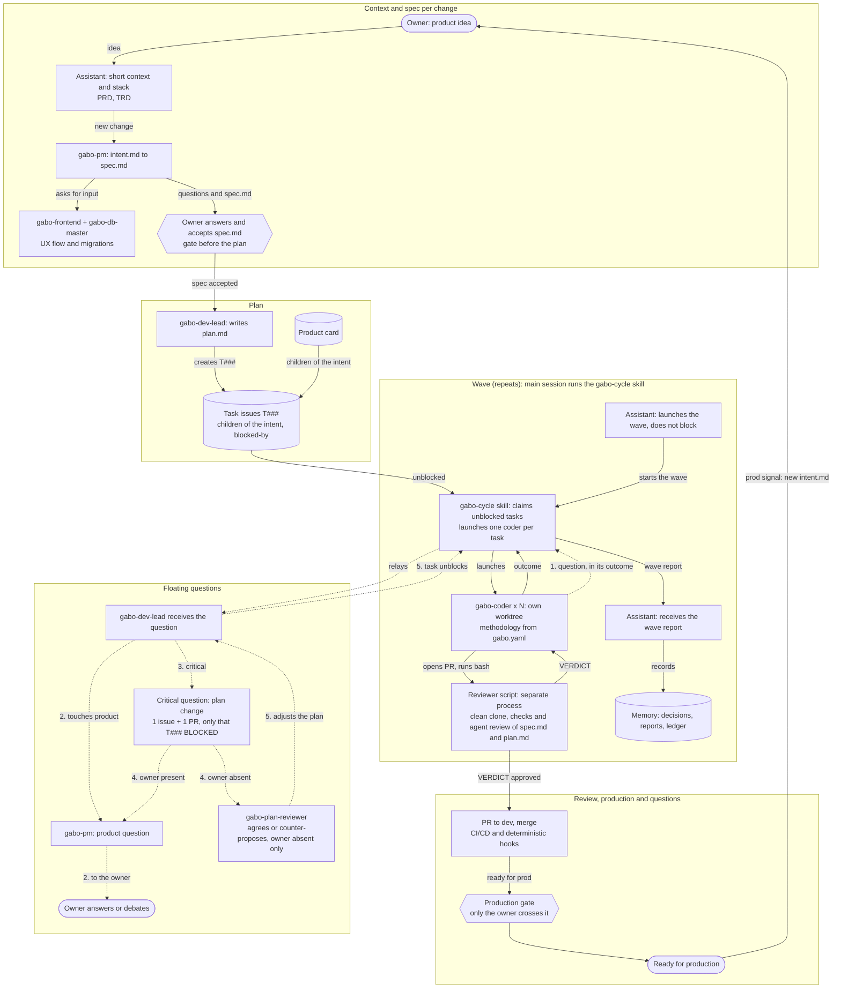

# Per-change SDLC flow

Each change is one intent. The tracker is the global view. This chart shows who does what from the idea to production, with one subagent layer in the wave (intent 0015, spec S1, S10): the main session runs the `gabo-cycle` skill and launches the coders; each coder starts the reviewer script as a separate process in a clean clone.

## Reading the graph

- The only subagents are `gabo-pm`, `gabo-dev-lead`, `gabo-db-master`, `gabo-frontend`, `gabo-plan-reviewer` and one `gabo-coder` per task. `gabo-cycle` is a skill run by the main session, and the reviewer is a script, not an agent.
- No edge goes from one gabo agent to another. A coder question travels in its outcome to the main session, which relays it (dotted path).
- Floating questions never stop the wave: only the task that depends on the answer is BLOCKED.
- The production gate belongs to the owner; the agent never crosses it.
