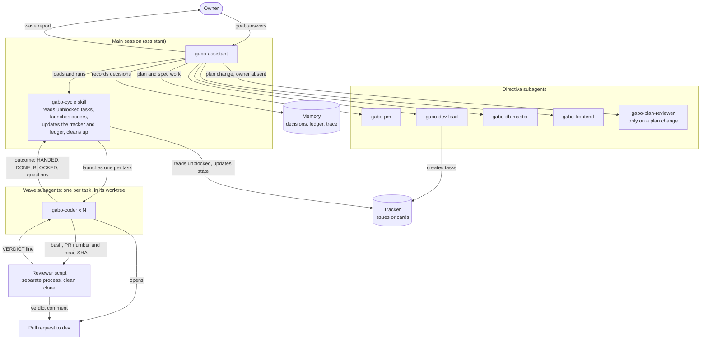

# Team flow: one subagent layer

The assistant runs the wave in the main session. Its only subagents are the directiva agents, the plan reviewer and one `gabo-coder` per task. No gabo agent launches another agent. Each coder starts the user-level reviewer script as a separate process in a clean clone of the repository. Intent 0015 (spec in PR #475, not yet on `dev`) defines this graph.

## Reading the graph

- **Main session.** `gabo-cycle` is a skill, not an agent. It runs inside the assistant's session on every engine, so a Claude Code wave works with `CLAUDE_CODE_MAX_SUBAGENT_SPAWN_DEPTH=1`.
- **Coders.** Each coder is a first-level subagent. It works in its own worktree, opens the PR and closes its task after the merge.
- **Review.** The coder runs the reviewer script through its shell, reads the last `VERDICT` line and acts on it. There is no reviewer relay agent.
- **Questions.** A coder returns questions in its outcome. The main session relays them to the directiva agents or the owner; coders never message another agent.
- **Configurable points.** The tracker, the memory, the repository host, the methodology and the reviewer placement and engine are slots set in `gabo.yaml`. See [configuration-flow.html](configuration-flow.html).
